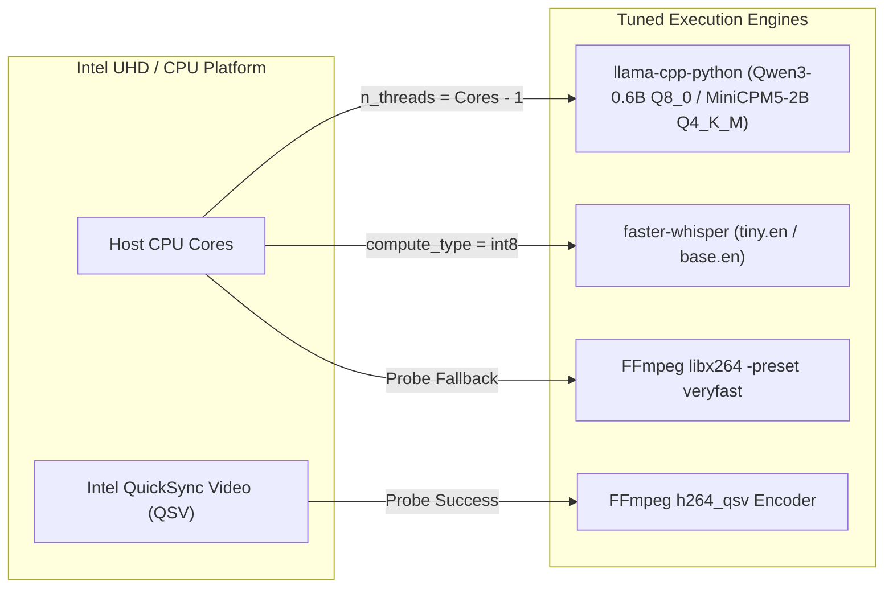
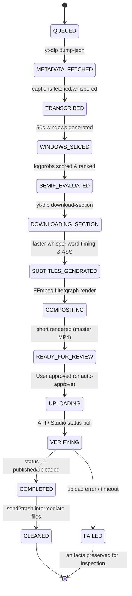
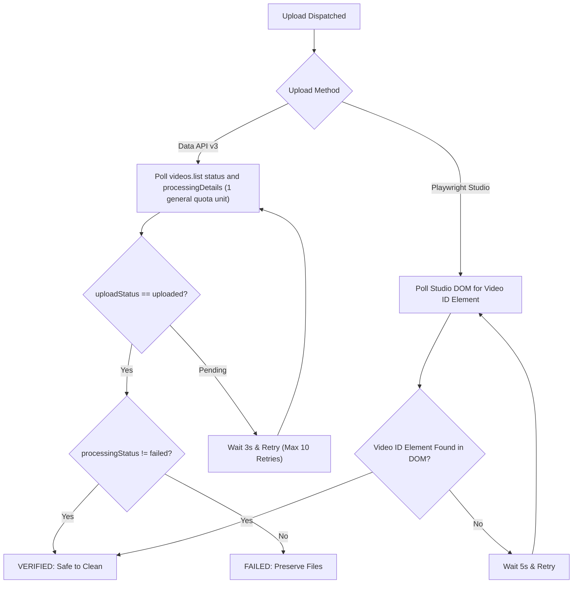

# Implementation Plan v3.2: On-Device / Cloud-Hybrid YouTube Shorts Clipping & Automation Pipeline
*(CPU-Optimized, URL-Driven Ingestion, Daily Cap & Spread Scheduler, Multimodal Edit Planning & Gemini Spark Companion)*

---

## Executive Summary

This specification defines the architecture, engineering design, and implementation plan for **AutoShorts v3.2**, a high-efficiency Windows-native automation pipeline designed to transform long-form YouTube videos into viral, high-retention 9:16 vertical Shorts. 

Operating under realistic consumer desktop constraints—specifically **CPU-only execution with integrated Intel UHD Graphics (no dedicated NVIDIA GPU)**—v3.2 optimizes every compute-intensive stage (quantized SemIf logit evaluation, `faster-whisper` `int8` speech recognition, and hardware-probed FFmpeg compositing). Rather than relying on fragile channel scraping, the system accepts direct YouTube video URLs paired with customizable instructions (e.g., target clipping angle, duration constraints, background selection, and clip count).

The core decision engine leverages **SemIf** (Semantic Inference via Logit Scoring, documented in `TheoLeeCJ/SemIf-OpenJev`) implemented across a flexible **Provider Abstraction** (Local GGUF with reference models `Qwen3-0.6B` `Q8_0` and `MiniCPM5-2B` `Q4_K_M`, Google Gemini, OpenRouter) with **zero hardcoded model names**. In v3.2, an optional **Multimodal AI Edit-Planner** (`gemini_video` provider) analyzes downloaded video clips via Google's Gemini Files API to generate a structured Edit Decision List (EDL) for micro-edits, hook trimming, and zoom punch-ins, which is then deterministically rendered by FFmpeg.

Crucially, v3.2 introduces a **Persistent Daily Cap & Spread Scheduler** capable of pacing up to **50 Shorts per day** across configurable daytime active windows. Uploads are strictly rate-limited to a maximum of 7 per rolling hour with non-fixed uniform random jittered gaps (5–25 minutes). The scheduler persists to SQLite, renders ahead of time, handles PC sleep/shutdown catch-up without bursting, resets daily counters at midnight Pacific Time (matching YouTube quota resets), and actively prevents system sleep during scheduled upload windows via the Windows `SetThreadExecutionState` API. A transparent accounting of YouTube Data API v3 granular quota buckets (dedicated 100 calls/day upload bucket for `videos.insert` vs. 10,000 units/day general endpoint pool) demonstrates that 50 Shorts per day is fully feasible on default allocations without requiring a quota extension audit, while reserving 50 upload calls for retries. Dual-bucket quota tracking, empirical private-lock verification, auto-throttling, and fallback modes ensure reliable operations. Finally, v3.2 defines a loosely coupled companion workflow for **Gemini Spark** (Google's 24/7 personal background AI agent) using prompt skills and an `inbox/` hand-off directory.

---

## Improvements vs v2 & v3 (Changelog)

### v3.2 Updates (Current Release - Quota Correction)

| Architecture Area | v3.1 Specification | v3.2 Production Architecture |
|---|---|---|
| **YouTube API Quotas & Buckets (v3.2 quota correction)** | Previously assumed `videos.insert` cost ~1,600 units against a single 10,000 unit pool (~6 uploads/day default) requiring an ~80,000 unit quota extension audit for 50 uploads/day. | **Granular Quota Buckets & Zero-Audit 50/Day Feasibility**: Corrects quota model based on verified official documentation. On 4 Dec 2025, upload cost dropped from ~1600 to ~100 units; on 1 Jun 2026, YouTube transitioned to granular quota buckets where `videos.insert` has its OWN bucket (default 100 calls/day, 1 unit/call) separate from `search.list` (100 calls/day) and general endpoints (10,000 units/day shared pool, e.g. `videos.list` = 1 unit). 50 uploads/day consumes 50 of 100 upload-bucket calls and is **fully feasible on default quotas with NO extension audit needed**. Hard cap at 50 (`daily_upload_cap: 50`) preserves 50 calls as headroom for retries (`reserve_retries: 50`). Dual-bucket tracking in SQLite (`upload_bucket_daily: 100`, `general_bucket_daily: 10000`). |
| **API Project Verification & Private-Lock** | Assumed unverified/unaudited projects are strictly locked to `private` uploads by YouTube backend. | **Empirical Privacy Verification**: Documents conflict in official Google documentation (28 Jul 2020 revision history states unverified projects created after that date are locked private until audit, while current `videos.insert` reference says 'Videos uploaded from unverified API projects are not restricted to private viewing mode'). Specifies verifying behavior empirically on first upload via `videos.list` status and YouTube notification email; default `privacyStatus` remains `unlisted`/`private` until creator review; compliance audit is the fix if locked. Documents separate new channel daily upload limits. |

### v3.1 Improvements (Pacing & Gemini Spark)

| Architecture Area | v3.0 Specification | v3.1 Production Architecture |
|---|---|---|
| **Daily Upload Pacing & Scheduler** | Immediate upload upon render completion or basic review gate; no persistent daily spread. | **Daily Cap + Persistent Spread Scheduler**: Hard cap at **50 Shorts/day** (`daily_upload_cap: 50`). Uploads distributed across configurable active window (default 08:00–23:59 local). Enforces **max 7 uploads per rolling hour** and **uniform random jittered intervals (5–25 min)**. Pre-renders in background; stores slots in SQLite `scheduler_queue`. Handles PC sleep/wake gracefully (skips expired slots without burst). Counter resets at midnight Pacific Time (YouTube quota reset). Windows `SetThreadExecutionState` sleep-prevention. Dashboard pause/resume and cap-compliant manual override. |
| **YouTube API Quota Architecture** | Documented standard single 10,000 unit quota in passing. | **Prominent Quota Architecture & Real-Time Tracker**: Introduced persistent quota tracking, auto-throttling, and 3 fallback modes (`queue_next_day`, `studio`, `local`), establishing the groundwork for multi-upload daily pacing and anti-spam safeguards. |
| **Download & Edit Tooling Constraints** | Mentioned yt-dlp and FFmpeg alongside general tooling. | **Strict Tooling Exclusivity**: Video downloading is **STRICTLY via `yt-dlp`** (using `--download-sections` for precision cuts). Video processing, compositing, and rendering are **STRICTLY via `FFmpeg` and `ffprobe`**. Zero external downloaders, zero MoviePy (prohibited due to memory leaks and CPU overhead), zero Playwright video downloads. Playwright is restricted solely to optional Studio upload and DOM verification fallback. |
| **AI Video Editing & Edit Decision List (EDL)** | Video clipping based only on transcript text sliding windows. | **AI Multimodal Edit-Planning Stage (`gemini_video`)**: Multimodal Gemini provider (`model: null` resolved at runtime) ingests clip video via Gemini Files API / inline data to generate a formal **Edit Decision List (EDL) JSON**: hook in/out trims, jump-cut timestamps, emphasis zoom punch-ins, caption corrections, and thumbnail frames. FFmpeg executes the EDL deterministically. Honestly documents that Gemini Omni does not edit/return raw video directly; falls back cleanly to transcript-only SemIf/LLM planning. Includes privacy notice regarding cloud video upload. |
| **Gemini Spark Companion** | Not supported. | **Gemini Spark Companion Integration**: Web-verified architecture for Google's 24/7 background personal agent (announced at Google I/O 2026). Confirms lack of public third-party REST API/SDK/MCP. Provides ready-to-use Spark 'Skills' prompt templates for YouTube topic research and clip curation, a Dashboard JSON/Markdown importer, and a watched `inbox/` file drop folder for loose companion hand-off. Direct API automation marked 'unverified / future'. |

### v3.0 Improvements (vs v2)

| Architecture Area | v2 (Previous Architecture) | v3 (Foundation Architecture) |
|---|---|---|
| **Hardware & Compute Target** | Assumed optional NVIDIA GPU / unconstrained compute; no CPU budget. | **100% CPU + Intel UHD Graphics optimized**. Pinned to `faster-whisper` `tiny.en`/`base.en` (`int8`), local Qwen3-0.6B GGUF `Q8_0` / MiniCPM5-2B `Q4_K_M`, QuickSync (`h264_qsv`) hardware probe with `libx264 -preset veryfast` fallback, strict concurrency=1 queue, fast low-res preview, and persistent artifact caching. |
| **Input Ingestion Model** | Channel handle resolution and RSS scraping (`@handle` $\to$ channel ID $\to$ latest videos). | **URL-Driven Direct Ingestion**. User inputs one or more direct YouTube video links via dashboard/CLI/file accompanied by global and per-link custom instructions (e.g., "focus on funny moments", "max 45s", "clips per video: 3"). Metadata fetched via `yt-dlp --dump-json` / oEmbed without video download. Channel RSS relegated to optional future extension. |
| **LLM & Provider Layer** | Tightly coupled to local `llama-cpp-python` with hardcoded Qwen model paths. | **Decoupled Provider Abstraction** (`local`, `gemini`, `openrouter`). **Zero hardcoded models** (`model: null` dynamically resolves to provider defaults or user-selected aliases). Comprehensive capability matrix explaining token logprob extraction vs constrained single-letter voting fallbacks. Integrated privacy badge (On-Device Private vs Cloud API). |
| **Role of SemIf / OpenJev** | Used strictly for sliding-window retention scoring. | **Dual Role**: (1) Candidate segment classification; (2) **Automation Orchestration Engine** driven by a declarative Semantic-IF $\to$ Action table mapping SemIf categorical decisions to discrete pipeline state transitions. |
| **Video Editing ("Dopamine")** | Basic static 50/50 split-screen with standard karaoke ASS text. | **High-Dopamine Compositor Engine**: Split-screen gameplay with random start offsets (user-supplied footage only), ASS `\t` word pop/scale animations, first-3s hook title cards, dynamic top progress bar, periodic zoom punch-ins, silence trimming/jump-cuts, background music sidechain ducking, whoosh SFX, and Shorts UI safe-zone compliance. Configurable presets (`low`, `medium`, `high`). |
| **Attribution & Compliance** | Generic advice warning of copyright risks. | **Automated Description & Attribution Engine**: Template-driven description injection (`{title}`, `{channel}`, `{channel_url}`, `{video_url}`, `{hook}`, `{hashtags}`) with an explicit copyright disclaimer and optional on-screen corner credit. Detailed Risk & Compliance disclosure regarding Content ID, YPP reused content, and unverified API upload visibility policies. |
| **YouTube Data API Realities** | Assumed standard API upload without quota or audit caveats. | **Pragmatic API Integration**: Documents OAuth Desktop client configuration, granular quota bucket expenditure (dedicated 100 calls/day upload bucket, 10,000 units/day general pool), empirical private-lock testing on first upload, channel-level upload limits, and robust fallback workflows (Studio or local export). |
| **Developer & Agent Guidance** | Standard phased roadmap only. | Added **End-to-End Walkthrough**, **Comprehensive Troubleshooting Table**, **Mermaid Sequence Diagram**, and a **Master Prompt for Implementing Agents**. |

---

## 1. End-to-End System Architecture

### 1.1 Architecture & Data Flow

```mermaid
flowchart TD
    subgraph Ingestion["1. Ingestion & Instruction Parsing"]
        UI["Web Dashboard (http://localhost:8765)"] -->|Paste URLs + Custom Instructions| Orch["Pipeline Orchestrator (run.py)"]
        CLI["CLI / Batch Links File"] --> Orch
        Spark["Gemini Spark Companion (Skills / inbox/ Hand-off)"] -->|Watched Drop Folder| Orch
        Orch --> Q["Ingestion Queue (Concurrency = 1, state.db)"]
    end

    subgraph Discovery["2. Non-Scraping Metadata & Transcript"]
        Q --> Meta["Metadata Extractor (yt-dlp --dump-json / oEmbed)"]
        Meta --> Trans{"Transcript Available?"}
        Trans -- "Yes" --> SubAPI["youtube-transcript-api / yt-dlp subs"]
        Trans -- "No" --> AudioOnly["yt-dlp Audio-Only Extraction"]
        AudioOnly --> Whisper["faster-whisper (int8 CPU)"]
        SubAPI --> TransJSON["Clean Timed Transcript JSON"]
        Whisper --> TransJSON
    end

    subgraph SemIfDecision["3. SemIf Window Scoring & Edit Planning"]
        TransJSON --> Slicer["Sliding Window Slicer (30-60s with Sentence Snapping)"]
        Slicer --> Provider["Provider Abstraction (Local GGUF / Gemini / OpenRouter)"]
        Provider --> LogprobScorer["SemIf Logit Scorer (Single Forward Pass max_tokens=1)"]
        LogprobScorer --> ActionTable["Semantic-IF Action Table"]
        ActionTable -->|Select Top Segments| WinChosen["Top N Candidate Windows"]
        ActionTable -->|Select Asset Theme| BGChoice["Gameplay Category & Hook Style"]
        WinChosen --> SectionCut["yt-dlp Precision Download (--download-sections)"]
        SectionCut --> EditPlanner["AI Multimodal Edit Planner (Gemini Files API / Video Understanding)"]
        EditPlanner --> EDL["Edit Decision List JSON (Trims, Jump-Cuts, Zooms, Captions)"]
    end

    subgraph MediaPipeline["4. Precision Compositing Engine (FFmpeg Only)"]
        SectionCut --> WordWhisper["faster-whisper Word Alignment (int8 CPU)"]
        WordWhisper --> ASSGen["Karaoke ASS Generator (Pop/Scale Animation & Safe Zones)"]
        BGChoice --> BGBank["User Footage Bank in assets/backgrounds"]
        BGBank --> OffsetCalc["Random Offset Selector"]
        EDL --> FFmpeg["FFmpeg Complex Filtergraph (libx264 / Intel h264_qsv)"]
        SectionCut --> FFmpeg
        OffsetCalc --> FFmpeg
        ASSGen --> FFmpeg
        DopamineAssets["SFX / Ducked Music / Progress Bar"] --> FFmpeg
        FFmpeg --> MasterShort["Rendered 1080x1920 Short MP4 (Saved to output/)"]
    end

    subgraph Scheduling["5. Persistent Quota & Spread Scheduler"]
        MasterShort --> SchedQ["Persistent SQLite Queue (Render Ahead of Time)"]
        SchedQ --> QuotaCheck{"Quota Available? (Upload Bucket 100/day, General 10k/day)"}
        QuotaCheck -- "Upload Bucket Exhausted" --> FallbackMode{"Quota Fallback Policy"}
        FallbackMode -- "Queue Next Day" --> SleepWait["Hold in Queue until Midnight PT Reset"]
        FallbackMode -- "Studio Mode" --> Playwright["Playwright Edge Studio Fallback"]
        FallbackMode -- "Local Mode" --> LocalExport["Preserve in output/ for Manual Upload"]
        QuotaCheck -- "Quota Available" --> RateCheck{"Rolling Hour < 7 & Daily < 50?"}
        RateCheck -- "Yes & Slot Due" --> Dispatch["Upload Dispatcher (SetThreadExecutionState Active)"]
        RateCheck -- "Wait Slot" --> Timer["Wait for Jittered Slot (5-25m Uniform Random Gap)"]
        Timer --> SchedQ
    end

    subgraph ReviewUpload["6. Upload & Post-Upload Verification"]
        Dispatch --> Gate{"Review Required? (Default: OFF for Auto-Paced)"}
        Gate -- "Pending Approval" --> DashPreview["Dashboard HTML5 Preview Player"]
        DashPreview -- "User Approved" --> Target{"Upload Method"}
        Gate -- "Auto-Paced" --> Target
        Target -- "Data API v3" --> YouTubeAPI["YouTube Data API v3 (Resumable Upload)"]
        Target -- "Studio Fallback" --> Playwright
        YouTubeAPI --> Verifier["Verification Engine (videos.list Polling ~1 unit)"]
        Playwright --> Verifier
    end

    subgraph SafeCleanup["7. Transactional Path-Guarded Cleanup"]
        Verifier -- "Status: Confirmed Hosted" --> Cleaner["Path-Guarded send2trash Cleaner"]
        Cleaner --> Recycle["Recycle Intermediate work/* Files"]
        Cleaner --> DBUpdate["Update SQLite state.db & scheduler_queue to COMPLETED"]
        Verifier -- "Status: Failed / Unverified" --> Preserve["Retain Artifacts for Debugging"]
    end
```



---

### 1.2 Sequence Diagram: Processing a Single Video Link

```mermaid
sequenceDiagram
    autonumber
    actor User
    participant Spark as Gemini Spark / Inbox
    participant Dash as Local Web Dashboard
    participant Orch as Job Orchestrator
    participant Meta as Metadata & Transcript (yt-dlp)
    participant Prov as LLM Provider (SemIf)
    participant EditPlan as Multimodal Edit Planner
    participant Comp as FFmpeg Compositor
    participant Sched as Persistent Scheduler & Quota
    participant YT as YouTube API / Studio
    participant Clean as Safety Cleaner

    opt Input from Gemini Spark Companion
        Spark->>Orch: Drop Job Spec JSON into inbox/ (Timestamps, Topic, Hook Ideas)
    end
    User->>Dash: Paste YouTube URL and custom instructions (or import from Spark)
    Dash->>Orch: Submit Job to Ingestion Queue (concurrency=1)
    Orch->>Meta: Fetch Metadata (Title, Channel Name, Channel URL) via oEmbed/yt-dlp
    Meta-->>Orch: Return Metadata JSON (Zero video download)
    Orch->>Meta: Fetch Captions (youtube-transcript-api)
    alt Captions Missing
        Orch->>Meta: Download Audio Only & Transcribe with faster-whisper (int8)
    end
    Meta-->>Orch: Timed Transcript Data

    Orch->>Orch: Generate 30-60s candidate windows with sentence boundary snapping
    loop For each candidate window
        Orch->>Prov: SemIf Prompt: Rate retention likelihood (Option A vs Option B)
        Prov-->>Orch: Token Logits / Logprob for 'A' vs 'B'
    end
    Orch->>Orch: Softmax rank windows; select top non-overlapping segments

    loop For each selected segment
        Orch->>Meta: yt-dlp precision download-section (exact timestamps)
        Meta-->>Orch: Segment MP4 saved to work/
        opt Multimodal Edit-Planning Enabled
            Orch->>EditPlan: Upload clip to Gemini Files API (Video Understanding)
            EditPlan-->>Orch: Return Edit Decision List (EDL JSON: trims, jump cuts, zooms)
        end
        Orch->>Meta: Extract 16kHz WAV & run faster-whisper word-level alignment
        Orch->>Comp: Execute FFmpeg Complex Filtergraph (executes EDL deterministically)
        Note over Comp: Split-screen + Random BG offset + ASS Karaoke + Hook Card + Progress Bar + Audio Duck
        Comp-->>Orch: 1080x1920 Rendered MP4 (Stored in output/)
    end

    Orch->>Sched: Enqueue Rendered Short into SQLite scheduler_queue
    Note over Sched: Pre-rendered ahead of time! Slots spaced by 5-25m random jitter.
    
    Sched->>Sched: Check Quota Buckets (videos.insert bucket: 100 calls/day; daily_upload_cap: 50 + retry reserve)
    Sched->>Sched: Assert Windows Sleep Prevention (SetThreadExecutionState)
    Sched->>Sched: Wait until target jittered slot arrives within active window (08:00-23:59)
    Sched->>Sched: Verify rolling hourly count < 7

    Sched->>YT: Dispatch Resumable videos.insert (with attribution & disclaimer)
    YT-->>Sched: Return Assigned Video ID
    Sched->>YT: Poll videos.list for status (general bucket: 1 unit)
    YT-->>Sched: Status: uploadStatus=uploaded, processingStatus=succeeded

    Sched->>Clean: Trigger Transactional Cleanup for Job ID
    Clean->>Clean: Validate paths strictly within work/ & send2trash
    Clean-->>Sched: Intermediate files purged to Recycle Bin
    Sched->>Dash: Status = COMPLETED (Display Video URL, Quota Ledger, Next Slot)
```

---

## 2. How the App Works End-to-End (Walkthrough & Troubleshooting)

### 2.1 Step-by-Step Operator Walkthrough

This walkthrough details the exact path from a freshly configured Windows system to the first published YouTube Short.

#### Step 1: Install System Prerequisites
Open Windows PowerShell (Run as Administrator or regular user) and ensure the runtime tools are installed:
```powershell
# 1. Install FFmpeg using Windows Package Manager
winget install Gyan.FFmpeg

# 2. Verify FFmpeg is on PATH
ffmpeg -version

# 3. Install uv (ultra-fast Python package and project manager)
powershell -ExecutionPolicy ByPass -c "irm https://astral.sh/uv/install.ps1 | iex"

# 4. Refresh environment variables
$env:Path = [System.Environment]::GetEnvironmentVariable("Path","User") + ";" + [System.Environment]::GetEnvironmentVariable("Path","Machine")
uv --version
```

#### Step 2: Clone and Setup Workspace
Navigate to the application root directory and initialize the virtual environment:
```powershell
cd "c:\Users\Sirisha Rajana\Desktop\New folder\Automation"

# Initialize Python 3.12 virtual environment using uv
uv venv --python 3.12
.venv\Scripts\activate

# Install all project dependencies
uv pip install -e .
```

#### Step 3: Populate Assets and Environment Variables
Create the `.env` file in the project root to store credentials safely:
```powershell
# Copy template
Copy-Item .env.example .env

# Edit .env using Notepad
notepad .env
```
Ensure `.env` contains your desired keys (leave unused ones blank):
```ini
# AutoShorts Environment Configuration
APP_ENV=production
LOG_LEVEL=INFO

# Optional Cloud LLM API Keys (leave blank to force 100% on-device local mode)
GEMINI_API_KEY=
OPENROUTER_API_KEY=

# Local LLM GGUF Path (if using local provider)
LOCAL_GGUF_PATH=data/models/Qwen3-0.6B-Instruct-Q8_0.gguf
```

Drop vertical gameplay videos (recorded in 1080x1920 or standard 16:9) into the background folders:
```text
assets/backgrounds/minecraft/   <-- Drop your Minecraft parkour clips here
assets/backgrounds/subway/      <-- Drop your Subway Surfers clips here
assets/sfx/whoosh.wav           <-- Optional transition sound effect
```

#### Step 4: Configure YouTube Upload Credentials (OAuth)
1. Navigate to [Google Cloud Console](https://console.cloud.google.com/).
2. Create a new project named `AutoShorts-Uploader`.
3. Go to **APIs & Services $\to$ Library**, search for **YouTube Data API v3**, and click **Enable**.
4. Go to **APIs & Services $\to$ OAuth consent screen**:
   - User Type: **External**.
   - App Name: `AutoShorts Automation`.
   - Publishing Status: Leave in **Testing**.
   - Under **Test Users**, click **Add Users** and enter the exact Gmail address of your YouTube channel.
5. Go to **APIs & Services $\to$ Credentials $\to$ Create Credentials $\to$ OAuth client ID**:
   - Application Type: **Desktop App**.
   - Name: `AutoShorts Desktop Client`.
6. Download the generated client secret JSON, rename it to `client_secret.json`, and place it in the `data/` directory:
   `data/client_secret.json`.

#### Step 5: Launch the Application
Run the launcher script:
```powershell
uv run python run.py
```
- The local server initializes at `http://localhost:8765`.
- Microsoft Edge automatically opens displaying the interactive dashboard.

#### Step 6: Input URLs & Custom Instructions
In the dashboard interface:
1. Paste one or more YouTube links into the **Input URLs** field:
   `https://www.youtube.com/watch?v=dQw4w9WgXcQ`
2. Specify instructions in the **Custom Prompt / Instructions** box:
   `"Focus on surprising facts or high-energy moments. Max duration 45 seconds. Clips per video: 2. Background: minecraft."`
3. Click **Add to Queue**.

#### Step 7: Automated Pipeline Execution
The worker dequeues the item and executes:
1. Validates the URL and retrieves video metadata (title, author, channel URL) via `yt-dlp --dump-json` in <1.5s.
2. Extracts timed captions via `youtube-transcript-api`.
3. Slices transcript into 30–60s sliding windows with punctuation snapping.
4. Passes windows to SemIf to extract retention probabilities.
5. Downloads only the highest-scoring timestamps via `yt-dlp --download-sections`.
6. Executes `faster-whisper` `int8` on CPU to extract word-level timings.
7. Assembles the FFmpeg high-dopamine filtergraph and renders the 1080x1920 Short.

#### Step 8: Pre-Render, Scheduled Spread & Publish
1. Rendered 1080x1920 MP4 Shorts are automatically saved to `output/` and enqueued into SQLite `scheduler_queue`.
2. The **Persistent Spread Scheduler** manages publishing throughout the active window (e.g. 08:00–23:59 local):
   - Computes jittered upload slots with non-fixed uniform random gaps (5–25 minutes).
   - Enforces a hard ceiling of 50 uploads/day and a rolling rate limit of max 7 uploads/hour.
   - Asserts Windows `SetThreadExecutionState` to prevent PC sleep while slots are pending.
3. If human review is configured (`auto_approve: false`), click the job in the dashboard to review in the HTML5 player; otherwise, unattended scheduler dispatches when slot is due.
4. On first upload, a browser window opens requesting one-time Google OAuth authorization. The token is saved to `data/token.json` for future unattended runs.
5. The video uploads via the resumable API protocol with automatic metadata and disclaimer injection.
6. The verification engine polls `videos.list` (1 general quota unit) until processing succeeds.
7. The transactional cleanup worker purges intermediate files from `work/` to the Recycle Bin while retaining the master MP4 in `output/`.

---

### 2.2 Troubleshooting Guide

| Issue / Error Symptom | Root Cause | Exact Remediation |
|---|---|---|
| `WinError 32: The process cannot access the file because it is being used by another process` | Windows file locks held open by FFmpeg subprocess or Whisper model instances. | The pipeline wraps deletions in `assert_safe_to_delete` with exponential backoff (retries after 500ms, 1500ms, 3000ms) after invoking Python `gc.collect()`. Ensure anti-virus software is not locking newly written MP4s in `work/`. |
| `[subtitles @ ...] Unable to open 'C:\work\subs.ass'` | FFmpeg on Windows interprets single backslashes and drive colons (`C:`) as filter separators. | Run all filter file paths through `escape_ffmpeg_filter_path()`, converting `C:\path\subs.ass` to `'C\:/path/subs.ass'` with forward slashes and escaped colons. |
| `faster-whisper fails: ctranslate2 library not found or DLL load failed` | Incompatible Python version or missing MSVC C++ runtime. | Strictly use **Python 3.12** via `uv`. Python 3.13 lacks prebuilt Windows wheels. Install the official Microsoft Visual C++ Redistributable (x64). |
| YouTube API Upload Error: `403 quotaExceeded` | Dedicated upload bucket (default 100 calls/day) or general bucket (10,000 units/day) exhausted (e.g. excessive upload retries/failed attempts or other API calls). | 50 uploads/day consumes 50 of the 100 upload-bucket calls, reserving 50 calls for retries. If the upload bucket is exhausted due to retries, the scheduler automatically holds remaining queued Shorts until the next midnight Pacific Time (00:00 PT) reset, or switches `upload.mode` to `studio` (Playwright browser fallback) or `local` export. Submitting the official YouTube API Services Audit and Quota Extension form is only necessary if your operational volume legitimately exceeds default bucket limits (>100 upload calls or >10,000 general units/day). |
| YouTube API Upload Error: `403 Access Blocked: Project is unverified` | OAuth consent screen is not configured for the authenticated Google user. | Add your personal Gmail account to the **Test Users** list under Google Cloud Console $\to$ OAuth consent screen. |
| Uploaded video visibility is locked to `Private` and cannot be changed | Official Google documentation contains conflicting guidance: revision history (28 Jul 2020) states unverified projects created after that date are locked private until audit, while current `videos.insert` reference states unverified projects are not restricted to private viewing mode. | Verify behavior empirically on first upload by checking `status.privacyStatus` via `videos.list` and checking the confirmation email from YouTube. Default upload status remains private/unlisted until creator review in YouTube Studio. If YouTube's backend enforces private-locking on the unverified project, passing an official YouTube API compliance audit is the fix, or use `upload.mode: studio`. Also note new or unverified channels may face separate channel-level daily upload limits. |
| Windows PC sleep interrupts active upload window | PC entered sleep/hibernation while scheduled upload slots were pending in `scheduler_queue`. | Enable `scheduler.prevent_sleep: true` in `config.yaml`. The app invokes Windows Win32 API `kernel32.SetThreadExecutionState(ES_CONTINUOUS | ES_SYSTEM_REQUIRED | ES_AWAYMODE_REQUIRED)` during active windows. If the PC was powered off, the scheduler's catch-up logic skips expired slots and reschedules pending uploads without bursting beyond the 7/hr limit. |
| High CPU usage / system freezing during compositing | FFmpeg attempting to use all available threads on an Intel UHD laptop CPU. | Configure `-threads 4` and `-preset veryfast` in FFmpeg args. In `config.yaml`, ensure `concurrency: 1` so only a single video is processed at any given moment. |
| `OpenRouter / Gemini API error: 429 Rate Limit Exceeded` | Cloud provider quota exceeded or free tier throttling. | Toggle provider in dashboard dropdown to `local` to run 100% on-device via quantized GGUF with zero internet or API dependency. |
| Edge Profile Locking: `Target closed / SingletonLock` in Playwright | User opened regular Edge using the dedicated automation profile folder. | The pipeline strictly isolates automation to `./data/edge_profile`. Never launch your daily browser pointing to `./data/edge_profile`. |

---

## 3. Hardware Optimization & Resource Budgets (CPU + Intel UHD)

### 3.1 Target Hardware Reality
- **Host CPU**: Multi-core Intel Core i5/i7 (or AMD equivalent) without a dedicated NVIDIA GPU.
- **Host GPU**: Integrated Intel UHD Graphics / Iris Xe.
- **Operating System**: Windows 11 / 10 64-bit.
- **Engineering Imperative**: Avoid memory thrashing, thermal throttling, and process crashes by enforcing single-thread/bounded-thread execution, quantized models, and strict sequential queuing.

### 3.2 Compute Tuning Matrix



1. **SemIf Engine (`llama-cpp-python`)**:
   - Model: `Qwen3-0.6B-Instruct-Q8_0.gguf` (or `MiniCPM5-2B Q4_K_M`).
   - Thread Allocation: `n_threads = max(1, os.cpu_count() - 1)` (preserves UI responsiveness).
   - Context: `n_ctx=2048`, `logits_all=True`.
   - Execution: Evaluates single forward pass ($max\_tokens=1$) over candidate windows in 30–60ms on CPU.
2. **Audio Transcription (`faster-whisper`)**:
   - Quantization: `compute_type="int8"`, `device="cpu"`.
   - Model Tier: Default to `base.en` (~140MB RAM). Fallback to `tiny.en` (~75MB RAM) if CPU frequency is below 2.0 GHz.
   - Word Timestamps: Extracted only for the selected 30–60s cut, **never for the full 1-hour source audio**, reducing transcription time from minutes to ~3 seconds.
3. **FFmpeg Hardware Probe (`h264_qsv` $\to$ `libx264`)**:
   - The system executes a non-blocking 1-frame probe on startup:
     ```bash
     ffmpeg -f lavfi -i color=c=black:s=256x256:d=0.1 -c:v h264_qsv -f null -
     ```
   - If Intel QuickSync is supported by the installed Intel graphics driver, FFmpeg utilizes `-c:v h264_qsv -global_quality 25 -look_ahead 0`.
   - If QSV fails or is unavailable, it immediately falls back to `-c:v libx264 -preset veryfast -crf 22 -threads 4`.

### 3.3 Concurrency & Queue Policy
- **Strict Concurrency = 1**: Only one job transitions through active media download, Whisper transcription, or FFmpeg compositing at any time.
- **Queue State Storage**: Managed via SQLite `data/state.db` with atomic status updates.
- **Fast Low-Resolution Preview Pipeline**:
  - When a job is composited, the engine can optionally generate a lightweight preview (`540x960`, 15fps, CRF 28) in <6 seconds for rapid operator scrubbing in the dashboard before initiating high-quality master rendering.

### 3.4 Tiered Caching Strategy
To prevent redundant computation:
1. **Audio/Transcript Cache**: Keyed by `sha256(video_id + caption_track)`. If a video is processed multiple times for multiple clips, caption retrieval and Whisper passes run exactly once.
2. **SemIf Score Cache**: Sliding window scores are persisted in SQLite. If instructions change slightly without altering duration constraints, existing scores are reused.
3. **Background Media Cache**: Background loops are pre-indexed for duration and resolution to eliminate runtime `ffprobe` latency.

### 3.5 Latency & Time Budget Estimates (Intel 4-Core CPU Benchmark)

| Pipeline Stage | Engine / Parameters | Estimated Duration (per 45s Short) |
|---|---|---|
| **Metadata Fetch** | `yt-dlp --dump-json` (no media download) | 0.8 – 1.5 seconds |
| **Transcript Retrieval** | `youtube-transcript-api` (HTTP JSON) | 0.3 – 0.8 seconds |
| **Window Scoring (10 windows)** | `llama-cpp-python` Q8_0 CPU ($max\_tokens=1$) | 0.4 – 0.8 seconds |
| **Precision Section Download** | `yt-dlp --download-sections` (45s slice) | 2.5 – 5.0 seconds |
| **Audio Extraction & Whisper Alignment** | `ffmpeg` WAV extraction + `faster-whisper` `int8` | 2.0 – 4.0 seconds |
| **Filtergraph Compositing (Dopamine: Med)** | FFmpeg (`libx264 veryfast` or `h264_qsv`) | 12.0 – 22.0 seconds |
| **YouTube Resumable API Upload** | Network upload (1080x1920 MP4 ~15MB) | 3.0 – 8.0 seconds |
| **Total Turnaround Time** | **Start to Published Short** | **~25 – 45 seconds** |

### 3.6 Strict Tooling Constraints (Download, Edit & Automation Exclusivity)

To guarantee predictable CPU performance, prevent memory leaks, and eliminate runtime instability on consumer Windows hardware, AutoShorts v3.2 enforces strict tooling boundaries across the entire codebase:

1. **Video Ingestion & Downloading: Exclusively `yt-dlp`**:
   - All YouTube video extraction, metadata scraping, audio-only extraction, and timestamped section cutting MUST use `yt-dlp`.
   - **Precision Section Slicing**: When retrieving target candidate clips, the pipeline strictly executes `yt-dlp --download-sections "*START_TIME-END_TIME"` to download only the necessary 30–60 second slice. Whole-video downloads of 1–3 hour podcasts are strictly forbidden.
   - **No Alternative Downloaders**: No `pytube`, `pytube-fix`, `youtube-dl`, or generic HTTP stream scrapers are permitted.
2. **Video Editing, Compositing & Encoding: Exclusively `FFmpeg` and `ffprobe`**:
   - All video decoding, cropping, scaling, split-screen stacking, overlaying, SubStation Alpha (`.ass`) burning, zoom punch-in animation, audio ducking, volume normalization (`loudnorm`), and MP4 muxing are executed via direct subprocess calls to `ffmpeg` and verified with `ffprobe`.
   - **MoviePy is Strictly Prohibited**: MoviePy incurs massive memory leaks on Windows, forces unneeded NumPy array round-trips through RAM, lacks hardware QSV pipeline integration, and frequently deadlocks or exhausts CPU resources during multi-clip runs.
3. **Browser Automation: Strictly Restricted to Studio Upload / Verification Fallback**:
   - Playwright is strictly limited to the optional YouTube Studio browser upload fallback (`mode: studio`) and DOM verification.
   - **Never Use Playwright for Downloads**: Automating browser page clicks or using headless browsers to scrape video streams or trigger downloads is prohibited.

---

## 4. Input Model: URL-Driven Ingestion & Custom Instructions

### 4.1 Ingestion Specifications
The v3 architecture abandons automated channel RSS scraping as the primary input mechanism. Users drive the pipeline with curated video links and explicit editorial intent.

#### Input Vectors
1. **Local Web Dashboard**: Multi-line textarea supporting batch URLs with instruction overrides.
2. **CLI Parameter**: `python run.py --links "https://youtu.be/XYZ,https://youtu.be/ABC" --instructions "focus on business tips"`.
3. **Batch File**: `data/links.txt` watched by the background daemon.

### 4.2 Custom Instructions & Configuration Schema

Custom instructions allow users to control clip selection and styling both globally and per-video.

```yaml
# Global defaults in config.yaml
job_defaults:
  clips_per_video: 1
  min_duration_seconds: 30
  max_duration_seconds: 50
  focus_prompt: "Select the most engaging, surprising, or highly educational standalone moment."
  background_style: "minecraft"      # "minecraft", "subway", or "auto"
  dopamine_level: "medium"           # "low", "medium", "high"
  auto_approve: false                # Require manual click in dashboard before upload
```

#### Per-Link Instruction Parsing
The pipeline parses structured instruction syntax embedded alongside URLs:
```text
https://www.youtube.com/watch?v=VIDEO_ID_1 | clips: 2 | max_s: 45 | focus: funny reactions | bg: subway
https://www.youtube.com/watch?v=VIDEO_ID_2 | clips: 1 | bg: minecraft | dopamine: high
```

### 4.3 Multi-Clip Pipeline & Job Lifecycle State Machine

When a video yields multiple clips (`clips_per_video > 1`), the orchestrator generates a parent `video_job` and individual `clip_jobs` tracked via SQLite:



---

## 5. LLM & Decision Layer: Provider Abstraction & SemIf Orchestration

### 5.1 Universal Provider Abstraction

To ensure long-term resilience, the LLM layer abstracts inference across three interchangeable providers with **zero hardcoded models**:

```text
core/providers/
├── __init__.py
├── base.py              # Abstract BaseProvider defining score_candidates & generate_text
├── local_provider.py    # llama-cpp-python GGUF CPU runner
├── gemini_provider.py   # Google Gemini API client
└── openrouter_provider.py # OpenRouter API client
```

#### Runtime Model Resolution (`model: null` Rule)
No model name may be hardcoded into Python source code or default configuration. When `model: null` is set in `config.yaml`:
- **Local**: Resolves to the GGUF file discovered in `data/models/` (reference: `Qwen3-0.6B-Instruct-Q8_0.gguf` or `MiniCPM5-2B Q4_K_M`) or specified via `LOCAL_GGUF_PATH`.
- **Gemini**: Dynamically resolves at runtime to the provider default model (or queries `list_models` for the active default Flash alias), never a hardcoded model ID string.
- **OpenRouter**: Dynamically resolves at runtime to provider default routing (`openrouter/auto`) or populates available models dynamically from `/api/v1/models` in the dashboard dropdown.

#### Secrets Management & Privacy Badge
- API keys are retrieved strictly via environment variables (`GEMINI_API_KEY`, `OPENROUTER_API_KEY`), `.env`, or the Windows Credential Manager (`keyring`). Keys are **never** committed to version control, logged to disk, or exposed in frontend HTML.
- **Privacy Dashboard Badge**:
  - `LOCAL`: Displays `🟢 100% On-Device (Private - Zero Data Leaves Computer)`.
  - `GEMINI` / `OPENROUTER`: Displays `🟡 Cloud API Active (Transcript text transmitted to provider)`.

### 5.2 SemIf Mathematical Mechanics & Token Logprob Extraction

SemIf evaluates candidates by passing a structured classification prompt and reading the unnormalized logit values $z_i$ corresponding to specific discrete token choices (e.g., token `"A"` vs `"B"`):

$$P(\text{Option A}) = \frac{e^{z_A}}{e^{z_A} + e^{z_B}}$$

#### Capability & Fallback Matrix

| Provider | Logprob Capability | Primary Evaluation Method | Fallback Mode |
|---|---|---|---|
| **Local (`llama-cpp`)** | Direct unnormalized logits available via C++ API. | Single forward pass ($max\_tokens=1$), resolve token IDs for `"A"` and `"B"`, compute exact Softmax. | GBNF Grammar constraint: `root ::= "A" \| "B"`. |
| **Gemini API** | Supports `responseLogprobs` on supported model families. | Request `response_logprobs=True` and read logprob of top token. | Constrained single-token output with temperature=0, regex schema, and 3-vote self-consistency sampling. |
| **OpenRouter** | Supports `logprobs` and `top_logprobs` on compliant endpoints. | Inspect `choices[0].logprobs.top_logprobs` for option letter probabilities. | JSON enum schema `{ "choice": ["A", "B"] }` with greedy decoding ($T=0$). |

### 5.3 Semantic-IF Driven Automation (The Orchestration State Machine)

Beyond scoring transcript segments, SemIf operates as an autonomous decision engine driving the pipeline state machine. Each decision prompt evaluates state and maps discrete choices directly to pipeline actions:

```python
# Conceptual Semantic-IF Action Mapping
SEMIF_ACTION_TABLE = {
    "WINDOW_SELECTION": {
        "question": "Does this segment represent a complete, viral standalone hook?",
        "options": {"A": "Accept window", "B": "Reject window"},
        "action": lambda choice, win: queue_window(win) if choice == "A" else drop_window(win)
    },
    "BACKGROUND_SELECTION": {
        "question": "Which background style best complements this topic?",
        "options": {"A": "High-speed Subway Surfers", "B": "Calm Minecraft Parkour"},
        "action": lambda choice: "subway" if choice == "A" else "minecraft"
    },
    "HOOK_STYLE": {
        "question": "What hook visual matches the emotional tone?",
        "options": {"A": "Bold Question Card", "B": "Shocking Keyword Highlight"},
        "action": lambda choice: "card" if choice == "A" else "keyword"
    },
    "UPLOAD_VERIFICATION_GATE": {
        "question": "Is this generated Short clear of rendering defects and within safe guidelines?",
        "options": {"A": "Approved for publish", "B": "Flag for manual creator review"},
        "action": lambda choice: trigger_upload() if choice == "A" else flag_review()
    }
}
```

### 5.4 Generative LLM Roles
When enabled, the provider abstraction also handles generative tasks:
- **Click-Worthy Title**: Generates a punchy title under 50 characters ending with `#Shorts`.
- **Description Hook**: Generates a 2-sentence curiosity-inducing summary.
- **Hashtag Clustering**: Extracted relevant semantic tags (`#Topic`, `#Podcast`, `#Shorts`).

### 5.5 AI Multimodal Edit-Planning Stage (`gemini_video`)

While SemIf operates on timed transcript text to identify high-retention 30–60s candidate windows, micro-editing (hook trim points, jump-cuts of dead air, and zoom punch-in moments) benefits from visual and auditory understanding. AutoShorts v3.2 introduces an optional **Multimodal Edit-Planning Stage** configured as `provider: "gemini_video"`.

#### Architecture & Execution Flow
1. **Provider Resolution**: Configured in `config.yaml` with `model: null` (resolved dynamically at runtime to the provider's multimodal vision/video default using the user's `GEMINI_API_KEY`).
2. **Video Ingestion via Files API**: The downloaded 30–60s segment MP4 is uploaded via Google's Gemini Files API (`client.files.upload()`) or passed inline for short segments, with `mime_type="video/mp4"`.
3. **Structured Edit Decision List (EDL)**: The multimodal model analyzes the video stream and outputs a strictly validated JSON Edit Decision List matching the schema below.
4. **Deterministic FFmpeg Compositing**: The model **never** generates or manipulates video bytes directly. Instead, FFmpeg deterministically parses the EDL and translates it into filtergraph commands (`trim`, `select`, `zoompan`, `crop`).

```json
{
  "$schema": "http://json-schema.org/draft-07/schema#",
  "title": "EditDecisionList",
  "type": "object",
  "required": [
    "hook_in_sec",
    "hook_out_sec",
    "jump_cuts",
    "zoom_punch_ins",
    "caption_corrections",
    "recommended_thumbnail_timestamp",
    "recommended_title",
    "recommended_hook",
    "background_style_recommendation"
  ],
  "properties": {
    "hook_in_sec": { "type": "number", "description": "Exact trim start (seconds) to eliminate pre-hook throat-clearing." },
    "hook_out_sec": { "type": "number", "description": "Exact trim end (seconds) for punchy conclusion." },
    "jump_cuts": {
      "type": "array",
      "items": {
        "type": "object",
        "required": ["cut_start", "cut_end", "reason"],
        "properties": {
          "cut_start": { "type": "number" },
          "cut_end": { "type": "number" },
          "reason": { "type": "string" }
        }
      },
      "description": "Segments of dead air, pauses, or stuttering to excise."
    },
    "zoom_punch_ins": {
      "type": "array",
      "items": {
        "type": "object",
        "required": ["timestamp", "scale", "duration", "emphasis_word"],
        "properties": {
          "timestamp": { "type": "number" },
          "scale": { "type": "number", "minimum": 1.05, "maximum": 1.25 },
          "duration": { "type": "number", "minimum": 0.3, "maximum": 2.0 },
          "emphasis_word": { "type": "string" }
        }
      },
      "description": "Visual camera punch-ins synchronized to peak emphasis words."
    },
    "caption_corrections": {
      "type": "array",
      "items": {
        "type": "object",
        "required": ["original", "corrected"],
        "properties": {
          "original": { "type": "string" },
          "corrected": { "type": "string" }
        }
      },
      "description": "Niche jargon, proper nouns, or slang misheard by Whisper."
    },
    "recommended_thumbnail_timestamp": { "type": "number", "description": "Timestamp containing the most expressive speaker facial expression." },
    "recommended_title": { "type": "string", "maxLength": 60 },
    "recommended_hook": { "type": "string", "maxLength": 100 },
    "background_style_recommendation": { "type": "string", "enum": ["minecraft", "subway", "auto"] }
  }
}
```

#### Honest Assessment of Gemini Omni & Video Editing Capabilities
> [!WARNING]
> **No Direct Video Manipulation by LLMs**:
> Gemini Omni / advanced multimodal models do **not** provide public APIs to directly edit, transcode, or render raw video files. Any assumption that a model can "take an MP4 and return a cut MP4" is technically incorrect for production APIs.
> - **Verification Requirement**: Public availability and API features for Gemini Omni video reasoning must be verified at implementation time.
> - **Strict Architectural Decoupling**: AutoShorts explicitly designs the AI layer to output **symbolic instructions (EDL JSON)** only. All rendering is performed deterministically by local FFmpeg on the user's CPU/QSV hardware.
> - **Graceful Fallback**: If `gemini_video` is disabled or returns an error (e.g. rate limit, video file size limit, or unsupported endpoint), the pipeline automatically falls back to **transcript-only SemIf/LLM planning**, generating basic jump-cuts via silence detection and heuristics.
> - **Data Privacy Disclosure**: Uploading video clips to `gemini_video` transmits local media frames to Google Cloud servers. Users desiring complete offline isolation must retain `llm.provider: "local"` (100% on-device).

---

### 5.6 Gemini Spark Companion Integration

#### Verified Facts & Ecosystem Status
Based on official Google announcements and developer documentation ([Google Blog: The Gemini app becomes more agentic](https://blog.google/technology/ai/gemini-app-updates-may-2026/)):
- **What Gemini Spark Is**: Gemini Spark is Google's 24/7 autonomous personal AI agent designed to run background multi-step workflows across Google Workspace apps (Gmail, Drive, Docs, Calendar) and Chrome web browsing.
- **API Availability Reality**: As of late 2026, **no public REST API, SDK, or MCP server is exposed by Google for third-party programmatic execution of Gemini Spark**. Spark is a user-facing managed agent service, not a headless API endpoint.
- **Architectural Stance**: Any direct programmatic Spark-to-AutoShorts automation is classified as **"unverified / future"**. Rather than creating fragile, unauthorized scraping hooks, AutoShorts implements a **loosely coupled companion workflow**.

#### Companion Workflow 1: Spark-Compatible 'Skills' Text Prompts
Users can paste the following structured Skill prompt into Gemini Spark's persistent prompt memory or conversation window, instructing Spark to autonomously monitor YouTube topics, discover candidate clips, and output standardized metadata:

````markdown
```text
[GEMINI SPARK SKILL: VIRAL SHORT CURATOR]
Role: You are an autonomous YouTube Shorts research agent.
Goal: Monitor selected YouTube channels or search for high-retention long-form videos on topic: {TOPIC}.
Instructions:
1. Identify high-engagement videos released in the past 7 days with duration > 10 minutes.
2. For each video, locate 1 to 2 standalone viral segments (30-55 seconds) with high curiosity hooks, surprising revelations, or emotional peaks.
3. For each candidate segment, format your findings strictly as this JSON block:
{
  "source_url": "https://www.youtube.com/watch?v=VIDEO_ID",
  "clip_title": "Descriptive Topic Hook",
  "start_time": "MM:SS",
  "end_time": "MM:SS",
  "hook_text": "First 3-second hook question",
  "target_background": "minecraft",
  "notes": "Key punchline occurs at MM:SS"
}
```
````

#### Companion Workflow 2: Import Mechanisms (`inbox/` Watcher & Dashboard Paste)
1. **Dashboard Import Modal**: The local web UI provides a dedicated **"Import from Gemini Spark"** button. The user pastes Spark's JSON or Markdown response into the textarea, and the dashboard automatically parses the URLs, timestamps, and hook text directly into the ingestion queue.
2. **Watched Hand-Off Directory (`inbox/`)**:
   - AutoShorts continuously monitors the root `inbox/` directory for incoming `.json`, `.yaml`, or `.txt` instruction files.
   - If the user configures Gemini Spark to save summary notes into Google Drive, and syncs that Google Drive folder to their local Windows PC (`inbox/`), AutoShorts automatically ingests new files, enqueues the clipping jobs, and moves processed files to `inbox/processed/`.

---

## 6. High-Dopamine Video Editing & Compositing Engine

### 6.1 Retention Mechanics & Editorial Philosophy
To maximize audience retention on vertical video platforms, the compositor combines multiple sensory stimuli designed to reset the viewer's attention cycle every 3–5 seconds:
1. **Vertical Dual-Split**: Top 50% contains the source speaker/clip; bottom 50% contains dynamic gameplay.
2. **Dynamic Caption Pop**: Word-level karaoke with active-word color change and scale pop.
3. **Hook Title Card**: Displays a bold contextual question/header during the first 3.0 seconds.
4. **Top Progress Bar**: A thin, clean gradient bar showing remaining video duration.
5. **Attention Punch-Ins**: Subtle camera zoom (1.08x) applied dynamically during emphasis phrases.
6. **Audio Normalization & Ducking**: Spoken dialogue normalized to -14 LUFS with subtle background music ducking under voice peaks.
7. **Safe-Zone UI Compliance**: Critical graphics placed strictly within the YouTube Shorts mobile safe zone.

```text
+-------------------------------+  0px
|   [=== Dynamic Progress Bar ===]
|                               |
|        TOP SPLIT (1080x960)   |
|         Source Speaker        |
|    (with subtle zoom punch)   |
|                               |
+ - - - - - - - - - - - - - - - +  960px (Split Line)
|   [ ACTIVE KARAOKE CAPTION ]  |  MarginV ~780px
|                               |
|       BOTTOM SPLIT (1080x960) |
|      Gameplay Background      |
|    (Random Temporal Offset)   |
|                               |  Safe Zone Bottom (Avoid 0-250px)
+-------------------------------+  1920px
```

### 6.2 Background Asset Management & Anti-Copyright Policy
- **Zero Automatic Gameplay Scraping**: The pipeline **strictly forbids** downloading copyrighted gameplay from third-party YouTube creators.
- **User-Supplied Asset Folders**:
  `assets/backgrounds/minecraft/`
  `assets/backgrounds/subway/`
- **Random Temporal Offsets**: To prevent identical background loops across multiple Shorts, the compositor queries the total duration of the chosen background file and selects a random start offset $t_{\text{offset}} \in [0, T_{\text{total}} - T_{\text{clip}}]$.

### 6.3 Advanced SubStation Alpha (`.ass`) Karaoke & Pop Animation

The subtitle generator produces `.ass` script events with real-time scaling and color highlights:

```ini
[Script Info]
ScriptType: v4.00+
PlayResX: 1080
PlayResY: 1920
ScaledBorderAndShadow: yes

[V4+ Styles]
Format: Name, Fontname, Fontsize, PrimaryColour, SecondaryColour, OutlineColour, BackColour, Bold, Italic, Underline, StrikeOut, ScaleX, ScaleY, Spacing, Angle, BorderStyle, Outline, Shadow, Alignment, MarginL, MarginR, MarginV, Encoding
Style: DopamineYellow,Montserrat ExtraBold,76,&H00FFFFFF,&H0000FFFF,&H00000000,&H80000000,-1,0,0,0,100,100,2,0,1,8,4,2,60,60,780,1
Style: HookCard,Montserrat Black,64,&H0000FFFF,&H00FFFFFF,&H00000000,&H90000000,-1,0,0,0,100,100,1,0,1,6,3,8,80,80,220,1

[Events]
Format: Layer, Start, End, Style, Name, MarginL, MarginR, MarginV, Effect, Text
; Hook title card displayed for first 2.8 seconds
Dialogue: 1,0:00:00.00,0:00:02.80,HookCard,,0,0,0,,{\fad(200,300)}HOW BRAIN PLASTICITY WORKS
; Word-level karaoke with scale pop on active word (\t transform scale 100 -> 115 -> 100)
Dialogue: 0,0:00:01.10,0:00:02.30,DopamineYellow,,0,0,0,,{\t(0,80,\fscx115\fscy115)\t(80,160,\fscx100\fscy100)\c&H0000FFFF&}THE {\r\c&H00FFFFFF&}SECRET {\c&H00FFFFFF&}TO
```

### 6.4 Concrete FFmpeg Filtergraph Commands

#### High-Dopamine Compositing Filtergraph (with Split-Screen, Progress Bar & Audio Ducking)
```bash
ffmpeg -y \
  -ss 00:02:15.00 -t 00:00:42.00 -i "work/job123/raw.mp4" \
  -ss 00:08:30.00 -t 00:00:42.00 -i "assets/backgrounds/minecraft/parkour_01.mp4" \
  -i "assets/music/ambient_beat.mp3" \
  -filter_complex "\
    [0:v]scale=1080:960:force_original_aspect_ratio=increase,crop=1080:960,setsar=1,fps=30[top]; \
    [1:v]scale=1080:960:force_original_aspect_ratio=increase,crop=1080:960,setsar=1,fps=30[bottom]; \
    [top][bottom]vstack=inputs=2[stacked]; \
    color=c=red@0.8:s=1080x12:d=42.0[bar_color]; \
    [stacked][bar_color]overlay=x='-1080+(1080*t/42.0)':y=0[with_bar]; \
    [with_bar]subtitles='C\:/work/job123/subs.ass':fontsdir='assets/fonts'[outv]; \
    [0:a]loudnorm=I=-14:LRA=7:tp=-1[voice]; \
    [2:a]volume=0.15[bg_music]; \
    [voice][bg_music]amix=inputs=2:duration=first:dropout_transition=2[outa]" \
  -map "[outv]" -map "[outa]" \
  -c:v libx264 -preset veryfast -crf 22 -pix_fmt yuv420p \
  -c:a aac -b:a 192k \
  -shortest \
  "output/job123_master.mp4"
```

### 6.5 Dopamine Presets & CPU Cost Profile

| Preset Level | Active Effects | Extra CPU Cost | Target Turnaround (45s Short) |
|---|---|---|---|
| **`low`** | Clean 50/50 split-screen + plain ASS karaoke subtitles. | Baseline | ~12 seconds |
| **`medium` (Default)** | Split-screen + karaoke pop animation + Hook card + Top progress bar + Audio `loudnorm`. | +15% CPU | ~16 seconds |
| **`high`** | All medium effects + Zoom punch-ins on top video + Ducked background music + Transition whoosh SFX. | +35% CPU | ~22 seconds |

---

## 7. Disclaimer, Attribution & Risk & Compliance

### 7.1 Automated Attribution & Description Engine

Every generated video automatically formats its metadata using a strict attribution template defined in `config.yaml`:

```yaml
upload:
  title_template: "{hook} | {channel} #Shorts"
  description_template: |
    {hook}

    ---
    📌 ORIGINAL SOURCE ATTRIBUTION:
    This video is an educational commentary clip excerpted from:
    Video Title: "{title}"
    Original Creator: {channel}
    Original Video: {video_url}
    Channel Link: {channel_url}

    All rights and intellectual property belong to {channel}. If you are the copyright owner and wish for this clip to be removed or modified, please contact the channel administrator.

    #Shorts #Podcasts #Education {hashtags}
```

#### Optional On-Screen Watermark
If enabled (`onscreen_credit: true`), the subtitle generator inserts a discreet, semi-transparent text banner across the bottom split during the final 4 seconds: `Source: youtube.com/@ChannelName`.

### 7.2 Concise Risk & Compliance Notice

> [!CAUTION]
> **Important Legal Realities Regarding Automated Clipping:**
> 1. **Attribution Does Not Equal Copyright Permission**: Adding a disclaimer or link to the original creator in your description does **not** grant legal copyright immunity under US Fair Use or international copyright laws. Original rights-holders retain the full legal power to issue YouTube Content ID claims, claim advertising revenues, or file DMCA copyright strikes against your channel.
> 2. **YouTube Partner Program (YPP) Reused Content**: Channels that aggregate third-party podcast clips with looped gameplay frequently fail YPP monetization reviews under the "Reused Content" policy unless significant educational commentary or original transformative value is added.
> 3. **Terms of Service**: Automated downloading of YouTube media streams via `yt-dlp` technically bypasses standard web players as defined in YouTube ToS Section 5B.
> 4. **Safe Recommended Practice**:
>    - Primary intended use: Repurposing **your own** streams/podcasts or licensed Creative Commons material.
>    - Default upload privacy should always be set to `private` or `unlisted`.
>    - Keep the local dashboard's **Review Before Upload** gate enabled (`auto_approve: false`) to visually review every output prior to publication.
> 5. **High-Volume Upload Enforcement & Channel-Level Limits**:
>    - Posting up to 50 near-duplicate-format Shorts per day (e.g., identical split-screen layouts, identical gameplay loops, automated text captions) carries significant risk of triggering YouTube's automated spam, repetitive content, and inauthentic activity detection filters.
>    - This can result in shadowbanning (suppression of impressions on the Shorts feed), sudden API token revocation, or channel termination under YouTube Community Guidelines and Channel Monetization Policies.
>    - While AutoShorts v3.2 provides the scheduling and rate-limiting infrastructure to pace up to 50 uploads/day safely across waking hours, creators are strongly advised to inject substantial editorial variety, rotate gameplay themes, test diverse hook angles, and prioritize high-retention curated clips over sheer mechanical volume.
>    - Note that separate channel-level daily upload limits apply to new or unverified YouTube channels (often restricted by YouTube to 10–20 uploads/day independent of API quotas until phone verification and channel history are established).

---

## 8. YouTube Upload Architecture, Granular Quota Buckets & Spread Scheduler

### 8.1 YouTube Data API v3 Granular Quota Architecture & Mathematical Breakdown

To maintain an honest, resilient, and reliable automation pipeline, AutoShorts v3.2 implements YouTube's modern granular quota architecture:

#### Granular Quota Bucket Architecture
- **Official Documentation**: Reference [YouTube Data API Quota Calculator](https://developers.google.com/youtube/v3/determine_quota_cost), [videos.insert Reference](https://developers.google.com/youtube/v3/docs/videos/insert), and [YouTube API Revision History](https://developers.google.com/youtube/v3/revision_history#june-1-2026).
- **Evolution of Quota Costs**:
  - On 4 December 2025, Google reduced the video upload cost from previous legacy levels to ~100 units.
  - Since **1 June 2026**, YouTube transitioned from a monolithic quota pool to **granular quota buckets**:
    1. **Upload Bucket (`videos.insert`)**: Has its **OWN dedicated bucket** with a default allocation of **100 calls per day**. Each `videos.insert` call costs **1 unit** of this bucket.
    2. **Search Bucket (`search.list`)**: Has its own dedicated bucket with a default allocation of **100 calls per day**.
    3. **General Bucket (All other endpoints)**: All other endpoints (such as `videos.list`, `playlists.list`, etc.) share a separate pool of **10,000 units per day**. Each `videos.list` call costs **1 unit** from this general pool.
- **Quota Reset Timing**: All quota buckets reset daily at **midnight Pacific Time (00:00:00 PT)**.

#### Feasibility of 50 Shorts/Day on Default Allocations (Zero Audit Required)
- **Mathematical Reality**:
  $$\text{Daily Upload Bucket Allocation} = 100 \text{ calls/day}$$
  $$\text{Scheduled Target Uploads} = 50 \text{ Shorts/day} \implies 50 \text{ calls from the upload bucket}$$
  $$\text{Remaining Headroom (Reserve for Retries)} = 100 - 50 = \mathbf{50 \text{ calls/day}}$$
- **No Quota Extension Required**: Uploading 50 Shorts per day is **fully feasible on standard default quotas**. No quota extension request or compliance audit is required to achieve this volume.
- **Retry Headroom**: The hard cap of 50 uploads/day (`daily_upload_cap: 50`) deliberately utilizes only half of the 100-call upload bucket, leaving 50 calls in reserve (`reserve_retries: 50`) to absorb failed attempts, network interruptions, or resumable session retries that may register against the bucket.
- **General Bucket Consumption**: Polling `videos.list` to verify upload processing costs 1 unit per poll from the general 10,000 units/day bucket. For 50 uploads with 2–3 status polls each, general consumption is only $\approx 100\text{--}150 \text{ units/day}$ ($< 1.5\%$ of the 10,000 unit pool).
- **When Quota Extensions Apply**: Submitting the official YouTube API Services Audit and Quota Extension form is only necessary if a creator deliberately scales beyond default allocations (>100 upload calls/day or >10,000 general units/day).

#### Project Verification & Private-Lock Status: Empirical Verification Strategy
- **Conflicting Official Documentation**:
  - The YouTube API Revision History (28 July 2020) states that API projects created after that date that have not completed compliance audit have all uploaded videos locked to `private` viewing mode.
  - In contrast, the current official `videos.insert` endpoint documentation explicitly states: *"Videos uploaded from unverified API projects are not restricted to private viewing mode."*
- **Engineering Strategy**:
  - Because official documentation is conflicting and backend enforcement can vary by project creation date and account status, AutoShorts adopts an **empirical verification approach**:
    1. On the very first upload, the pipeline inspects `status.privacyStatus` and visibility returned via `videos.list` as well as any automated notification email sent by YouTube to the channel owner.
    2. Default configured privacy status remains `unlisted` or `private` (`privacy_status: "unlisted"`) so creators can review outputs in YouTube Studio prior to public release.
    3. If YouTube's backend enforces private-locking on the unverified project, the recommended resolution is to submit the project for an official YouTube API compliance audit, or toggle to `upload.mode: "studio"` (Playwright browser automation fallback).
- **Channel-Level Upload Limits & Spam Enforcement**:
  - In addition to API quotas, YouTube enforces channel-level daily upload limits, particularly on newer or unverified channels (which may be restricted to 10–20 uploads/day until phone verification or channel history is established).
  - High-volume automation (up to 50 uploads/day) carries platform risk under YouTube's spam, repetitive content, and inauthentic activity policies. Staggered pacing (max 7/hr with 5–25m jitter) and editorial variety are mandatory to safeguard the channel.

#### Dual-Bucket SQLite Quota Tracker (`quota/quota_tracker.py`)
To prevent unhandled `403 quotaExceeded` exceptions from halting the pipeline, the application tracks expenditures across both quota buckets in SQLite (`data/state.db`):
- **Upload Bucket Ledger**: Tracks each `videos.insert` call (+1 upload call). Alerts if daily scheduled dispatches exceed `daily_upload_cap: 50` or if remaining calls dip into the reserve threshold without active retries.
- **General Bucket Ledger**: Tracks `videos.list` status checks and other general calls (+1 unit).
- **Auto-Throttling**: If either bucket reaches its exhaustion threshold (e.g. general units drop below `stop_threshold_units: 100`, or upload bucket calls reach capacity), the scheduler halts API dispatches and activates the configured fallback mode.

#### Quota Exhaustion Fallback Modes
Configured via `quota.exhaustion_fallback` in `config.yaml`:
1. **`queue_next_day` (Default)**: Pre-rendered Shorts remain safely in `output/` with status `SCHEDULED` in the SQLite queue. The scheduler pauses uploads until the next quota day reset at **midnight Pacific Time (00:00 PT)**, at which point uploads automatically resume.
2. **`studio`**: Automatically falls back to the Playwright Edge browser engine (`uploader/studio_playwright.py`), uploading directly through YouTube Studio's web interface without consuming API quota calls.
3. **`local`**: Exports the rendered 1080x1920 MP4 into `output/` and displays a dashboard alert so the operator can upload manually.

---

### 8.2 Daily Cap & Persistent Spread Scheduler (50 Shorts/Day Architecture)

Rather than dumping rendered videos into YouTube in sudden bursts—which triggers platform rate-limits, spam flags, and quota exhaustion—AutoShorts v3.2 features a robust, persistent upload pacing engine.

#### Core Scheduling Constraints
1. **Hard Daily Upload Cap**: `daily_upload_cap: 50` (hard maximum ceiling enforced per quota day).
2. **Rolling Hourly Rate Limit**: **Max 7 uploads per rolling 60-minute window**. The scheduler inspects the timestamp of all successful uploads in the preceding 60 minutes; if count $\ge 7$, dispatch is deferred.
3. **Non-Fixed Uniform Random Gaps**: Uploads are spaced with unpredictable jitter. The interval between consecutive uploads is chosen uniformly at random between `min_gap_minutes: 5` and `max_gap_minutes: 25` (jittered, never fixed intervals), mimicking natural creator activity.
4. **Active Time Window**: Defined in local time (default: `08:00` to `23:59`, a 16-hour daytime window).
   - *Feasibility Math*: Spreading 50 uploads across a 16-hour window requires an average of $\approx 3.1$ uploads per hour (an average gap of $\approx 19.2$ minutes), fitting comfortably within the rolling 7/hour limit and the 5–25 minute random gap range.
5. **Render-Ahead SQLite Persistence**:
   - Videos are clipped, transcribed, and rendered ahead of time in the background.
   - Master MP4s are saved in `output/` and indexed in the SQLite `scheduler_queue` table with status `SCHEDULED` and a target `scheduled_time`.
   - The scheduler runs as a persistent background daemon, awakening to dispatch an upload only when its slot is due.

```sql
-- SQLite Schema: scheduler_queue in data/state.db
CREATE TABLE IF NOT EXISTS scheduler_queue (
    id INTEGER PRIMARY KEY AUTOINCREMENT,
    job_id TEXT UNIQUE NOT NULL,
    video_path TEXT NOT NULL,
    title TEXT NOT NULL,
    description TEXT NOT NULL,
    tags TEXT,
    privacy_status TEXT NOT NULL,
    scheduled_time DATETIME NOT NULL,
    slot_jitter_minutes INTEGER NOT NULL,
    status TEXT NOT NULL DEFAULT 'SCHEDULED', -- 'SCHEDULED', 'UPLOADING', 'COMPLETED', 'FAILED', 'SKIPPED'
    attempts INTEGER NOT NULL DEFAULT 0,
    quota_spent INTEGER NOT NULL DEFAULT 0,
    youtube_video_id TEXT,
    created_at DATETIME DEFAULT CURRENT_TIMESTAMP,
    uploaded_at DATETIME
);
```

#### PC Sleep, Shutdown & Catch-Up Behavior
Because the pipeline runs locally on the user's desktop, the PC may sleep, hibernate, or shut down during the active window:
- **No Bursting on Wake**: If the PC awakens after several hours of sleep and finds multiple scheduled slots in the past, **it will NEVER burst-upload missed items**.
- **Rescheduling Policy**: Expired slots are marked as missed and re-spread across future available slots within the current or next active window, strictly upholding the rolling 7 uploads/hour ceiling.
- **Windows Sleep Prevention (`SetThreadExecutionState`)**:
  - During active window hours when items are pending in `scheduler_queue`, the scheduler prevents Windows from entering idle sleep by invoking the Win32 API via `ctypes`:
    ```python
    import ctypes
    ES_CONTINUOUS = 0x80000000
    ES_SYSTEM_REQUIRED = 0x00000001
    ES_AWAYMODE_REQUIRED = 0x00000040

    def prevent_system_sleep():
        ctypes.windll.kernel32.SetThreadExecutionState(
            ES_CONTINUOUS | ES_SYSTEM_REQUIRED | ES_AWAYMODE_REQUIRED
        )

    def allow_system_sleep():
        ctypes.windll.kernel32.SetThreadExecutionState(ES_CONTINUOUS)
    ```
  - Sleep lock is released outside the active window or when the queue is completely drained.

#### Quota Day Midnight Pacific Time Reset
YouTube Data API daily quotas across all buckets reset at **midnight Pacific Time (00:00:00 PT)**:
- The scheduler tracks daily upload counts and bucket usage relative to Pacific Time (`America/Los_Angeles`), correctly converting from host local time and handling Daylight Saving Time (PST vs. PDT) transitions.
- At 00:00:00 PT, the daily upload counter resets to 0, the quota tracker resets spent bucket units to 0, and slot calculations for the new quota day are re-anchored.

#### Dashboard Controls & Manual Override
- **Pause / Resume**: Operators can pause or resume the upload scheduler at any time via a single toggle on the web dashboard.
- **Real-Time Metering**: Displays the daily upload count (e.g. `23 / 50`), current rolling hourly rate, remaining upload bucket calls (and retry headroom), remaining general quota units, and exact countdown to the next scheduled upload slot.
- **"Upload Now" Override**: Users can immediately force-dispatch a selected queued Short. The manual override still strictly validates that the rolling hourly limit ($< 7$) and daily cap ($< 50$) are not violated.
- **Windows Startup**: AutoShorts can be registered to launch automatically on Windows login via Windows Task Scheduler (`schtasks /create /sc onlogon ...`) or by placing a launcher shortcut in `shell:startup`.

---

### 8.3 Scheduler Pseudocode Implementation

```python
# scheduler/scheduler.py - Persistent Upload Pacing Engine
import time
import random
from datetime import datetime, timedelta
import zoneinfo

class SpreadScheduler:
    def __init__(self, db, quota_tracker, config):
        self.db = db
        self.quota = quota_tracker  # Tracks upload_bucket (100 calls/day) & general_bucket (10k units/day)
        self.config = config
        self.pt_zone = zoneinfo.ZoneInfo("America/Los_Angeles")
        self.local_zone = zoneinfo.ZoneInfo("localtime")

    def compute_daily_slots(self, count_to_schedule: int) -> list[datetime]:
        """Distribute count_to_schedule uploads across active window with random jitter."""
        now = datetime.now()
        start_hour, start_min = map(int, self.config.active_window.start.split(":"))
        end_hour, end_min = map(int, self.config.active_window.end.split(":"))
        
        window_start = now.replace(hour=start_hour, minute=start_min, second=0, microsecond=0)
        window_end = now.replace(hour=end_hour, minute=end_min, second=0, microsecond=0)
        
        if now > window_start:
            window_start = now + timedelta(minutes=random.randint(self.config.min_gap_minutes, self.config.max_gap_minutes))
            
        total_minutes = max(10, int((window_end - window_start).total_seconds() / 60))
        if count_to_schedule <= 0 or total_minutes <= 0:
            return []
            
        nominal_gap = total_minutes / count_to_schedule
        slots = []
        current_time = window_start
        
        for _ in range(count_to_schedule):
            jitter = random.uniform(-0.35, 0.35) * nominal_gap
            gap = max(self.config.min_gap_minutes, min(self.config.max_gap_minutes, nominal_gap + jitter))
            current_time += timedelta(minutes=gap)
            if current_time >= window_end:
                break
            slots.append(current_time)
            
        return slots

    def check_rolling_hour_limit(self) -> bool:
        """Returns True if uploads in the last 60 minutes are strictly under max_per_rolling_hour (7)."""
        one_hour_ago = datetime.utcnow() - timedelta(hours=1)
        recent_count = self.db.count_uploads_since(one_hour_ago)
        return recent_count < self.config.max_per_rolling_hour

    def check_daily_cap(self) -> bool:
        """Returns True if uploads in current Pacific Time quota day are under daily_upload_cap (50)."""
        pt_now = datetime.now(self.pt_zone)
        pt_midnight = pt_now.replace(hour=0, minute=0, second=0, microsecond=0)
        today_count = self.db.count_uploads_since_pt(pt_midnight)
        return today_count < self.config.daily_upload_cap

    def run_tick(self):
        """Executed periodically (e.g. every 30 seconds) by the scheduler daemon."""
        if self.db.is_scheduler_paused():
            allow_system_sleep()
            return

        pending_slots = self.db.get_pending_slots()
        if not pending_slots:
            allow_system_sleep()
            return

        # Ensure Windows PC does not sleep during active scheduled window
        prevent_system_sleep()

        now = datetime.now()
        next_job = pending_slots[0]

        # Catch-up check: if slot passed while PC was off, reschedule without bursting
        if now > next_job.scheduled_time + timedelta(minutes=15):
            self.reschedule_missed_job(next_job)
            return

        # Check if slot is due
        if now >= next_job.scheduled_time:
            if not self.check_daily_cap():
                self.logger.warning("Daily upload cap (50) reached for quota day. Holding queue.")
                return

            if not self.check_rolling_hour_limit():
                self.logger.info("Rolling hourly rate limit (7/hr) reached. Deferring dispatch.")
                return

            if not self.quota.has_upload_bucket_budget():
                self.handle_quota_exhaustion(next_job)
                return

            # Dispatch upload
            self.dispatch_upload(next_job)
```

---

### 8.4 Post-Upload Verification Engine

Cleanup routines must never delete local files based on an unverified HTTP status code. The verification engine enforces multi-step confirmation:

> [!NOTE]
> **Post-Upload Verification & Privacy Status**:
> As part of the empirical verification strategy, the verification engine checks `status.privacyStatus` and confirms `uploadStatus == "uploaded"` and `processingStatus == "succeeded"`. Whether a video is unlisted, public, or locked to private by platform policies on unverified projects, **it counts as a verified, successful upload** once hosted and processed by YouTube, and intermediate working files in `work/` are eligible for safe cleanup.



---

## 9. Strict Cleanup, Retention & Safety Architecture

### 9.1 Path-Guarded File Removal

To prevent catastrophic directory deletion errors, all purge operations are routed through a hardened safety guard. Intermediate working files in `work/` are purged ONLY after the verification engine reports `VERIFIED` status. (Note: videos confirmed uploaded and successfully processed on YouTube are recognized as fully verified regardless of whether private visibility was configured or applied).

```python
# safety_cleaner.py - Whitelist & Blacklist Guard
ALLOWED_CLEANUP_ROOTS = [
    os.path.abspath("./work"),
    os.path.abspath("./output"),
]

FORBIDDEN_PROTECTED_PATHS = [
    os.path.abspath("./assets"),
    os.path.abspath("./data"),
    os.path.abspath("./core"),
    os.path.abspath("./config"),
    os.path.abspath("./logs"),
    os.path.abspath("./tests"),
]

def assert_safe_to_delete(target_path: str) -> None:
    abs_target = os.path.abspath(target_path)
    for protected in FORBIDDEN_PROTECTED_PATHS:
        if abs_target.startswith(protected):
            raise PermissionError(f"CRITICAL: Attempted deletion of protected path: {abs_target}")
    if not any(abs_target.startswith(allowed) for allowed in ALLOWED_CLEANUP_ROOTS):
        raise ValueError(f"Path-guard violation: {abs_target} is outside allowed cleanup roots")
```

### 9.2 Windows File-Locking & Recycle Bin (`send2trash`)
1. **Recycle Bin Default**: Files are sent to the OS Recycle Bin via `send2trash` instead of permanent unlinking, allowing user recovery if needed.
2. **Exponential Backoff Wrapper**: Windows file handles held by FFmpeg or audio streams can take milliseconds to release. Deletions are attempted with retry backoffs (500ms, 1500ms, 3000ms) after invoking `gc.collect()`.
3. **Atomic File Writes**: Media outputs are rendered to `.tmp` files and committed via atomic `os.replace`.

---

## 10. User Experience & Dashboard Interface

### 10.1 Local Interactive Web Dashboard
- **Host & Port**: `http://localhost:8765` running on `FastAPI` + `uvicorn`.
- **Browser Behavior**: Automatically launches in Microsoft Edge via Python `webbrowser.open()`.
- **Interface Modules**:
  1. **URL & Instruction Ingestion**: Paste box supporting multiple links and custom parameters.
  2. **Provider & Model Selector**: Dynamic dropdown switching between `Local GGUF`, `Gemini`, and `OpenRouter` with live privacy indicators.
  3. **Live Job Queue**: Real-time table streaming job progress states (`TRANSCRIBING`, `COMPOSITING`, etc.) via Server-Sent Events (SSE).
  4. **Integrated Review Player**: HTML5 video player to inspect 1080x1920 MP4 outputs before initiating publication.
  5. **One-Click Action Controls**: Approve, Re-cut with different timestamps, or Reject/Delete.

### 10.2 Headless CLI & Automation
For background scheduled tasks, the application provides a zero-interaction CLI:
```powershell
uv run python run.py --links "https://youtu.be/XYZ" --instructions "focus on high energy" --auto-approve --headless
```

---

## 11. Project Directory Structure

```text
Automation/
├── assets/
│   ├── backgrounds/
│   │   ├── minecraft/            # User-supplied Minecraft parkour loops
│   │   └── subway/               # User-supplied Subway Surfers loops
│   ├── fonts/                    # Montserrat-ExtraBold.ttf, etc.
│   ├── music/                    # Optional background audio loops
│   └── sfx/                      # whoosh.wav, pop.wav
├── config/
│   └── config.yaml               # Master application configuration
├── core/
│   ├── __init__.py
│   ├── config_loader.py          # Pydantic-validated settings schema
│   ├── state_manager.py          # SQLite database interface (state.db)
│   ├── logger.py                 # Structured file and console logging
│   └── providers/                # Universal LLM Provider Abstraction
│       ├── __init__.py
│       ├── base.py               # Abstract BaseProvider class
│       ├── local_provider.py     # llama-cpp-python CPU runner
│       ├── gemini_provider.py    # Google Gemini API client
│       └── openrouter_provider.py# OpenRouter API client
├── discovery/
│   ├── __init__.py
│   ├── url_validator.py          # Link parsing and normalization
│   └── metadata_fetcher.py       # Non-download metadata fetcher (yt-dlp/oEmbed)
├── transcript/
│   ├── __init__.py
│   └── fetcher.py                # youtube-transcript-api wrapper with audio fallback
├── decision/
│   ├── __init__.py
│   ├── window_slicer.py          # Candidate window generator with punctuation snap
│   ├── semif_engine.py           # Logit Softmax scoring & option evaluation
│   └── orchestrator.py           # Semantic-IF action table runner
├── edit_planner/                 # AI Multimodal Edit-Planning Stage
│   ├── __init__.py
│   ├── edl_schema.py             # Pydantic/JSON schema for Edit Decision List
│   └── multimodal_planner.py     # Gemini Files API video analyzer & EDL generator
├── media/                        # Strict Tooling: yt-dlp & FFmpeg ONLY
│   ├── __init__.py
│   ├── downloader.py             # yt-dlp section-cutter wrapper (--download-sections)
│   ├── whisper_aligner.py        # faster-whisper int8 word-level alignment
│   ├── ass_styler.py             # High-Dopamine ASS subtitle generator
│   ├── dopamine_effects.py       # Progress bar, hook cards, zoom expressions
│   ├── encoder_probe.py          # Intel QSV vs libx264 probe
│   └── compositor.py             # FFmpeg complex filtergraph pipeline (executes EDL)
├── quota/                        # YouTube Quota Tracking & Ledger
│   ├── __init__.py
│   └── quota_tracker.py          # SQLite quota ledger, auto-throttle & fallbacks
├── scheduler/                    # Daily Cap & Persistent Spread Scheduler
│   ├── __init__.py
│   ├── slot_generator.py         # Uniform random jitter slot computation
│   ├── power_management.py      # Win32 SetThreadExecutionState sleep prevention
│   └── scheduler.py              # Persistent SQLite queue runner (50/day, 7/hr rolling)
├── integrations/                 # External Companions
│   └── spark/
│       ├── __init__.py
│       ├── spark_prompts.md      # Ready-to-copy Gemini Spark 'Skills' templates
│       └── inbox_watcher.py      # Background watcher for inbox/ drop folder
├── uploader/
│   ├── __init__.py
│   ├── description_builder.py    # Attribution & template injector
│   ├── youtube_api.py            # YouTube Data API v3 resumable client
│   ├── studio_playwright.py      # Playwright Edge Studio fallback
│   └── verifier.py               # Multi-step post-upload verifier
├── cleanup/
│   ├── __init__.py
│   └── safety_cleaner.py         # Path-guarded send2trash retention worker
├── dashboard/
│   ├── __init__.py
│   ├── app.py                    # FastAPI web application (includes scheduler & Spark UI)
│   ├── static/                   # CSS, JS, favicon
│   └── templates/                # index.html (Dashboard view)
├── inbox/                        # Watched folder for Spark/external JSON/YAML specs
│   └── processed/                # Archive for completed inbox tasks
├── data/
│   ├── client_secret.json        # Google OAuth desktop client secret
│   ├── token.json                # Cached Google OAuth credentials
│   ├── edge_profile/             # Dedicated persistent Playwright Edge profile
│   ├── models/                   # Quantized local GGUF models
│   └── state.db                  # SQLite database (jobs, scheduler_queue, quota_ledger)
├── work/                         # Temporary working directory per job
├── output/                       # Pre-rendered 1080x1920 MP4 Shorts awaiting schedule
├── tests/
│   ├── test_provider_abstraction.py
│   ├── test_semif_math.py
│   ├── test_description_builder.py
│   ├── test_path_escaping.py
│   ├── test_ass_builder.py
│   ├── test_cleanup_guard.py
│   ├── test_synthetic_ffmpeg.py
│   ├── test_multimodal_planner.py # Mocked Gemini video understanding & EDL schema
│   ├── test_quota_tracker.py      # Quota unit deduction & threshold auto-throttle
│   ├── test_scheduler.py          # Daily 50 cap, rolling 7/hr, jitter bounds, midnight PT
│   └── test_spark_inbox.py        # Watched inbox drop folder parsing
├── .env.example                  # Environment variable template
├── pyproject.toml                # Project packaging and dependencies
├── PLAN.md                       # Complete v3.2 architecture plan
└── run.py                        # Master CLI / Dashboard / Scheduler entrypoint
```

---

## 12. Master Configuration Schema (`config/config.yaml`)

```yaml
app:
  name: "AutoShorts-OnDevice"
  version: "3.1.0"
  port: 8765
  host: "127.0.0.1"
  auto_open_browser: true

# Tooling Constraints:
# - Video downloading: Exclusively yt-dlp (with --download-sections).
# - Video rendering/compositing: Exclusively FFmpeg + ffprobe (zero MoviePy).
# - Browser automation: Exclusively Playwright for YouTube Studio upload/verification fallback.

llm:
  provider: "local"                # "local", "gemini", or "openrouter"
  model: null                      # null = use provider default (resolved dynamically at runtime)
  local_model_path: "data/models/Qwen3-0.6B-Instruct-Q8_0.gguf"
  n_threads: 4                     # Bounded for CPU execution
  temperature: 0.0

job_defaults:
  clips_per_video: 1
  min_duration_seconds: 30
  max_duration_seconds: 50
  window_stride_seconds: 15
  focus_prompt: "Identify the most compelling, high-retention standalone insight or moment."
  background_category: "minecraft" # "minecraft", "subway", or "auto"
  dopamine_level: "medium"         # "low", "medium", "high"
  auto_approve: false              # Require human dashboard confirmation before upload

edit_planner:
  enabled: true                    # Multimodal AI edit planning
  provider: "gemini_video"         # Uses Gemini Files API video understanding
  model: null                      # Resolved at runtime to Gemini multimodal default
  fallback_to_transcript: true     # If API fails/unavailable, fall back to SemIf text planning
  max_video_duration_for_analysis_sec: 180

scheduler:
  enabled: true                    # Persistent upload pacing engine
  daily_upload_cap: 50             # Hard maximum Shorts uploaded per quota day (leaves 50 calls for retries)
  max_per_rolling_hour: 7          # Anti-burst ceiling: max 7 uploads in any 60-minute window
  min_gap_minutes: 5               # Minimum uniform random delay between uploads
  max_gap_minutes: 25              # Maximum uniform random delay between uploads
  active_window:
    start: "08:00"                 # Start of active upload window (local time)
    end: "23:59"                   # End of active upload window (local time)
    timezone: "local"
  quota_reset_timezone: "America/Los_Angeles" # YouTube quota resets midnight Pacific Time
  prevent_sleep: true              # Win32 SetThreadExecutionState while slots are pending
  catch_up_policy: "reschedule_respect_rate_limit" # Skip missed slots on PC wake; do not burst

quota:
  upload_bucket_daily: 100         # Dedicated videos.insert daily quota bucket (calls/day)
  general_bucket_daily: 10000      # Shared general API daily quota bucket (units/day)
  reserve_retries: 50              # Headroom reserved in upload bucket for retries/resumes
  insert_cost_units: 1             # videos.insert cost per call in the upload bucket
  list_cost_units: 1               # videos.list verification poll cost in general bucket
  stop_threshold_units: 100        # General bucket reserve threshold
  exhaustion_fallback: "queue_next_day" # "queue_next_day", "studio", or "local"

spark:
  inbox_dir: "inbox"               # Monitored drop directory for Gemini Spark companion
  watch_inbox: true                # Watch inbox for incoming .json/.yaml instruction files
  poll_interval_sec: 10            # Ingestion polling frequency

media:
  preferred_encoder: "auto"        # "auto" (probes h264_qsv then libx264), "h264_qsv", "libx264"
  whisper_model: "base.en"         # "tiny.en" or "base.en" (CPU int8)
  fps: 30
  crf: 22
  preset: "veryfast"
  generate_lowres_preview: true    # Renders 540x960 fast preview for dashboard

subtitles:
  font_name: "Montserrat ExtraBold"
  font_size: 76
  words_per_burst: 3
  karaoke_highlight: true
  active_color: "&H0000FFFF"       # Vibrant Yellow
  primary_color: "&H00FFFFFF"      # White
  outline_color: "&H00000000"      # Black
  safe_zone_margin_v: 780          # Centers over 960px boundary

upload:
  mode: "api"                      # "api" (Data API v3), "studio" (Playwright Edge), "local" (export only)
  privacy_status: "unlisted"       # "private", "unlisted", "public"
  title_template: "{hook} | {channel} #Shorts"
  description_template: |
    {hook}

    ---
    📌 ORIGINAL SOURCE ATTRIBUTION:
    This video is an educational commentary clip excerpted from:
    Video Title: "{title}"
    Original Creator: {channel}
    Original Video: {video_url}
    Channel Link: {channel_url}

    All rights and intellectual property belong to {channel}. If you are the copyright owner and wish for this clip to be removed or modified, please contact the channel owner.

    #Shorts #Podcasts #Education {hashtags}

cleanup:
  enabled: true
  use_recycle_bin: true            # Use send2trash
  keep_master_mp4: true            # Retain output/ master MP4, purge work/ intermediate files
  purge_intermediate_work: true
  dry_run: false
```

---

## 13. Dependencies & Packaging (`pyproject.toml`)

```toml
[project]
name = "autoshorts-ondevice"
version = "3.0.0"
description = "CPU-optimized, URL-driven YouTube Shorts clipping pipeline with SemIf orchestration"
requires-python = ">=3.12,<3.13"
dependencies = [
    "yt-dlp>=2024.10.7",
    "youtube-transcript-api>=0.6.2",
    "faster-whisper>=1.0.3",
    "llama-cpp-python>=0.3.1",
    "google-api-python-client>=2.149.0",
    "google-auth-oauthlib>=1.2.1",
    "google-genai>=0.1.1",
    "httpx>=0.27.2",
    "playwright>=1.48.0",
    "fastapi>=0.115.0",
    "uvicorn>=0.31.0",
    "pydantic>=2.9.2",
    "pydantic-settings>=2.5.2",
    "pyyaml>=6.0.2",
    "send2trash>=1.8.3",
    "jinja2>=3.1.4",
    "python-multipart>=0.0.12"
]

[project.optional-dependencies]
dev = [
    "pytest>=8.3.3",
    "pytest-asyncio>=0.24.0",
    "pytest-mock>=3.14.0",
    "black>=24.8.0",
    "ruff>=0.6.9"
]

[build-system]
requires = ["hatchling"]
build-backend = "hatchling.build"
```

---

## 14. Testing & Verification Suite

The repository includes a comprehensive, network-independent automated test suite under `tests/`:

1. **`test_provider_abstraction.py`**:
   - Uses `pytest-mock` to simulate HTTP responses for Gemini and OpenRouter APIs.
   - Tests `model: null` runtime resolution and verifies that missing API keys gracefully fall back or raise informative exceptions.
2. **`test_semif_math.py`**:
   - Validates unnormalized logit extraction, dynamic option letter token resolution, Softmax calculation, and candidate ranking.
3. **`test_description_builder.py`**:
   - Asserts correct string substitution of all template variables (`{title}`, `{channel}`, `{channel_url}`, `{video_url}`, etc.) and validates that copyright disclaimers are present in formatted descriptions.
4. **`test_path_escaping.py`**:
   - Validates Windows FFmpeg filter path escaping (e.g., `C:\work\subs.ass` $\to$ `'C\:/work/subs.ass'`).
5. **`test_cleanup_guard.py`**:
   - Asserts that attempting to delete paths in `assets/`, `data/`, or root directory immediately raises `PermissionError` or `ValueError`.
   - Tests exponential backoff deletion on simulated Windows file locks.
6. **`test_synthetic_ffmpeg.py` (Zero-Network Integration Test)**:
   - Uses FFmpeg's built-in `testsrc` and `sine` audio filters to generate synthetic 5-second test video clips.
   - Executes the complete high-dopamine compositing filtergraph (split-screen, progress bar, ASS karaoke).
   - Probes output with `ffprobe` to verify that the generated video matches `1080x1920`, 30 fps, and valid AAC audio.
7. **`test_multimodal_planner.py` (Edit Decision List & Fallback)**:
   - Uses `pytest-mock` to simulate Gemini Files API video upload and structured JSON responses.
   - Asserts strict validation against the EDL JSON schema (validating timestamps, jump-cuts, and zoom punch-ins).
   - Verifies that if `gemini_video` is disabled or returns an error, the planner falls back cleanly to transcript-only SemIf planning.
8. **`test_quota_tracker.py` (Dual-Bucket Accounting & Auto-Throttling)**:
   - Validates dual-bucket accounting: tracks dedicated `upload_bucket` (100 calls/day, 1 unit/call) and shared `general_bucket` (10,000 units/day, `videos.list` = 1 unit).
   - Confirms 50 uploads consume 50 upload-bucket calls, preserving `reserve_retries` (50 calls).
   - Asserts that when buckets reach capacity or remaining units fall below `stop_threshold_units` (100), the scheduler halts API uploads and activates the configured fallback mode (`queue_next_day`, `studio`, or `local`).
9. **`test_scheduler.py` (Daily Cap, Rate Limits, Jitter & Catch-Up)**:
   - `test_daily_cap_enforcement`: Asserts scheduler strictly caps uploads at 50 per quota day; subsequent uploads are held.
   - `test_rolling_hourly_limit`: Asserts no more than 7 uploads occur in any 60-minute rolling window; excess dispatches are deferred.
   - `test_random_gap_bounds`: Statistically validates that slot intervals lie strictly within `[min_gap_minutes, max_gap_minutes]` (5 to 25 min) with non-zero variance.
   - `test_midnight_pt_reset`: Validates Pacific Time conversion (`America/Los_Angeles`) across PST/PDT transitions, confirming daily count and quota reset at 00:00:00 PT.
   - `test_sleep_catchup_no_burst`: Simulates a 4-hour PC sleep gap with 12 missed slots; confirms the scheduler reschedules pending items into future slots without bursting beyond 7/hr.
10. **`test_spark_inbox.py` (Companion File Watcher)**:
    - Drops synthetic JSON and YAML task specifications into `inbox/`.
    - Verifies that `inbox_watcher.py` correctly parses URLs, timestamps, and hook text, enqueues jobs into `state.db`, and moves files to `inbox/processed/`.

---

## 15. Phased Implementation Roadmap & Acceptance Criteria

| Phase | Milestone & Focus | Key Deliverables | Effort | Acceptance Criteria |
|---|---|---|---|---|
| **Phase 1** | **Environment & Project Scaffolding** | `pyproject.toml`, directory tree, `.env.example`, assets folders, `config.yaml`. | 1 day | `uv sync` installs clean Python 3.12 environment; FFmpeg CLI verified on system PATH. |
| **Phase 2** | **URL Ingestion & Non-Scraping Metadata** | `url_validator.py`, `metadata_fetcher.py`, `transcript/fetcher.py`. | 1.5 days | Given a YouTube URL, retrieves title, channel name, channel URL, and timed transcript in <2s without downloading video. |
| **Phase 3** | **LLM Provider Abstraction & SemIf Engine** | `core/providers/*`, `decision/window_slicer.py`, `decision/semif_engine.py`, `decision/orchestrator.py`. | 2 days | Evaluates 10 sliding windows via single forward pass logprobs; resolves `model: null` at runtime; passes `test_semif_math.py`. |
| **Phase 4** | **Precision Downloader & Whisper Alignment** | `media/downloader.py`, `media/whisper_aligner.py`, `media/ass_styler.py`. | 2 days | Strictly uses `yt-dlp --download-sections`; runs `faster-whisper` `int8` CPU alignment; generates animated `.ass` file with karaoke tags. |
| **Phase 5** | **High-Dopamine Compositor Engine** | `media/encoder_probe.py`, `media/dopamine_effects.py`, `media/compositor.py`. | 2.5 days | FFmpeg complex filtergraph renders 1080x1920 MP4 with split-screen, hook card, progress bar, and audio ducking via QSV/libx264 in <25s. Zero MoviePy. |
| **Phase 6** | **Multimodal AI Edit Planner** | `edit_planner/edl_schema.py`, `edit_planner/multimodal_planner.py`. | 2 days | Implements `gemini_video` provider; uploads clip to Gemini Files API; generates validated EDL JSON; falls back cleanly to transcript text planning. |
| **Phase 7** | **Persistent Quota Manager & Spread Scheduler** | `quota/quota_tracker.py`, `scheduler/slot_generator.py`, `scheduler/power_management.py`, `scheduler/scheduler.py`. | 3 days | Enforces 50/day hard cap, rolling 7/hr limit, 5–25m uniform random gaps, midnight PT reset, sleep catch-up without burst, and Win32 `SetThreadExecutionState`. |
| **Phase 8** | **Gemini Spark Companion & Inbox Watcher** | `integrations/spark/spark_prompts.md`, `integrations/spark/inbox_watcher.py`, `inbox/`. | 1 day | Monitors `inbox/` for dropped JSON/YAML task specs; moves to `inbox/processed/`; provides ready-to-use Spark 'Skills' prompt templates. |
| **Phase 9** | **Attribution Engine & YouTube Upload** | `uploader/description_builder.py`, `uploader/youtube_api.py`, `uploader/verifier.py`, `uploader/studio_playwright.py`. | 2 days | Resumable `videos.insert` succeeds with injected attribution description; tracks dual quota buckets; polls status to confirmed verification; handles empirical privacy status verification. |
| **Phase 10** | **Safety Cleaner & State Persistence** | `cleanup/safety_cleaner.py`, `core/state_manager.py`. | 1 day | Deletes intermediate files strictly inside `work/` to Recycle Bin after confirmed upload; blocks deletion of protected folders. |
| **Phase 11** | **Local Web Dashboard & Operator Controls** | `dashboard/app.py`, `templates/index.html`, `run.py`. | 2 days | Web dashboard opens in Edge; supports pasting URLs, Spark import modal, live queue, HTML5 video preview player, scheduler pause/resume, and quota meter. |

---

## 16. Open Architectural Decisions & User Tradeoffs

1. **Local Model Selection: Qwen3-0.6B vs. MiniCPM5-2B**:
   - *Tradeoff*: `Qwen3-0.6B-Instruct-Q8_0` executes in ~35ms on CPU with minimal memory footprint (~700MB RAM), making it ideal for background processing. `MiniCPM5-2B Q4_K_M` provides slightly higher semantic discrimination at the expense of ~2x higher CPU inference latency.
   - *Design Choice*: Default to `Qwen3-0.6B-Instruct-Q8_0` (with `MiniCPM5-2B Q4_K_M` as supported alternative) with configurable path in `config.yaml`.
2. **API Resumable Upload vs. Playwright Studio Fallback**:
   - *Tradeoff*: Data API v3 is clean, headless, and fast, operating under granular quota buckets (100 upload calls/day, accommodating 50 uploads/day plus retries). However, official documentation on unverified project privacy visibility is conflicting (revision history says locked private, current reference says unrestricted), requiring empirical verification on first upload. Playwright Studio enables direct web uploads via YouTube Studio if API upload visibility is constrained, but is vulnerable to web DOM updates.
   - *Design Choice*: Implement Data API v3 as primary with dual-bucket quota tracking, verify visibility empirically on first upload, maintain Playwright Studio as an optional toggle/fallback, and default video privacy to unlisted/private for creator review.
3. **Background Footage Library Size**:
   - *Tradeoff*: Storing multiple 10-minute 1080x1920 60fps gameplay clips requires 2–5 GB of local disk space.
   - *Design Choice*: The user provides their own gameplay footage in `assets/backgrounds/`. The compositor applies random start offsets so that even a single 5-minute video yields hundreds of non-identical background cuts.

---

## 17. Instructions for the Antigravity Agent (Master Prompt)

```text
================================================================================
ANTIGRAVITY AGENT MASTER INSTRUCTION: BUILD AUTOSHORTS V3.2
================================================================================
You are tasked with building the complete, production-grade AutoShorts v3.2 codebase
on Windows 11 under the directory:
"c:\Users\Sirisha Rajana\Desktop\New folder\Automation"

CONSTRAINTS & NON-NEGOTIABLES:

1. HARDWARE (CPU + Intel UHD Graphics, Zero NVIDIA CUDA):
   - Use faster-whisper with compute_type="int8" on CPU.
   - Use llama-cpp-python for local SemIf scoring on CPU with bounded threads (n_threads=4)
     using reference models Qwen3-0.6B GGUF Q8_0 or MiniCPM5-2B Q4_K_M.
   - Probe FFmpeg for Intel QuickSync (h264_qsv); fallback immediately to libx264 -preset veryfast.
   - Enforce concurrency=1 for all active rendering and transcription jobs.

2. ZERO HARDCODED MODELS:
   - In config.yaml, set `model: null` by default (dynamically resolved to provider defaults).
   - In providers/ (base.py, local_provider.py, gemini_provider.py, openrouter_provider.py),
     resolve models dynamically at runtime. Never hardcode model strings in python code.
   - API keys must be loaded strictly from .env or environment variables, never hardcoded.

3. STRICT TOOLING EXCLUSIVITY:
   - Video downloading: STRICTLY via yt-dlp (using --download-sections for precision cuts).
     Zero other downloaders permitted.
   - Video editing, compositing & encoding: STRICTLY via direct FFmpeg and ffprobe subprocesses.
     MoviePy is STRICTLY PROHIBITED (memory leaks, CPU overhead, no QSV).
   - Browser automation: STRICTLY restricted to Playwright for optional YouTube Studio upload
     and DOM verification fallback. NEVER use Playwright for downloading videos.

4. INPUT & GEMINI SPARK COMPANION:
   - Accept direct YouTube video links via dashboard, CLI, batch file, or watched inbox/ folder.
   - Fetch metadata via `yt-dlp --dump-json` or oEmbed (do not download video for metadata).
   - Gemini Spark is a 24/7 background personal agent with NO public API. Implement loosely
     coupled companion integration: Spark Skills prompt templates, dashboard JSON/Markdown
     import box, and watched inbox/ folder for file drop hand-off. Direct API is unverified/future.

5. MULTIMODAL AI EDIT PLANNER (gemini_video):
   - Optional edit-planning provider analyzing downloaded clips via Gemini Files API.
   - Outputs strictly validated Edit Decision List (EDL JSON): hook trims, jump cuts, zoom
     punch-ins, caption corrections, and thumbnail timestamps.
   - FFmpeg executes the EDL deterministically. The AI NEVER manipulates raw video files.
   - Honest state: Gemini Omni API access/availability must be verified at implementation time;
     fall back gracefully to transcript-only SemIf planning if unavailable.
   - Privacy note: uploading video sends media to Google Cloud.

6. HIGH-DOPAMINE EDITING:
   - Split-screen: Top = source speaker, Bottom = user-supplied gameplay from assets/backgrounds/.
   - Apply random start offset to background video to prevent repetition.
   - Karaoke subtitles: Advanced SubStation Alpha (.ass) with \k tags and \t pop/scale transforms.
   - Dynamic progress bar at top + first 3.0s hook title card + audio loudnorm normalization.
   - Mobile safe-zone margins (keep captions centered over split boundary, MarginV ~780px).

7. DAILY CAP & PERSISTENT SPREAD SCHEDULER:
   - Hard daily cap: max 50 Shorts uploaded per quota day (daily_upload_cap: 50).
   - Rolling rate limit: max 7 uploads per rolling 60-minute window.
   - Random jitter: uniform random delay between min_gap_minutes (5) and max_gap_minutes (25).
   - Active window: configurable daytime window (default 08:00-23:59 local).
   - Pre-render ahead of time: videos render into output/ upon submission; scheduled in SQLite.
   - Sleep catch-up: on PC wake, detect missed slots and reschedule into future slots without
     bursting beyond 7/hr.
   - Quota day reset: resets counters daily at midnight Pacific Time (America/Los_Angeles).
   - Sleep prevention: assert Win32 SetThreadExecutionState while slots are pending.
   - Dashboard controls: pause/resume scheduler, quota meter, manual "Upload Now" override.

8. YOUTUBE QUOTA REALITY & UPLOAD VERIFICATION:
   - Granular quota buckets: videos.insert has its OWN dedicated bucket (default 100 calls/day, 1 unit/call).
   - Shared general bucket: 10,000 units/day for all other endpoints (videos.list = 1 unit).
   - 50 uploads/day = 50 of 100 upload-bucket calls: FEASIBLE on defaults, no quota extension needed.
   - Hard cap at 50 (daily_upload_cap: 50) reserves 50 calls for retries/resumes (reserve_retries: 50).
   - Quotas reset midnight Pacific Time (America/Los_Angeles). Extensions only apply if exceeding defaults.
   - Private-lock documentation conflict: verify empirically on first upload via videos.list and notification email;
     default privacyStatus remains private/unlisted until review; audit is the fix if locked private.
   - Account for separate channel-level daily upload limits on new/unverified channels.
   - Dual-bucket tracking in SQLite (upload_bucket_daily: 100, general_bucket_daily: 10000); auto-throttle.
   - Quota exhaustion fallback modes: queue_next_day, studio fallback, local export.
   - Risk disclosure: posting 50 near-duplicate Shorts/day risks spam / inauthentic content penalties.

9. ATTRIBUTION & COMPLIANCE:
   - Automatically format description with source attribution template:
     {title}, {channel}, {channel_url}, {video_url}, {hook}, {hashtags}.
   - Include clear disclaimer and credit. Set default upload privacy to unlisted/private.

10. TRANSACTIONAL CLEANUP:
   - Delete intermediate files from work/ ONLY after verified upload status.
   - Note: Verified upload status is confirmed once uploadStatus is uploaded and processing succeeds,
     regardless of whether private visibility was configured or applied.
   - Use send2trash (Recycle Bin) and enforce assert_safe_to_delete path guard.
   - Never delete from assets/, data/, inbox/, or project root.

11. DASHBOARD & CLI:
   - FastAPI server at http://localhost:8765, auto-launching Edge browser.
   - Provide URL input, custom instruction parsing, Spark import modal, live queue,
     HTML5 preview player, quota gauge, and scheduler controls.

Follow the implementation roadmap step by step. Write clean, modular, typed Python 3.12 code,
comprehensive unit tests under tests/, and verify each phase before proceeding.
================================================================================
```
