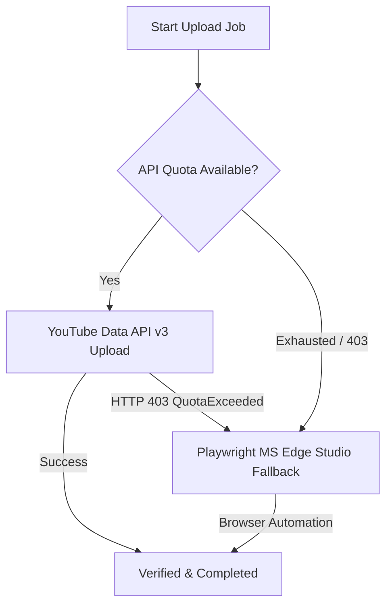

# AutoShorts v1.0

[](LICENSE)
[](https://www.python.org/)
[](pyproject.toml)
[](PLAN.md)

An on-device, CPU-optimized YouTube clip-to-Shorts automation pipeline designed for consumer Windows hardware (Intel UHD / CPU execution). Transforms long-form YouTube videos into high-retention 9:16 vertical Shorts using Semantic Inference (SemIf) orchestration, word-level animated karaoke captions, and scheduled pacing.

For the exhaustive engineering specification and architecture, see **[PLAN.md](PLAN.md)**.

---

## What's New in v1.0

- ⚙️ **In-App Settings Modal**: Configure LLM providers, API keys, caption styles, and upload visibility live from the web dashboard header without touching raw YAML files or restarting the server.
- 🔑 **YouTube Data API v3 In-App OAuth**: Guided `client_secret.json` upload and one-click in-app Google OAuth consent flow for automated token management (`credentials.json`).
- 🌐 **Live Link Preview**: Real-time metadata and thumbnail preview card as soon as a YouTube link is pasted into the queue submission form.
- 🎨 **Caption Style Presets (`neon`, `minimal`, `pill`)**: One-click switchable SubStation Alpha (`.ass`) caption aesthetic styles tailored for maximum viewer retention.
- 🛡️ **Playwright MS Edge Studio Auto-Fallback**: Seamless mid-flight failover to headless Microsoft Edge Studio browser automation whenever YouTube API quotas are exhausted (HTTP 403 / `quotaExceeded`), ensuring 100% upload delivery continuity.

---

## Key Features

- **Strict Tooling Exclusivity**:
  - Video downloading strictly via `yt-dlp` (`--download-sections` for precision cuts).
  - Video rendering, audio ducking, and compositing strictly via direct `FFmpeg` and `ffprobe` subprocesses.
  - Zero MoviePy (prohibited due to memory leaks and CPU overhead); zero Playwright video downloads.
- **Persistent Daily Spread Scheduler (Up to 50 Shorts/Day)**:
  - Hard daily ceiling of **50 uploads per day** (`daily_upload_cap: 50`).
  - Strict rolling rate limiting of **maximum 7 uploads per rolling hour**.
  - Non-fixed uniform random jittered gaps (5–25 minutes) distributed across daytime active windows (e.g. 08:00–23:59).
  - Pre-renders ahead of time in background; persists queue in SQLite (`data/state.db`).
  - Intelligent catch-up behavior after PC sleep/shutdown (skips/reschedules missed slots without bursting).
  - Daily counters and quota reset synchronized to midnight Pacific Time (00:00 PT).
  - System sleep prevention via Windows Win32 `SetThreadExecutionState` during active windows.
- **Granular YouTube Data API v3 Quota Management & Studio Fallback**:
  - Transparent quota accounting based on YouTube's granular bucket architecture: `videos.insert` operates within its own dedicated bucket (default 100 calls/day, 1 unit/call) separate from the 10,000 units/day general pool (`videos.list` = 1 unit).
  - Pacing 50 uploads/day consumes 50 of the 100 upload-bucket calls and is **fully feasible on standard default quotas without requiring a quota extension audit**, while reserving 50 calls as headroom for retries.
  - **Automatic Playwright Studio Fallback**: When API quota units are exhausted, AutoShorts automatically falls back to Microsoft Edge browser automation (`msedge` channel) to complete uploads with 0 quota cost.
  - Dual-bucket SQLite quota tracker with auto-throttling and 3 fallback modes: `queue_next_day`, Playwright Studio fallback, or local export.
- **Multimodal AI Edit Planning (`gemini_video`)**:
  - Optional AI edit planner leveraging Google's Gemini Files API video understanding to output a structured **Edit Decision List (EDL JSON)**: hook trims, dead-air jump-cuts, and camera zoom punch-ins.
  - Executed deterministically by FFmpeg; falls back cleanly to transcript-only SemIf planning if disabled or unavailable.
- **Gemini Spark Companion Integration**:
  - Loosely coupled companion workflow for Google's 24/7 personal background AI agent (Gemini Spark).
  - Includes ready-to-use Spark 'Skills' research prompt templates, a dashboard JSON/Markdown import modal, and a watched `inbox/` file drop folder.
- **Decoupled Provider Abstraction**:
  - Seamlessly switch between Local GGUF (`llama-cpp-python` on CPU), Google Gemini, and OpenRouter with **zero hardcoded model names** (`model: null` dynamically resolved at runtime).
- **High-Dopamine Compositor Engine & Caption Presets**:
  - Dual vertical split-screen (speaker on top, gameplay on bottom with random start offsets).
  - Three distinct subtitle style presets:
    - **`neon`** (Default): High-energy yellow karaoke active pop animation with micro-tilt bounce, black outline, and keyword color accents.
    - **`minimal`**: Clean, elegant sans-serif typography with subtle outline, suitable for commentary and podcast excerpts.
    - **`pill`**: Modern high-contrast rounded box backdrop behind words for maximum legibility against vibrant gaming footage.
  - First-3s hook title card, dynamic top progress bar, and dialogue volume normalization (`loudnorm`).
- **Interactive Local Dashboard & Headless CLI**:
  - FastAPI web UI running on `http://localhost:8765` with HTML5 video preview player, queue management, quota meter, and scheduler controls.
  - **Settings Modal (⚙️)** for managing configurations, API keys, and OAuth credentials.
  - **Live Link Preview** for instant thumbnail and video verification upon pasting YouTube URLs.
  - 9-stage progress stepper tracking each job's lifecycle from ingestion to final cleanup.
  - Real-time Server-Sent Events (SSE) log streaming from the orchestrator.
  - Automatic transactional post-upload intermediate cleanup via path-guarded `SafetyCleaner`.

---

## Quick Start (Windows One-Click Launcher)

> [!NOTE]
> **Why `start.bat` is excluded from git:**
> Windows SmartScreen and security software often flag downloaded `.bat` files from the internet as suspicious. To avoid security prompts, create your own local `start.bat` file in this directory.

### Creating Your Local `start.bat` (Step-by-Step)
*(Full standalone copy-paste guide also available in [bat.md](file:///c:/Users/Sirisha%20Rajana/Desktop/New%20folder/Automation/bat.md))*

1. In this project folder, right-click an empty space and choose **New** &rarr; **Text Document**.
2. Rename the file to **`start.bat`** (ensure file name extensions are visible in File Explorer view settings so it is named `start.bat` rather than `start.bat.txt`).
3. Right-click **`start.bat`** and click **Edit** (or open it with Notepad).
4. Copy and paste the following self-healing launcher script into the file and save:

```bat
@echo off
setlocal enabledelayedexpansion

title AutoShorts Launcher

echo =====================================================================
echo                Starting AutoShorts Web Dashboard
echo =====================================================================
echo Dashboard URL: http://localhost:8765
echo Preferred Browser: Microsoft Edge
echo.

cd /d "%~dp0"

:: 1. Detect uv or python
set "UV_CMD="
where uv >nul 2>&1
if %ERRORLEVEL% equ 0 (
    set "UV_CMD=uv"
) else if exist "%USERPROFILE%\.local\bin\uv.exe" (
    set "UV_CMD=%USERPROFILE%\.local\bin\uv.exe"
)

where python >nul 2>&1
set "HAS_PYTHON=%ERRORLEVEL%"

:: 2. Check if .venv exists. If not, create it
if not exist ".venv\Scripts\python.exe" (
    echo [INFO] Virtual environment not found. Initializing .venv...
    if defined UV_CMD (
        echo [INFO] Creating virtual environment using uv...
        "%UV_CMD%" venv --python 3.12 >nul 2>&1
        if not exist ".venv\Scripts\python.exe" (
            "%UV_CMD%" venv
        )
    ) else if %HAS_PYTHON% equ 0 (
        echo [INFO] Creating virtual environment using Python venv...
        python -m venv .venv
    ) else (
        echo [ERROR] Neither Python 3.11+ nor uv was found on your system PATH!
        echo Please install Python from https://www.python.org/ or uv from https://astral.sh/uv
        echo Ensure "Add Python to PATH" is checked during setup.
        pause
        exit /b 1
    )

    if not exist ".venv\Scripts\python.exe" (
        echo [ERROR] Failed to initialize .venv virtual environment.
        pause
        exit /b 1
    )
    echo [INFO] Virtual environment created successfully.
)

:: 3. Check if core dependencies are installed
".venv\Scripts\python.exe" -c "import autoshorts, playwright, imageio_ffmpeg" >nul 2>&1
if %ERRORLEVEL% neq 0 (
    echo [INFO] Core dependencies missing or incomplete. Installing packages...
    if defined UV_CMD (
        "%UV_CMD%" pip install -e .
    ) else (
        if not exist ".venv\Scripts\pip.exe" (
            echo [INFO] Bootstrapping pip...
            ".venv\Scripts\python.exe" -m ensurepip --default-pip >nul 2>&1
        )
        ".venv\Scripts\python.exe" -m pip install -e .
    )

    if %ERRORLEVEL% neq 0 (
        echo [ERROR] Dependency installation failed. Please check your network connection.
        pause
        exit /b 1
    )
    echo [INFO] Dependencies installed successfully.
)

:: 4. Open browser to http://localhost:8765
echo [INFO] Opening browser to http://localhost:8765 ...
start "" "http://localhost:8765"

:: 5. Launch AutoShorts
echo [INFO] Launching AutoShorts server...
".venv\Scripts\python.exe" run.py %*

if %ERRORLEVEL% neq 0 (
    echo.
    echo [WARNING] AutoShorts exited with error code %ERRORLEVEL%.
    pause
)

endlocal
```

### Running AutoShorts

1. **One-Click Launch**:
   - Double-click **`start.bat`**.
   - It automatically checks for dependencies, verifies/creates `.venv`, opens **`http://localhost:8765`** in your default browser, and launches the web dashboard.

2. **One-Time YouTube Studio Browser Sign-In**:
   - For zero-quota browser automation uploads (`upload.mode: studio`), run:
     ```bash
     python run.py edge-login
     ```
     (or click **"Sign In with Edge"** in the web dashboard header).
   - This opens an isolated Microsoft Edge session with user profile persistence in `data/edge_profile`. Once signed into YouTube Studio, sessions persist across system reboots.

---

---

## Configuration & Settings Modal (⚙️)

AutoShorts v1.0 features an interactive **Settings Modal** accessible directly from the top navigation bar of the web dashboard (click the **⚙️ Settings** icon).

The modal allows you to inspect and modify pipeline behavior in real time without manually editing YAML files or restarting the server:

- **AI Engine / LLM Provider**:
  - Switch between `local` (CPU GGUF via `llama-cpp-python`), `gemini` (Google Gemini 1.5 Flash / Pro), and `openrouter`.
  - Enter or update `GEMINI_API_KEY` and `OPENROUTER_API_KEY` with automatic secret masking and redaction in logs.
  - Set local model paths (default: `data/models/Qwen3-0.6B-Instruct-Q8_0.gguf`).
- **Caption Style Presets**:
  - Select your default caption aesthetic: `neon`, `minimal`, or `pill`.
- **Upload & Privacy Defaults**:
  - Choose default Shorts visibility: `public`, `unlisted`, or `private`.
  - Toggle between `api`, `studio`, and `local` upload modes.
  - Set quota exhaustion fallback behavior (`studio`, `queue_next_day`, or `local`).
- **YouTube OAuth Credentials**:
  - Upload `client_secret.json` directly through the modal.
  - Initiate one-click in-app OAuth 2.0 authorization.

---

## YouTube Data API v3 In-App OAuth Setup

To upload Shorts automatically using the official YouTube Data API v3:

### 1. Create Google Cloud Project & Credentials
1. Go to the [Google Cloud Console](https://console.cloud.google.com/).
2. Create a new project (e.g. `AutoShorts-Uploader`).
3. Navigate to **APIs & Services** &rarr; **Library**, search for **YouTube Data API v3**, and click **Enable**.
4. Go to **APIs & Services** &rarr; **OAuth consent screen**:
   - Select **External** user type and click **Create**.
   - Fill in the required App name and Support email.
   - Under **Test users**, add your YouTube channel's Google account email address.
5. Go to **APIs & Services** &rarr; **Credentials**:
   - Click **Create Credentials** &rarr; **OAuth client ID**.
   - Set Application type to **Desktop app**.
   - Name it `AutoShorts Desktop Client` and click **Create**.
   - Click **Download JSON** and save the file as **`client_secret.json`**.

### 2. Connect in AutoShorts
1. Place **`client_secret.json`** into the `config/` directory (or open the dashboard **⚙️ Settings** modal and click **Upload client_secret.json**).
2. Click **Authorize YouTube API** in the dashboard header or Settings modal.
3. A Google sign-in window will open in your browser. Select your channel account and grant upload permissions (`youtube.upload`).
4. Once completed, AutoShorts saves the authorized refresh token to `config/credentials.json`. All future uploads run autonomously without user interaction.

---

## Caption Style Presets

AutoShorts includes 3 built-in SubStation Alpha (`.ass`) caption rendering presets optimized for vertical mobile screens:

| Preset | Aesthetic & Behavior | Best Suited For |
| :--- | :--- | :--- |
| **`neon`** *(Default)* | Vibrant yellow active karaoke pop (`#FFFF00`), dynamic `\t` scaling bounce (100% &rarr; 118% &rarr; 100%), micro-tilt angle pop (`\frz-2`), deep black outline, and keyword color accents. | High-retention clips, viral moments, gaming, fast-paced dialogue |
| **`minimal`** | Clean, modern sans-serif typography (Montserrat ExtraBold) with subtle outline and soft drop shadow. Zero distracting animations; crisp word-by-word active focus. | Educational podcasts, technical commentary, interviews, business insights |
| **`pill`** | High-contrast bounded dark pill backdrop behind the active text block (`\bord10\shad0` translucent rounded background). Guarantees 100% legibility over any visual background. | Busy Minecraft parkour, vibrant gameplay, colorful animation, motion-heavy footage |

You can configure your default preset in `config/config.yaml`:
```yaml
subtitles:
  style_preset: "neon" # "neon", "minimal", or "pill"
```
Or override it per job submission through the dashboard or CLI.

---

## Live Link Preview

When pasting YouTube URLs into the dashboard queue submission box:
- AutoShorts instantly initiates a lightweight non-download metadata probe (`yt-dlp --dump-single-json`).
- Displays a **Live Link Preview Card** showing:
  - Video thumbnail image
  - Video title and duration
  - Original channel name and channel URL
  - Direct link validity status
- Allows operators to verify clip targets before submitting them into the processing pipeline.

---

## Playwright MS Edge Studio Auto-Fallback

AutoShorts provides an automated failover system to ensure 100% upload delivery continuity:



1. **Primary Route**: AutoShorts uploads via YouTube Data API v3 chunked resumable protocol.
2. **Auto-Detection**: If the daily upload bucket is depleted (`quota_tracker.can_upload() == False`) or the API returns `403 QuotaExceeded`, the pipeline automatically catches the exception.
3. **Seamless Failover**: Without aborting the job, the orchestrator invokes `PlaywrightStudioUploader`, launches Microsoft Edge (`msedge`), navigates to YouTube Studio (`studio.youtube.com`), and completes the upload using the authenticated persistent user profile (`data/edge_profile`).
4. **Zero Quota Units Spent**: Studio browser uploads consume **0 API quota units**, allowing your publishing schedule to continue uninterrupted.

---

## Upload Modes

AutoShorts supports three interchangeable upload targets (`upload.mode` in `config/config.yaml` or overridden on job submission):
1. **`api`** (Default): YouTube Data API v3 resumable chunked upload with dual-bucket quota tracking (`videos.insert` dedicated upload bucket).
2. **`studio`**: Playwright browser automation with Microsoft Edge (`msedge` channel) and persistent profile. Consumes **0 API quota units**, ideal for restricted or exhausted API projects.
3. **`local`**: Offline export of master MP4s and subtitle files directly to `output/` without contacting YouTube.

---

## Web Dashboard & Real-Time Monitoring

- **9-Stage Progress Stepper**: Live visual progress tracking through:
  `QUEUED` &rarr; `METADATA_FETCHED` &rarr; `TRANSCRIPT_FETCHED` &rarr; `WINDOWS_SLICED` &rarr; `CLIPS_SELECTED` &rarr; `EDL_GENERATED` &rarr; `SUBTITLES_GENERATED` &rarr; `COMPOSITING` &rarr; `READY_FOR_REVIEW` (then `SCHEDULED` / `UPLOADING` &rarr; `COMPLETED` / `CLEANED`).
- **Live SSE Log Streaming**: Real-time console log viewer with Server-Sent Events (`/api/logs/stream`), log pause/resume, search filter, and buffer clear.
- **Quota & Schedule Meters**: Real-time Pacific Time daily upload meter, hourly rolling limiter gauge, and pause/resume toggles.
- **Transactional Post-Upload Cleanup**: Automatically purges raw downloads, extracted WAVs, and intermediate clips upon verified upload completion via path-guarded recycle-bin deletion (`send2trash`).

---

## CLI Reference

```bash
# Launch web dashboard in Microsoft Edge (default)
python run.py

# Process links directly from command line
python run.py run --links "https://www.youtube.com/watch?v=..." --auto-upload

# One-time Edge authentication for YouTube Studio upload mode
python run.py edge-login

# Run upload scheduler tick
python run.py scheduler --once

# Inspect current daily quota allocation and rolling limits
python run.py quota

# Clean up stale temporary files older than 24 hours
python run.py clean --older-than 24
```

---

## Important Legal & Compliance Disclaimer

> [!CAUTION]
> **Attribution Does Not Equal Copyright Permission**:
> Including an attribution disclaimer or original creator link in video descriptions does **not** grant legal copyright immunity under US Fair Use or international copyright law. Original rights-holders retain the full right to issue YouTube Content ID claims or DMCA strikes.
> 
> Furthermore, publishing up to 50 near-duplicate-format Shorts per day carries risk under YouTube's spam, repetitive content, and inauthentic activity policies. Additionally, separate channel-level daily upload limits apply to newer or unverified channels. Creators are strongly advised to inject editorial variety, rotate backgrounds and hooks, and prioritize curated quality over mechanical volume.
