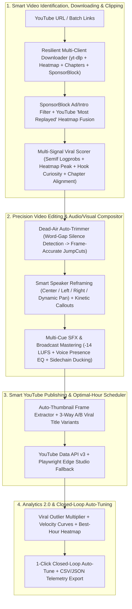

# AutoShorts v1.1 — Studio 2.0 Overhaul

[](LICENSE)
[](https://www.python.org/)
[](pyproject.toml)
[](tests/)
[](PLAN.md)

An on-device, CPU-optimized YouTube clip-to-Shorts and autonomous faceless video creation pipeline designed for consumer Windows hardware (Intel UHD / CPU execution). Transforms long-form YouTube videos and neural text scripts into high-retention 9:16 vertical Shorts using Semantic Inference (SemIf) orchestration, word-level animated karaoke captions, multi-layout compositing, live viral research, and closed-loop YouTube Shorts analytics.

For the exhaustive engineering specification and architecture, see **[PLAN.md](PLAN.md)** and **[INTERFACES.md](INTERFACES.md)**.

---

## What's New in v1.1 (Studio 2.0 Overhaul)

- 🎯 **Smart Video Identification & Resilient Clipping**:
  - **YouTube "Most Replayed" Heatmap Peak Fusion**: Automatically extracts YouTube viewer retention curves (`0.0–1.0`), fusing audience replay density with SemIf token-probability scoring, hook curiosity ratings, and chapter boundaries for maximum clip virality.
  - **SponsorBlock Ad/Intro/Outro Auto-Skipping**: Seamless SponsorBlock API integration (`skip_sponsors: true`) that identifies and filters out sponsored promotions, self-promos, intros, and outros during candidate window generation.
  - **Chapter Boundary Alignment**: Extracts native video chapters and snaps candidate slice windows to logical thematic boundaries, eliminating mid-sentence cuts or context fragmentation.
  - **Hook Curiosity Scoring**: Multi-signal scoring engine that evaluates narrative tension, hook curiosity, and opening 3–5s viewer retention power.
  - **Multi-Client `yt-dlp` Resilience**: Resilient player client fallback cascade (`default` &rarr; `android` &rarr; `web`) to bypass bot-detection blocks, paired with keyframe-accurate section downloading.
- ✂️ **Advanced Video Editing & Smart Publishing**:
  - **Dead-Air Silence Auto-Trimmer (`detect_dead_air_cuts`)**: Whisper word-gap pause detection (`> 0.45s`) that automatically converts awkward pauses into frame-accurate `JumpCut` ranges and dynamic `ZoomPunch` camera motions (`auto_trim_silence: true`).
  - **Speaker Crop Focus Reframing (`crop_focus`)**: Horizontal speaker reframing in 9:16 vertical canvas with `center`, `left`, `right`, and `dynamic_pan` tracking.
  - **Auto-Extracted Peak Hook Thumbnail**: FFmpeg-powered frame extraction of high-retention hook frames (`thumbnail.jpg`) and direct integration with YouTube Data API v3 `thumbnails().set` for automated custom thumbnail uploads.
  - **3-Way A/B Viral Title Variants (`generate_title_variants`)**: Generates 3 distinct viral angle variants for every clip—*Curiosity Hook*, *Contrarian Contrasting*, and *Stat/Number Shock*.
- 📊 **Analytics 2.0 & Closed-Loop Auto-Tuning**:
  - **Viral Outlier Multiplier Badges (`outlier_multiplier`)**: Calculates view velocity against channel median benchmarks to highlight breakout hits (`🔥 3.2x Outlier`, `1.5x`, `3.0x+` Outlier badges).
  - **Best Publish Hour & Day Insights**: Computes historical velocity heatmaps and recommends optimal publishing windows tailored to the channel's specific audience.
  - **1-Click Closed-Loop Auto-Tune (`POST /api/analytics/auto-tune`)**: Automatically adopts winning attributes (crop focus, caption preset, background category, dopamine pacing) from top-performing Shorts directly into pipeline defaults.
  - **CSV & JSON Telemetry Exporter (`GET /api/analytics/export?format=csv|json`)**: Full programmatic export of all channel Shorts performance, engagement ratios, and attribution metadata.
  - **Strict Zero-Phantom Data Policy**: Guarantees all analytics and telemetry strictly stem from real credentials and official endpoints (`YOUTUBE_API_KEY`, OAuth `token.json`, `yt-dlp`, Playwright Studio scraper), with zero synthetic or placeholder metrics.
- 💎 **Glassmorphic & Claymorphic Studio UI**:
  - Complete dashboard aesthetic evolution featuring frosted glass panels (`backdrop-filter: blur`), semi-translucent borders, claymorphic card elevation, and tactile interactive elements.
  - **Candidate Inspector & Editor**: Interactive clip selection modal equipped with Heatmap/SponsorBlock badges, one-click `✂️ Auto-Remove Silence` trimmer, Speaker Crop Focus dropdown, and A/B title variant selector.
  - **Analytics 2.0 Command Center**: Live outlier badges (`🔥 3.2x Outlier`), Best Upload Hour insights panel, `⚡ Auto-Tune Studio from Analytics` action button, and 1-click CSV/JSON telemetry downloaders.

---

## Studio 2.0 Architecture & Pipeline



---

## 4-View Studio Command Center

AutoShorts provides an all-in-one desktop studio operating on `http://localhost:8765`, styled with an ultramodern **Glassmorphic and Claymorphic UI**:

### 1. 🎬 Shorts Studio & Queue
- **Glassmorphic & Claymorphic Interface**: Sleek dark-mode aesthetic featuring frosted translucent glass surfaces (`backdrop-filter: blur`), subtle borders, tactile claymorphic elevation, and pastel accent glows.
- **Smart Candidate Inspector**: Interactive candidate review modal displaying sliced windows, YouTube *"Most Replayed"* Heatmap retention curves (`0.0–1.0`), SponsorBlock ad/intro indicators, chapter markers, and hook curiosity scores.
- **Dead-Air Silence Auto-Trimmer (`detect_dead_air_cuts`)**: One-click `✂️ Auto-Remove Silence` tool that scans transcript word gaps, converting pauses > 0.45s into seamless `JumpCut` edits and injecting dynamic `ZoomPunch` camera moves on high-emphasis moments.
- **Speaker Crop Focus Reframing**: Choose `center`, `left`, `right`, or `dynamic_pan` horizontal camera focus directly in the candidate editor.
- **Auto-Extracted Peak Hook Thumbnail**: Automatically captures the peak engagement frame (`thumbnail.jpg`) via FFmpeg and uploads it via YouTube Data API v3 `thumbnails().set`.
- **3-Way A/B Viral Title Variants**: Select or cycle between 3 auto-generated title hooks (*Curiosity Hook*, *Contrarian Angle*, *Stat/Number Shock*).
- **Live Link Preview & Multi-Client yt-dlp**: Instant metadata preview with resilient multi-client download fallback (`default` &rarr; `android` &rarr; `web`).
- **9:16 Live Phone Mockup Previewer**: Test video framing inside an interactive mobile viewport with YouTube Shorts UI overlay simulation to avoid caption clipping behind mobile buttons.
- **Transcript Editor & ⚡ Fast 1-Click Re-Burn**: Edit transcribed sentences and regenerate SubStation Alpha subtitles within seconds via `/api/jobs/{id}/re-burn` without re-downloading or re-rendering video.
- **Real-Time Job Queue & SSE Stepper**: Monitor job progression across pipeline states with live Server-Sent Events (SSE) log streaming.

### 2. 🔥 Viral Research & Trending Finder
- **Live Trending Videos & Podcasts**: Discovers high-velocity YouTube Shorts and podcast moments across major niches. Every card features a **direct clickable YouTube link** to inspect the source and a **`⚡ 1-Click Send to Pipeline`** button that instantly populates the Studio submission form.
- **Highest Payout Niche Matrix & Revenue Calculator**: Explores CPM/RPM dynamics across 7 lucrative niches (Finance & Wealth, AI & Tech, Business & Startups, Dark Psychology, Stoicism, Space & Physics, Health & Biohacking). Interactive calculator projects monthly revenue based on daily views and niche RPM.
- **Trending Viral Songs & 1-Click BGM Downloader**: Curated catalog of copyright-safe viral background tracks (Drift Phonk 138 BPM, Dark Synthwave 120 BPM, Lo-Fi Chill 80 BPM, Fast Tension Ticks 132 BPM) with one-click automated downloads into `assets/music/`.
- **AI Viral Strategy Brief Copilot**: Generates tailored strategy briefs detailing psychological hook triggers, pacing strategies, visual background recommendations, and thumbnail concepts for any target topic.

### 3. 🎙️ Autonomous Faceless AI Shorts Studio
- **End-to-End Autonomous Generation**: Produces complete faceless Shorts without requiring long-form video input.
- **SQLite Topic De-Duplication Memory**: Tracks every generated topic in `data/state.db` (`topic_history` table) so your channels never repeat content ideas.
- **Free High-Fidelity Neural TTS**: Leverages Microsoft Edge Neural TTS (`edge-tts`) across male and female voice personas in English, Spanish, Hindi, German, French, Portuguese, and Japanese.
- **Exact Word-Boundary Karaoke Synchronization**: Captures exact word timing boundaries during neural audio synthesis to generate sample-accurate SubStation Alpha (`.ass`) karaoke subtitles.
- **Pure FFmpeg 1080×1920 Compositor**: Composites neural audio, gameplay/stock footage, background music, and animated subtitles strictly via direct FFmpeg subprocesses with zero MoviePy overhead.

### 4. 📊 YouTube Shorts Analytics 2.0 & Closed-Loop A/B Telemetry
- **Multi-Source Waterfall Telemetry**:
  1. *YouTube Data API v3*: Batch `videos.list` fetching official view counts, likes, comments, and tags.
  2. *YouTube Analytics API v2*: Channel and video-level audience retention curves and average percentage viewed (APV).
  3. *Zero-Quota yt-dlp Fallback*: Public metadata scraping when API quota units are conserved.
  4. *Playwright YouTube Studio Scraper*: Automated headless browser scraping of private Studio metrics (subscriber conversion, impression click-through rate [CTR]).
- **Viral Outlier Multiplier Badges (`outlier_multiplier`)**: Compares video velocity against the channel's historical median, highlighting runaway breakouts with `🔥 3.2x Outlier`, `1.5x`, and `3.0x+` outlier badges.
- **Best Publish Hour & Day Heatmap**: In-depth audience engagement schedule determining the optimal day and hour to publish for maximum day-one algorithmic velocity.
- **1-Click Closed-Loop Auto-Tune (`POST /api/analytics/auto-tune`)**: One-click optimization that extracts the winning configurations (aspect ratio, caption preset, crop focus, dopamine pacing, background category) from your top viral outliers and automatically applies them to studio defaults.
- **CSV & JSON Telemetry Exporter (`GET /api/analytics/export?format=csv|json`)**: 1-click export of your full analytics dataset, retention figures, and attribution history.
- **Strict Zero-Phantom Data Policy**: Telemetry strictly represents verified API and scraped metrics; zero synthetic or placeholder values are ever injected.

---

## 5 Vertical 9:16 Layout Modes

AutoShorts supports five distinct vertical composition layouts:

| Layout Mode | Structure & Visual Hierarchy | Best Suited For |
| :--- | :--- | :--- |
| **`split_50_50`** *(Default)* | Dual vertical split: speaker cropped 9:16 on the top 50% (`540×960`), background gameplay or B-roll anchored on the bottom 50% (`540×960`). | High-energy podcasts, reaction videos, gaming commentary |
| **`split_70_30`** | Primary video commands the top 70% (`756×1344`) of the frame with a compact 30% (`324×576`) gameplay anchor at the base. | Technical demonstrations, presentations, software walkthroughs |
| **`full_blur_bg`** | 16:9 widescreen source centered horizontally and vertically over an aesthetically blurred, scaled 9:16 background layer. | Cinematic interviews, landscape documentaries, widescreen movie clips |
| **`full_center_crop`** | Source video cropped and scaled directly to fill the full 1080×1920 canvas (`crop=ih*9/16:ih`). | Face-to-camera monologue, single-speaker interviews, mobile-shot footage |
| **`pip_gameplay`** | Full-screen 9:16 gameplay footage with a circular or rounded-corner picture-in-picture speaker bubble overlay. | Commentary streams, storytime videos, educational gaming |

### 9:16 Live Phone Mockup Previewer & Safe-Zone HUD

Mobile video platforms place UI overlays (channel icon, title, like, comment, share, and sound ticker) over vertical videos. The AutoShorts Live Phone Mockup Previewer renders an interactive **YouTube Shorts Mobile UI Safe-Zone HUD** overlay:

```
┌─────────────────────────────────┐
│ [Top Progress Bar / Safe Zone]  │
│                                 │
│                                 │
│         [PRIMARY CONTENT]       │
│                                 │
│                                 │
│     ┌─────────────────────┐     │  [Like Button]
│     │   ACTIVE SUBTITLES  │     │  [Dislike]
│     │   (Safe Center Zone)│     │  [Comments]
│     └─────────────────────┘     │  [Share]
│                                 │  [Remix]
│ [Channel Pill & Subscribe]      │
│ [Video Title & Hashtags]        │  [Sound Disc]
└─────────────────────────────────┘
```

The HUD ensures subtitle lines and key visual subjects remain centered and completely unobstructed by native mobile platform controls.

---

## 7 Studio Caption Presets & ⚡ Fast Re-Burn

AutoShorts includes 7 high-retention SubStation Alpha (`.ass`) caption rendering presets:

| Preset | Visual Style & Behavior | Typical Use Case |
| :--- | :--- | :--- |
| **`neon`** *(Default)* | Vibrant yellow active karaoke pop (`#FFFF00`), dynamic scaling bounce (100% &rarr; 118% &rarr; 100%), micro-tilt angle pop (`\frz-2`), deep black outline, and keyword color accents. | High-retention clips, viral moments, gaming, fast dialogue |
| **`hormozi`** | Ultra-bold punchy text (The Bold Font / Montserrat Black) with bright yellow active words, deep green keyword accents, and heavy black stroke. | Motivation, business, direct-response advice, personal branding |
| **`mrbeast`** | Energetic pop font with dynamic orange, lime, and yellow highlights, playful active scale wobble, and thick drop shadows. | Challenges, surprising facts, viral entertainment |
| **`pill`** | High-contrast bounded dark translucent rounded box backdrop behind active words (`\bord10\shad0`). 100% legibility over any footage. | Busy Minecraft parkour, subway surfers, motion-heavy footage |
| **`minimal`** | Clean, modern sans-serif typography with subtle outline and soft shadow. Zero distracting animations; crisp word-by-word active focus. | Educational podcasts, technical commentary, interviews |
| **`cyberpunk`** | Neon cyan text with hot pink glow pulses, futuristic monospace aesthetic, and digital chromatic accenting. | AI & technology, gaming lore, crypto, sci-fi facts |
| **`cinematic`** | Warm cream and gold serif/sans typography with elegant kerning, subtle fade transitions, and cinematic letterboxing. | History, stoicism philosophy, deep storytelling, audiobooks |

### ⚡ Fast 1-Click Re-Burn Engine
When tweaking caption text, font sizes, colors, or styles:
- AutoShorts bypasses the entire download and audio alignment pipeline.
- Calls `/api/jobs/{id}/re-burn` to re-generate the SubStation Alpha `.ass` file and burn it into the pre-composited base video in seconds.
- Allows rapid transcript corrections and aesthetic experimentation without wasting compute or waiting for re-renders.

---

## Core Architecture & Engine Invariants

```
Long-Form YouTube URL / Topic Prompt
  │
  ├── [Ingestion & Discovery] (yt-dlp metadata probe / live link preview)
  ├── [Transcription & Alignment] (faster-whisper CPU int8 / edge-tts word events)
  ├── [SemIf Decision Engine] (Logit softmax scoring / Gemini video EDL planning)
  ├── [Compositor Engine] (Pure FFmpeg 1080x1920: 5 layouts + 7 caption presets)
  ├── [Interactive Review & Re-Burn] (9:16 Live phone previewer + safe-zone HUD)
  ├── [Daily Spread Scheduler] (50/day cap, 7/hr rolling limit, Pacific Time reset)
  ├── [Upload & Fallback Engine] (YouTube Data API v3 -> Playwright MS Edge Studio fallback)
  └── [Closed-Loop Analytics] (Waterfall telemetry -> SVS scoring -> Winning style cloning)
```

1. **Strict Tooling Exclusivity**:
   - Video downloading strictly via `yt-dlp` (`--download-sections` for precision cuts).
   - Video rendering, audio ducking, and compositing strictly via direct `FFmpeg` and `ffprobe` subprocesses.
   - Zero MoviePy (prohibited due to memory leaks and CPU overhead); zero Playwright video downloads.
2. **Persistent Daily Spread Scheduler (Up to 50 Shorts/Day)**:
   - Hard daily ceiling of **50 uploads per day** (`daily_upload_cap: 50`).
   - Strict rolling rate limiting of **maximum 7 uploads per rolling hour**.
   - Non-fixed uniform random jittered gaps (5–25 minutes) distributed across daytime active windows (e.g. 08:00–23:59).
   - System sleep prevention via Windows Win32 `SetThreadExecutionState` during active windows.
   - Daily quota resets synchronized to midnight Pacific Time (00:00 PT).
3. **Granular Quota Accounting & Studio Fallback**:
   - Pacing 50 uploads/day consumes 50 of the 100 dedicated `videos.insert` bucket calls, requiring **zero quota extension audits**.
   - Mid-flight failover catches `403 QuotaExceeded` and automatically deploys headless Microsoft Edge browser automation (`msedge`) to complete uploads with 0 quota cost.
4. **Hardware Optimized for Consumer Windows PCs**:
   - 100% executable on consumer multi-core CPUs with integrated Intel UHD / Iris Xe Graphics.
   - Bounded concurrency (`concurrency = 1`) to eliminate CPU thrashing and memory exhaustion.

---

## Quick Start (Windows One-Click Launcher)

> [!NOTE]
> **Why `start.bat` is created locally:**
> Windows SmartScreen often flags downloaded `.bat` files from the internet. To avoid security prompts, create your own local `start.bat` file in this directory.

### Creating Your Local `start.bat` (Step-by-Step)
*(Full standalone copy-paste guide also available in [bat.md](file:///c:/Users/Sirisha%20Rajana/Desktop/New%20folder/Automation/bat.md))*

1. In this project folder, right-click an empty space and choose **New** &rarr; **Text Document**.
2. Rename the file to **`start.bat`** (ensure file name extensions are visible in File Explorer view settings so it is named `start.bat` rather than `start.bat.txt`).
3. Right-click **`start.bat`** and click **Edit** (or open it with Notepad).
4. Copy and paste the following self-healing launcher script into the file and save:

```bat
@echo off
setlocal enabledelayedexpansion

title AutoShorts Launcher

echo =====================================================================
echo                Starting AutoShorts Web Dashboard
echo =====================================================================
echo Dashboard URL: http://localhost:8765
echo Preferred Browser: Microsoft Edge
echo.

cd /d "%~dp0"

:: 1. Detect uv or python
set "UV_CMD="
where uv >nul 2>&1
if %ERRORLEVEL% equ 0 (
    set "UV_CMD=uv"
) else if exist "%USERPROFILE%\.local\bin\uv.exe" (
    set "UV_CMD=%USERPROFILE%\.local\bin\uv.exe"
)

where python >nul 2>&1
set "HAS_PYTHON=%ERRORLEVEL%"

:: 2. Check if .venv exists. If not, create it
if not exist ".venv\Scripts\python.exe" (
    echo [INFO] Virtual environment not found. Initializing .venv...
    if defined UV_CMD (
        echo [INFO] Creating virtual environment using uv...
        "%UV_CMD%" venv --python 3.12 >nul 2>&1
        if not exist ".venv\Scripts\python.exe" (
            "%UV_CMD%" venv
        )
    ) else if %HAS_PYTHON% equ 0 (
        echo [INFO] Creating virtual environment using Python venv...
        python -m venv .venv
    ) else (
        echo [ERROR] Neither Python 3.11+ nor uv was found on your system PATH!
        echo Please install Python from https://www.python.org/ or uv from https://astral.sh/uv
        echo Ensure "Add Python to PATH" is checked during setup.
        pause
        exit /b 1
    )

    if not exist ".venv\Scripts\python.exe" (
        echo [ERROR] Failed to initialize .venv virtual environment.
        pause
        exit /b 1
    )
    echo [INFO] Virtual environment created successfully.
)

:: 3. Check if core dependencies are installed
".venv\Scripts\python.exe" -c "import autoshorts, playwright, imageio_ffmpeg" >nul 2>&1
if %ERRORLEVEL% neq 0 (
    echo [INFO] Core dependencies missing or incomplete. Installing packages...
    if defined UV_CMD (
        "%UV_CMD%" pip install -e .
    ) else (
        if not exist ".venv\Scripts\pip.exe" (
            echo [INFO] Bootstrapping pip...
            ".venv\Scripts\python.exe" -m ensurepip --default-pip >nul 2>&1
        )
        ".venv\Scripts\python.exe" -m pip install -e .
    )

    if %ERRORLEVEL% neq 0 (
        echo [ERROR] Dependency installation failed. Please check your network connection.
        pause
        exit /b 1
    )
    echo [INFO] Dependencies installed successfully.
)

:: 4. Open browser to http://localhost:8765
echo [INFO] Opening browser to http://localhost:8765 ...
start "" "http://localhost:8765"

:: 5. Launch AutoShorts
echo [INFO] Launching AutoShorts server...
".venv\Scripts\python.exe" run.py %*

if %ERRORLEVEL% neq 0 (
    echo.
    echo [WARNING] AutoShorts exited with error code %ERRORLEVEL%.
    pause
)

endlocal
```

### Running AutoShorts

1. **One-Click Launch**:
   - Double-click **`start.bat`**.
   - Automatically bootstraps virtual environments, opens **`http://localhost:8765`** in your default browser, and launches the web dashboard.

2. **One-Time YouTube Studio Browser Sign-In**:
   - For zero-quota browser automation uploads (`upload.mode: studio`), run:
     ```bash
     python run.py edge-login
     ```
     (or click **"Sign In with Edge"** in the web dashboard header).
   - This opens an isolated Microsoft Edge session with user profile persistence in `data/edge_profile`. Once signed into YouTube Studio, sessions persist across system reboots.

---

## Configuration & Settings Modal (⚙️)

AutoShorts features an interactive **Settings Modal** accessible from the dashboard header (click **⚙️ Settings**):

- **AI Engine / LLM Provider**:
  - Switch between `local` (CPU GGUF via `llama-cpp-python`), `gemini` (Google Gemini 1.5 Flash / Pro), and `openrouter`.
  - Enter or update `GEMINI_API_KEY` and `OPENROUTER_API_KEY` with automatic secret masking in logs.
  - Set local model paths (default: `data/models/Qwen3-0.6B-Instruct-Q8_0.gguf`).
- **Smart Clipping & Video Defaults (`job_defaults`)**:
  - `skip_sponsors`: Auto-query SponsorBlock API to skip sponsor segments, self-promos, and intros/outros (`true` by default).
  - `auto_trim_silence`: Auto-detect dead-air pauses (`> 0.45s`) in speech transcripts and convert to tight `JumpCut` ranges (`true` by default).
  - Target clip duration bounds (`min_duration_seconds: 30`, `max_duration_seconds: 50`) and sliding window stride (`15s`).
- **Caption Style & Layout Defaults (`branding`)**:
  - Select default caption preset (`neon`, `hormozi`, `mrbeast`, `pill`, `minimal`, `cyberpunk`, `cinematic`).
  - Set default layout mode (`split_50_50`, `split_70_30`, `full_blur_bg`, `full_center_crop`, `pip_gameplay`).
  - Set speaker reframing crop focus: `center`, `left`, `right`, or `dynamic_pan` (`crop_focus: "center"`).
- **Upload & Privacy Defaults**:
  - Set default Shorts visibility: `public`, `unlisted`, or `private`.
  - Toggle between `api`, `studio`, and `local` upload modes.
  - Set quota exhaustion fallback behavior (`studio`, `queue_next_day`, or `local`).
- **YouTube OAuth Credentials**:
  - Upload `client_secret.json` directly through the modal.
  - Initiate one-click in-app OAuth 2.0 authorization saving tokens to `config/credentials.json`.

---

## REST API Reference

The FastAPI server exposes clean REST endpoints covering all pipeline capabilities:

### Jobs & Pipeline (`/api/jobs`)
| Method | Endpoint | Description |
| :--- | :--- | :--- |
| `GET` | `/api/jobs` | List all jobs with status, metadata, and schedule info. |
| `POST` | `/api/jobs` | Submit a new clip job with URL, layout mode, caption preset, and instructions. |
| `GET` | `/api/jobs/{id}` | Retrieve comprehensive job status, candidates, EDL, and rendered paths. |
| `GET` | `/api/jobs/{id}/candidates` | Inspect sliced candidate windows with Heatmap retention curves, SponsorBlock tags, and curiosity scores. |
| `POST` | `/api/jobs/{id}/select-clip` | Select a specific candidate window, set speaker crop focus, and choose an A/B title variant. |
| `POST` | `/api/jobs/{id}/auto-trim-silence` | ✂️ Run Dead-Air Silence Auto-Trimmer (> 0.45s pauses) to generate frame-accurate jump-cuts. |
| `POST` | `/api/jobs/{id}/re-burn` | ⚡ Fast 1-click re-burn of ASS subtitles into base video with modified styling. |
| `DELETE` | `/api/jobs/{id}` | Cancel job and purge intermediate files via `SafetyCleaner`. |

### Built-In Viral Research Agent (`/api/research`)
| Method | Endpoint | Description |
| :--- | :--- | :--- |
| `GET` | `/api/research/trending` | Fetch live trending YouTube Shorts and podcasts with direct clickable links. |
| `GET` | `/api/research/payout-matrix` | Retrieve RPM/CPM intelligence and calculate projected revenue across niches. |
| `GET` | `/api/research/viral-music` | List trending royalty-free viral background audio tracks. |
| `POST` | `/api/research/download-music` | 1-click download of selected viral audio track into `assets/music/`. |
| `POST` | `/api/research/generate-brief` | Generate an AI Viral Strategy Brief Copilot recommendation for a given topic. |

### Autonomous Faceless AI Shorts Studio (`/api/faceless`)
| Method | Endpoint | Description |
| :--- | :--- | :--- |
| `GET` | `/api/faceless/voices` | List available Microsoft Edge Neural TTS voices by language and historical topics. |
| `POST` | `/api/faceless/generate-script` | Generate high-retention hook, script, and SEO tags with anti-duplication memory. |
| `POST` | `/api/faceless/create` | Synthesize neural TTS audio, build subtitles, composite 1080×1920 video, and queue. |
| `GET` | `/api/faceless/topics` | Retrieve SQLite `topic_history` de-duplication log across channels. |

### YouTube Shorts Analytics 2.0 (`/api/analytics`)
| Method | Endpoint | Description |
| :--- | :--- | :--- |
| `GET` | `/api/analytics/overview` | Summary KPI cards (total views, avg retention, avg SVS, top Shorts, viral outlier count). |
| `GET` | `/api/analytics/videos` | Video performance table with views, APV, likes, SVS, Outlier Multiplier, and layout attribution. |
| `POST` | `/api/analytics/refresh` | Trigger multi-source waterfall refresh (API v3 &rarr; Analytics v2 &rarr; yt-dlp &rarr; Studio). |
| `GET` | `/api/analytics/attribution/winning-style` | Extract the winning layout/caption/background recipe from top-performing Shorts. |
| `POST` | `/api/analytics/auto-tune` | ⚡ 1-Click Closed-Loop Auto-Tune: adopts winning parameters directly into studio pipeline defaults. |
| `GET` | `/api/analytics/export` | 📥 Export comprehensive channel telemetry dataset in CSV or JSON format (`?format=csv\|json`). |

### Settings & Quota (`/api/settings`, `/api/quota`)
| Method | Endpoint | Description |
| :--- | :--- | :--- |
| `GET` | `/api/settings` | Get current settings with masked API keys. |
| `POST` | `/api/settings` | Atomically update configuration keys and `.env` variables. |
| `POST` | `/api/settings/upload-client-secret` | Upload Google OAuth `client_secret.json`. |
| `POST` | `/api/settings/oauth/authorize` | Launch in-app Google OAuth consent flow for YouTube Data API v3. |
| `GET` | `/api/quota` | Current daily upload count, rolling limit status, and Pacific Time reset timer. |

---

## CLI Reference

```bash
# Launch web dashboard in Microsoft Edge (default)
python run.py

# Process links directly from command line
python run.py run --links "https://www.youtube.com/watch?v=..." --auto-upload

# One-time Edge authentication for YouTube Studio upload mode
python run.py edge-login

# Run upload scheduler tick
python run.py scheduler --once

# Inspect current daily quota allocation and rolling limits
python run.py quota

# Clean up stale temporary files older than 24 hours
python run.py clean --older-than 24
```

---

## Important Legal & Compliance Disclaimer

> [!CAUTION]
> **Attribution Does Not Equal Copyright Permission**:
> Including an attribution disclaimer or original creator link in video descriptions does **not** grant legal copyright immunity under US Fair Use or international copyright law. Original rights-holders retain the full right to issue YouTube Content ID claims or DMCA strikes.
> 
> Furthermore, publishing up to 50 near-duplicate-format Shorts per day carries risk under YouTube's spam, repetitive content, and inauthentic activity policies. Additionally, separate channel-level daily upload limits apply to newer or unverified channels. Creators are strongly advised to inject editorial variety, rotate backgrounds and hooks, and prioritize curated quality over mechanical volume.
