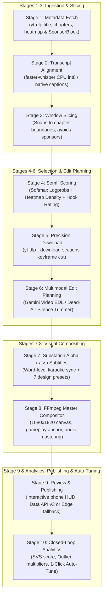
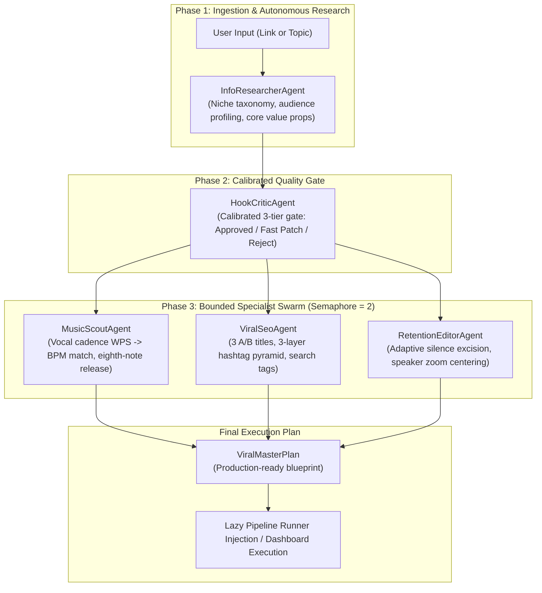
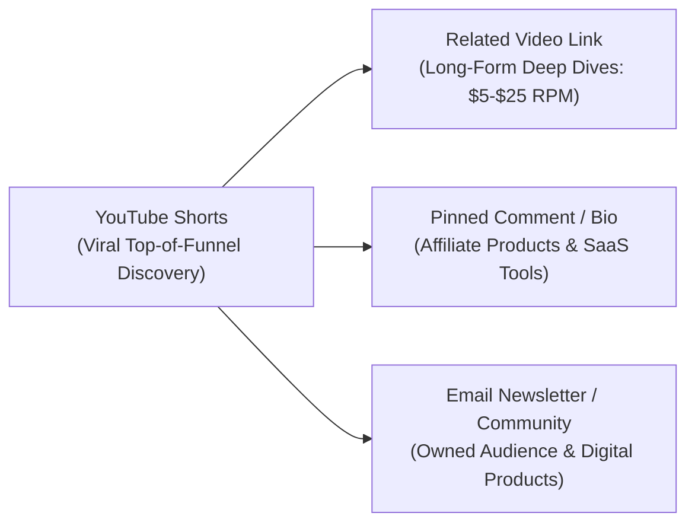

# AutoShorts Studio — Complete Beginner & Operator Walkthrough

Welcome to **AutoShorts Studio**! This guide walks you through everything from zero to producing, scheduling, and analyzing viral YouTube Shorts on consumer Windows hardware.

Whether you want to clip long-form podcasts, webinars, and interviews into high-retention vertical clips or generate autonomous faceless videos with neural voiceovers, this document covers the end-to-end operational workflow.

---

## ⚡ Quick-Start Checklist

Follow this checklist for your first run:

- [ ] **System Prereqs**: Windows 10/11, macOS 12+ Monterey (Apple Silicon M1-M4 & Intel), or Linux. Python 3.12 (or `uv`), and FFmpeg (`brew install python@3.12 ffmpeg uv` on macOS; bundled via `.venv` or winget on Windows).
- [ ] **Run Pre-Flight Check**: Execute `start.bat --check` in Windows PowerShell or `./start.sh --check` in macOS / Linux Terminal. Confirm all runtime folders, AI engines, and core dependencies show `[OK]`.
- [ ] **Run Automated Tests**: Verify all **670+ unit and integration tests** pass cleanly with `start.bat --test` or `./start.sh --test`.
- [ ] **Launch Dashboard**: Run `start.bat` (Windows) or `chmod +x start.sh && ./start.sh` (macOS/Linux). The studio opens at `http://127.0.0.1:8000` (tested with Safari 15+, Chrome, Edge, and Arc).
- [ ] **Configure AI Keys**: Click **⚙️ Settings** in the top navigation. Enter your `GEMINI_API_KEY` (recommended for video understanding and SuperBrain agents) or configure OpenRouter / Local GGUF.
- [ ] **Connect YouTube**: In **⚙️ Settings** &rarr; **YouTube API & Upload**, upload `client_secret.json` and click **"Authorize YouTube Account (OAuth 2.0)"** (or click **"Sign In with Edge"** for zero-quota Playwright uploads).
- [ ] **Add Gameplay Backgrounds**: Verify `assets/backgrounds/minecraft/` or `assets/backgrounds/subway/` contains at least one `.mp4` video (or run `start.bat --collect` / `./start.sh --collect`).
- [ ] **Submit First Clip**: In **🎬 Shorts Studio & Queue**, paste a YouTube URL, click **"Preview Link"**, select your layout and subtitle preset, and click **"Submit to Pipeline"** (or use the **SuperBrain Orchestrator** for autonomous multi-agent Mode A / Mode B workflows).
- [ ] **Review & Fast Re-Burn**: Inspect the candidate in the preview player. Tweak subtitles, speaker crop focus, or styling with **⚡ Fast Re-Burn** in seconds without re-downloading.
- [ ] **Publish or Schedule**: Send to immediate upload or let the **Daily Spread Scheduler** pace uploads automatically across active daytime hours.

---

## 🧠 How AutoShorts Studio Works: The Pipeline Stages

AutoShorts automates vertical video production through a deterministic 9-stage pipeline managed by an on-device SQLite state machine (`data/state.db`). Every stage caches its artifacts in `work/<job_id>/`, allowing jobs to resume seamlessly if interrupted:



### The 9 Pipeline Stages in Detail

| Stage | Name | What Happens Under the Hood |
| :--- | :--- | :--- |
| **Stage 1** | **Metadata Fetch** | `yt-dlp` extracts video metadata, YouTube chapter markers, viewer retention heatmap curves (`0.0–1.0`), and queries the SponsorBlock API for sponsor segments, self-promos, and intros/outros. |
| **Stage 2** | **Transcript Alignment** | Fetches native YouTube timed subtitles or runs `faster-whisper` (`compute_type="int8"` on CPU) to extract word-level timestamps. |
| **Stage 3** | **Window Slicing** | Generates overlapping candidate windows (`30–50s` duration, `15s` stride) aligned to natural sentence breaks and chapter markers, automatically discarding non-content sponsor segments (`skip_sponsors: true`). |
| **Stage 4** | **SemIf Scoring & Selection** | The **Semantic-IF (SemIf)** engine evaluates speech candidate text. It fuses next-token LLM logit probabilities with YouTube replay heatmap peaks and hook curiosity scores: `Composite = 0.72 * SemIf + 0.18 * Heatmap + 0.10 * Hook`. Selects top non-overlapping clips. |
| **Stage 5** | **Precision Download** | Downloads *only* the chosen candidate segment using `yt-dlp --download-sections "*start-end"` to minimize network bandwidth and local disk usage. |
| **Stage 6** | **Multimodal Edit Planning** | Multimodal Gemini Files API (or transcript heuristics) evaluates video pacing, generating an Edit Decision List (EDL). The **Dead-Air Auto-Trimmer** (`detect_dead_air_cuts`) identifies speech gaps `> 0.45s`, turning them into frame-accurate jump-cuts and camera punch-in zooms. |
| **Stage 7** | **Subtitle Generation** | Generates precision SubStation Alpha (`.ass`) karaoke subtitles with active word bounce, micro-tilt animations, color accents, and safe-zone vertical centering. Saves word timings to `work/<job_id>/aligned_words.json`. |
| **Stage 8** | **FFmpeg Compositing** | Pure `FFmpeg` subprocess (zero MoviePy memory leaks) composites the 1080×1920 canvas: speaker framing, bottom gameplay footage (random temporal offset), background music ducking, and EBU R128 loudness normalization (`-14 LUFS`). Extracts a peak hook thumbnail (`thumbnail.jpg`). |
| **Stage 9** | **Review, Schedule & Upload** | Video enters `READY_FOR_REVIEW`. Operator inspects framing in the 9:16 mobile mockup. Video is scheduled across active daytime hours and uploaded via YouTube Data API v3 (with automatic failover to Playwright Edge Studio). |
| **Closed-Loop** | **Analytics & Auto-Tune** | Telemetry monitors view velocity and engagement. When outliers hit (`🔥 3.2x Outlier`), **1-Click Auto-Tune** feeds winning layouts, caption presets, and pacing back into studio pipeline defaults. |

---

## 🤖 The Master SuperBrain Orchestrator & Specialist Swarm (`src/autoshorts/brain/`)

AutoShorts v1.3 introduces the **Master Brain Orchestrator**, a coordinated multi-agent DAG engine inspired by high-end Hollywood editing suites and viral growth engineering agencies. The orchestrator coordinates 5 dedicated specialist agents through a 3-stage directed acyclic graph (DAG):



### The 5 Specialist Agents

1. **`InfoResearcherAgent`**:
   - Analyzes target niches and topics to extract key insights, audience demographics, and tonal targets.
   - Operates with offline fallback resilience when external research APIs are throttled or offline.
2. **`HookCriticAgent` (Calibrated 3-Tier Quality Gate)**:
   - **Mode B (Generative Faceless AI)**:
     - **Score $\ge 80$**: Instant approval for production (*"High viral potential with strong curiosity gap"*).
     - **Score $70\text{--}79$**: Fast Hook Patch applied immediately to elevate borderline hooks to $85+$ score without re-prompting.
     - **Score $< 70$ (Attempt 1)**: Rejected with specific feedback to regenerate a stronger opening.
     - **Score $< 70$ (Attempt $\ge 2$)**: Argmax fallback with quality metadata attached.
   - **Mode A (Video Link Repurposing)**:
     - Evaluates transcript cut curiosity and narrative completeness.
     - Adjusts candidate window boundaries ($\pm 5.0$s) or switches candidate windows based on narrative tension.
     - **Crucial Rule**: **NEVER** rewrites or replaces spoken human words from the source creator.
3. **`ViralSeoAgent` (3-Layer Hashtag Pyramid)**:
   - Formulates 3 distinct A/B titles ($<100$ characters).
   - Constructs a **3-Layer Hashtag Pyramid** (3 to 5 description hashtags):
     - *Layer 1 (Broad Viral)*: `#Shorts`, `#Viral`
     - *Layer 2 (Category/Niche)*: `#Tech`, `#Finance`, `#Business`
     - *Layer 3 (Micro-Niche / Topic)*: `#Python`, `#Stoicism`, `#Quantum`
   - Builds clean search keyword tags (stripped of `#`, bounded to $\le 500$ characters for official YouTube Data API compliance).
4. **`MusicScoutAgent` (WPS-to-BPM Musical Matching)**:
   - Computes vocal cadence in Words Per Second (WPS).
   - Maps cadence to optimal musical tempo:
     - **$\text{WPS} < 2.2$**: 100 BPM ambient mood (volume 0.22).
     - **$2.2 \le \text{WPS} \le 3.0$**: 120 BPM synthwave pulse (volume 0.18).
     - **$\text{WPS} > 3.0$**: 140 BPM high-octane phonk (volume 0.15).
   - Calculates exact musical eighth-note sidechain ducking release time:
     $$\text{ducking\_release\_ms} = \text{round}\left(\frac{30000}{\text{target\_bpm}}\right)$$
   - Resolves local royalty-free audio tracks from `assets/music/`.
5. **`RetentionEditorAgent`**:
   - Determines speech-adaptive silence excision thresholds ($-28$ dB for rapid speech down to $-35$ dB for dramatic pauses).
   - Sets optical speaker zoom centering (`center`, `left`, `right`) based on visual layout hints.
   - Enforces pattern interrupt safety ceilings: **$\le 4$ interrupts per 60s Short** with a **$\ge 4.5$s refractory cooldown**.

### Mode A vs. Mode B Orchestration
- **Mode A (`mode_a`)**: Long-form YouTube video repurposing. Evaluates transcripts, extracts heatmap replay curves, identifies curiosity peaks, and fine-tunes segment boundaries without modifying the speaker's actual voice.
- **Mode B (`mode_b`)**: Fully generative faceless Shorts. Ingests topic and niche prompts, generates high-retention scripts, synthesizes neural TTS voiceover, syncs karaoke subtitles, and selects complementary gameplay/stock backgrounds.

### Zero-Phantom-Data Preflight Checks & Structured 422 Contract
Before executing generative synthesis, `MasterBrainOrchestrator.preflight_check()` actively verifies that required LLM provider credentials (`GEMINI_API_KEY`, OpenRouter, or local GGUF models) are configured and valid.
If credentials are unset or invalid, the orchestrator raises a `PreflightCredentialError`, returning a structured HTTP 422 error response:
```json
{
  "detail": {
    "error": "preflight_credential_error",
    "service": "llm",
    "message": "LLM provider 'gemini' requires GEMINI_API_KEY to be configured in .env",
    "missing_key_name": "GEMINI_API_KEY",
    "details": { "provider": "gemini" }
  }
}
```
This guarantees no synthetic or dummy pipeline runs are ever executed on unauthenticated environments.

---

## 📈 Google Research TimesFM Time-Series Forecasting (`src/autoshorts/analytics/forecasting.py`)

AutoShorts integrates Google Research's **TimesFM (Time Series Foundation Model)** architecture for predictive video analytics and preemptive viewer retention cliff detection.

### 3-Tier Fallback Architecture
To ensure seamless execution on any machine regardless of installed dependencies, the forecasting engine implements an automatic 3-tier cascade:
1. **Tier 1 (`timesfm`)**: Google Research TimesFM foundation model (if `timesfm` is installed).
2. **Tier 2 (`numpy_scipy`)**: Parametric exponential curve fitting and non-linear regression (if `numpy` and `scipy` are installed).
3. **Tier 3 (`pure_python`)**: Pure Python 3.11+ standard library (`math`, `statistics`) with **zero external dependencies**.

### Preemptive Retention Cliff Detection
Audience retention curves $R(t)$ from YouTube Analytics API v2 or heatmap curves are audited to prevent viewer drop-off:
- **5-Point Moving Average Filter**: Applies a low-pass filter across retention data points to eliminate high-frequency telemetry noise.
- **Derivative Threshold**: Flags an inflection cliff whenever the slope $\nabla R(t) \le -0.035$ (drop of $>3.5\%$ per second).
- **Refractory Cooldown ($\ge 4.5$s)**: Prevents over-editing by enforcing a minimum 4.5-second cooldown between consecutive pattern interrupts.
- **Ceiling Guard ($\le 4$ Interrupts)**: Enforces a hard ceiling of at most 4 pattern interrupts per 60-second Short to preserve narrative coherence.

### 48-Hour Early View Velocity Trajectory Forecasting
Using early view velocity telemetry (hours 1 through 6 post-publish), `forecast_trajectory()` computes a 48-hour hourly projection vector and classifies whether the video is on track for a **viral breakout** relative to channel historical benchmarks.

---

## 🎵 Laya Rhythm, Meter & Decision Engine (`src/autoshorts/media/rhythm_engine.py` & `laya_router.py`)

The **Laya Rhythm Engine** bridges musical beat tracking, vocal cadence, and video editing to ensure every cut and visual emphasis lands in tight synchronization with audio transients.

### Key Capabilities & Invariants
1. **Pure Python Beat & Transient Grid Extraction**:
   - Extracts onsets via temporal energy flux and autocorrelation lag peak detection.
   - Computes musical BPM and generates aligned beat timestamp grids.
2. **Ambient Confidence Floor ($C \ge 0.35$)**:
   - If audio lacks distinct percussive beats ($C < 0.35$), beat snapping is automatically bypassed to prevent awkward timing jumps over ambient tracks, falling back to vocal speech cadence.
3. **Musical Beat Snapping for Visual Zooms**:
   - Camera punch-in zoom timestamps (`ZoomPunchIn`) snap to the nearest musical beat if within $\le 100$ms.
4. **Word-Guarded Jump Cut Clamping**:
   - Jump cuts are clamped $\ge 50$ms away from transcribed speech boundaries:
     $$t_{\text{cut\_start}} \ge t_{\text{word}}[i].\text{end} + 0.05\text{s}$$
     $$t_{\text{cut\_end}} \le t_{\text{word}}[i+1].\text{start} - 0.05\text{s}$$
   - **Zero Word Truncation Guarantee**: Spoken words are **never** truncated under any circumstances.
5. **Rhythmic Sidechain Ducking Release**:
   - Background music ducks dynamically when speech is active and releases cleanly on a musical eighth note:
     $$T_{\text{release}} = \frac{60000}{\text{BPM} \times 2}\text{ ms} = \frac{30}{\text{BPM}}\text{ seconds}$$
6. **Sub-40ms System 1 Hook Triage (`LayaRouter`)**:
   - Rapid heuristic scoring bridge evaluating opening sentences in $<40$ms.
   - Identifies high-urgency power words (`destroy`, `secret`, `exposed`), curiosity gaps, and penalizes weak passive phrases (`in this video`, `welcome back`).
   - Routes candidates into `approved` ($\ge 80$), `patch_needed` ($70\text{--}79$), or `rejected` ($<70$). Borderline hooks receive an instant fast patch.

---

## 🔊 Hardened Compositor & Audio Ducking (`src/autoshorts/media/compositor.py`)

The FFmpeg compositing engine has been hardened to support explicit audio parameter overrides across all video presets:
- **Dynamic Sidechain Activation**: Passing explicit `bgm_path` and `bgm_volume` dynamically activates sidechain ducking across all presets (even if the chosen dopamine preset has ducking disabled by default).
- **Rhythmic Ducking Integration**: Feeds `rhythm_ducking_release` (in milliseconds) directly into FFmpeg's `sidechaincompress` audio filter, ensuring the ducking release matches the exact musical eighth note of the background music.
- **High Dopamine Split Divider Line**: For `split_50_50` and `split_70_30` layouts, customizable `split_separator` (`glow`, `line`, `shadow`, or `none`) inserts a sleek cyan/white glowing separator line or subtle depth shadow between speaker and gameplay views.
- **Resilient Media Stream Handling**: Automated `ffprobe` stream validation (`has_audio_stream`, `has_video_stream`) dynamically probes inputs and synthesizes fallback silent audio or video, preventing FFmpeg filtergraph failures when media clips lack standard streams.

---

## ⚡ Parallel Multi-Video Processing Engine (`src/autoshorts/core/parallel_runner.py`)

AutoShorts Studio features a high-throughput bounded thread pool executor for processing multiple video rendering jobs concurrently without UI stalls:
- **Default Concurrency**: 3 parallel worker threads (configurable via `AUTOSHORTS_CONCURRENCY`, e.g. `set AUTOSHORTS_CONCURRENCY=4` or `export AUTOSHORTS_CONCURRENCY=4`).
- **Parallel Queue Endpoints**:
  - `POST /api/jobs/process-queue`: Scans the SQLite database for queued jobs and submits up to available worker capacity.
  - `GET /api/jobs/parallel-status`: Returns live concurrency status (`active_count`, `max_workers`, `active_jobs`).

---

## 🛠️ Complete Environment & System Setup

### Prerequisites
- **Operating System**: Windows 10/11 (64-bit), macOS 12+ Monterey (Apple Silicon M1-M4 & Intel), or Linux.
- **Python**: Python 3.12 (or the fast [`uv`](https://astral.sh/uv) package manager).
- **FFmpeg**: Required for all video compositing and audio normalization.
  - Windows: Bundled `imageio-ffmpeg` inside `.venv` or system PATH (`winget install Gyan.FFmpeg`).
  - macOS: `brew install ffmpeg` (auto-detected at `/opt/homebrew/bin/ffmpeg` or `/usr/local/bin/ffmpeg`).
  - Linux: `sudo apt install ffmpeg` or distro package manager.
- **Browser**: Apple Safari 15+, Google Chrome, Arc, or Microsoft Edge.

---

### Dual-Platform Launchers (`start.bat` & `start.sh`)

AutoShorts includes self-healing one-click launchers with identical command-line flags across both platforms:

- **Windows**: `start.bat`
- **macOS & Linux**: `start.sh`

#### Running on Windows (`start.bat`)
```powershell
# Default launch: starts dashboard on http://127.0.0.1:8000
.\start.bat

# Launch on a custom port
.\start.bat --port 8080
# or short flag:
.\start.bat -p 8080

# Run pre-flight environment diagnostics and exit (does not launch server)
.\start.bat --check
# or short flag:
.\start.bat -c

# Run automated test suite (670+ tests) and exit
.\start.bat --test
# or short flag:
.\start.bat -t

# Interactive gameplay asset collector
.\start.bat --collect

# Display help information
.\start.bat --help
```

#### Running on macOS & Linux (`start.sh`)
```bash
# macOS Prerequisites (Homebrew)
brew install python@3.12 ffmpeg uv

# Make executable (one-time setup)
chmod +x start.sh

# Default launch: starts dashboard on http://127.0.0.1:8000 (Safari 15+ verified)
./start.sh

# Launch on a custom port
./start.sh --port 8080

# Run pre-flight environment diagnostics
./start.sh --check

# Run automated test suite (670+ tests)
./start.sh --test

# Interactive gameplay asset collector
./start.sh --collect

# Display help information
./start.sh --help
```

> [!NOTE]
> When `start.bat --check` is executed, it validates Python 3.11+, detects whether `uv` or `pip` is available, confirms runtime directories (`data/`, `work/`, `output/`, `assets/backgrounds/`, `assets/music/`), verifies FFmpeg detection, and checks that core packages (`autoshorts`, `fastapi`, `uvicorn`, `playwright`, `imageio_ffmpeg`) import cleanly.

---

### Environment Keys (`.env`)

Configure your API keys in the `.env` file at the repository root, or configure them dynamically in the dashboard via **⚙️ Settings &rarr; AI Providers & Keys**:

```bash
# ==============================================================================
# AutoShorts Environment Configuration (.env)
# ==============================================================================

# Application environment and logging verbosity
APP_ENV=production
LOG_LEVEL=INFO

# 1. Google Gemini API Key (Recommended)
# Used for multimodal video edit planning and SemIf scoring.
# Obtain free from: https://aistudio.google.com/
GEMINI_API_KEY=AIzaSy...

# 2. OpenRouter API Key (Optional)
# Used if you prefer routing SemIf scoring through third-party models.
# Obtain from: https://openrouter.ai/keys
OPENROUTER_API_KEY=sk-or-v1-...

# 3. YouTube Data API Key (Optional but recommended for public metadata queries)
# Obtain from Google Cloud Console: APIs & Services -> Credentials -> Create API Key
YOUTUBE_API_KEY=AIzaSy...

# 4. Local GGUF Quantized Model Path (Optional)
# For 100% on-device CPU execution without cloud APIs.
LOCAL_GGUF_PATH=data/models/Qwen3-0.6B-Instruct-Q8_0.gguf
```

> [!TIP]
> **Zero Hardcoded Models Policy**: AutoShorts never hardcodes model names. When `model: null` is set in config, Gemini auto-resolves to the latest recommended multimodal model (`gemini-2.5-flash`), while local execution automatically discovers any `.gguf` file placed in `data/models/`.

---

## ☁️ Google Cloud Project & YouTube API Setup (Step-by-Step)

To upload videos and read analytics directly through the YouTube Data API v3, you must create a project in Google Cloud Console. Follow these steps carefully:

### Step 1: Create a Project & Enable APIs
1. Navigate to the [Google Cloud Console](https://console.cloud.google.com/).
2. Click the project dropdown in the top bar and select **"New Project"**.
3. Name your project (e.g. `AutoShorts-Studio`) and click **Create**.
4. Go to **APIs & Services &rarr; Library**.
5. Search for and **Enable** both of the following APIs:
   - **YouTube Data API v3** (handles uploads, playlists, and video metadata)
   - **YouTube Analytics API** (handles retention curves, watch time, and average percentage viewed)

### Step 2: Configure the OAuth Consent Screen
1. Go to **APIs & Services &rarr; OAuth consent screen**.
2. Select User Type: **External** (standard for personal Gmail accounts) and click **Create**.
3. Fill in the required fields:
   - **App name**: `AutoShorts Studio`
   - **User support email**: Your email address
   - **Developer contact information**: Your email address
4. Click **Save and Continue**.
5. Under **Scopes**, click **Add or Remove Scopes** and add:
   - `https://www.googleapis.com/auth/youtube.upload`
   - `https://www.googleapis.com/auth/youtube.readonly`
   - `https://www.googleapis.com/auth/yt-analytics.readonly`
6. Under **Test users**, click **Add Users** and enter the Gmail address associated with your YouTube channel.
   > [!IMPORTANT]
   > While your Google Cloud app is in "Testing" mode, **only added test users** can authenticate. Make sure your channel's Google account is listed here.
7. Click **Save and Continue** to finish.

### Step 3: Create Credentials & Download `client_secret.json`
1. Go to **APIs & Services &rarr; Credentials**.
2. Click **+ Create Credentials &rarr; OAuth client ID**.
3. Under **Application type**, select **Desktop app**.
4. Enter a name (e.g., `AutoShorts Desktop Client`) and click **Create**.
5. A modal will appear. Click **Download JSON**.
6. Rename this downloaded file to `client_secret.json`.

### Step 4: Authorize in the AutoShorts Dashboard
1. Open the AutoShorts dashboard (`http://127.0.0.1:8000`).
2. Click **⚙️ Settings** in the top navigation bar.
3. Switch to the **YouTube API & Upload** tab (`tab-yt-api`).
4. Click **Choose File** under *Google OAuth Client Secret (`client_secret.json`)* and upload your downloaded file.
5. Click **"Authorize YouTube Account (OAuth 2.0)"**.
6. A Google authorization tab will open in your default browser. Select your channel's account, click **Continue** (bypassing the "Google hasn't verified this app" testing screen), and grant the requested permissions.
7. The dashboard will verify the token and display `Authorized: Connected to YouTube Data API v3`. The token is saved securely in `data/token.json`.

---

### YouTube Daily Quota & Upload Realities: 1,600 Units vs. 10,000 Units

Google assigns every YouTube Data API project a default daily quota of **10,000 quota units** (resetting every day at midnight Pacific Time, 00:00 PT). Understanding API call costs is critical:

| API Method | Action | Quota Cost per Call |
| :--- | :--- | :--- |
| `videos.insert` | **Uploading a video** | **1,600 units** |
| `thumbnails.set` | Setting custom thumbnail | 50 units |
| `videos.list` | Reading metadata / verifying upload (up to 50 IDs) | **1 unit** |
| `channels.list` | Reading channel information | 1 unit |

#### The Math: ~6 Uploads per Day on Default Quota
$$\frac{10,000 \text{ total units}}{1,600 \text{ units per upload}} = 6.25 \implies \mathbf{\approx 6 \text{ uploads / day}}$$

If you attempt to upload 7+ videos in a single day strictly using the default API key, Google will reject subsequent uploads with HTTP 403 `quotaExceeded`.

#### How to Request a YouTube API Quota Extension
If you want to scale API-based uploads to 20, 50, or 100 Shorts per day:
1. In Google Cloud Console, navigate to **APIs & Services &rarr; YouTube Data API v3 &rarr; Quotas**.
2. Click the pencil icon next to *Queries per day* or click **"Apply for Higher Quota"**.
3. Fill out Google's YouTube API Audit Form. You must provide a project description, privacy policy link, and an unlisted YouTube video link demonstrating how your app interacts with the API.

---

### Zero-Quota Microsoft Edge Studio / Playwright Fallback

**You do NOT need to wait for a Google quota extension to publish multiple Shorts daily.**

AutoShorts features a built-in headless Microsoft Edge browser automation uploader powered by Playwright (`autoshorts.uploader.studio_playwright`):

1. **How It Works**: Uploads directly through the YouTube Studio web interface (`studio.youtube.com`), handling video file selection, title/description population, playlist assignment, and altered-content declarations.
2. **Quota Cost**: **0 units**. Browser uploads do not consume your Google Cloud API quota.
3. **One-Time Sign-In**:
   - In the dashboard header, click **"Sign In with Edge"** (or run `python run.py edge-login`).
   - An isolated Microsoft Edge window opens with a dedicated user profile stored in `data/edge_profile`.
   - Log into your YouTube channel once. The session cookies persist across restarts.
4. **Automatic Mid-Flight Failover**: If you configure `upload.mode: api` and Google returns HTTP 403 `quotaExceeded`, AutoShorts' failover engine automatically intercepts the error and routes the upload through Playwright Edge Studio seamlessly.

---

## 🎮 Background Gameplay Assets & The Collector Script

Vertical split-screen Shorts require engaging background footage (such as Minecraft parkour or Subway Surfers) anchored below the primary speaker.

### Directory Structure
Place royalty-free, high-definition background clips in `assets/backgrounds/<category>/`:
```
assets/
└── backgrounds/
    ├── minecraft/
    │   ├── parkour_01.mp4
    │   └── parkour_02.mp4
    └── subway/
        ├── surfers_01.mp4
        └── surfers_02.mp4
```

During compositing, AutoShorts randomly samples a temporal start offset inside the background clip so no two generated Shorts share identical background gameplay.

### The Gameplay Collector Script
To quickly populate background folders without manual downloading, run the background collector script:

```bash
# Download 3 royalty-free Minecraft and Subway Surfers background clips
python scripts/collect_gameplay.py --categories minecraft subway --per-category 3
```

> [!NOTE]
> Run `python scripts/collect_gameplay.py --help` in your terminal to inspect all available category flags, resolution targets, and custom download options.

---

## 🧭 Tour of the 4 Dashboard Views

The AutoShorts dashboard (`http://127.0.0.1:8000`) features an ultramodern dark-mode glassmorphic interface divided into 4 specialized studios:

```
┌────────────────────────────────────────────────────────────────────────────────────────┐
│  [AutoShorts Studio]   [🎬 Shorts Studio]  [🔥 Viral Research]  [🎙️ Faceless AI]  [📊 Analytics]  │
└────────────────────────────────────────────────────────────────────────────────────────┘
```

### 1. 🎬 Shorts Studio & Queue
- **Live Link Preview**: Paste any YouTube video or podcast URL. The preview card displays the thumbnail, video duration, channel author, and view count before submission.
- **Candidate Inspector & Editor**: Click on any sliced candidate clip to open the inspector. View the YouTube *"Most Replayed"* retention density curve, check SponsorBlock segment tags, inspect the SemIf hook rating, and choose your preferred speaker crop.
- **✂️ Auto-Remove Silence**: Click the silence trimmer in the candidate modal to run `detect_dead_air_cuts`. Silences `> 0.45s` are converted into tight jump-cuts with optional zoom punch-ins on key emphasis phrases.
- **3-Way A/B Title Selector**: For every candidate, AutoShorts automatically formulates 3 distinct viral hooks:
  1. *Curiosity Hook* (e.g., *"The Hidden Reality of Quantum Computing"*).
  2. *Contrarian Contrasting* (e.g., *"Why Everything You Know About Sleep Is Wrong"*).
  3. *Stat/Number Shock* (e.g., *"The 99% Rule That Changed My Career"*).
- **9:16 Live Phone Mockup Previewer**: Test video framing inside an interactive mobile viewport with YouTube Shorts UI overlay simulation to prevent text clipping behind mobile buttons.
- **Transcript Editor & ⚡ Fast Re-Burn**: Correct words or adjust timing directly in the editor and click **"Fast Re-Burn"** to regenerate subtitles and composite within seconds.
- **Real-Time Job Queue**: Monitor jobs across states (`QUEUED`, `SLICING`, `COMPOSITING`, `READY_FOR_REVIEW`, `SCHEDULED`, `COMPLETED`) with live Server-Sent Events (SSE) logs.

### 2. 🔥 Viral Research & Trending Finder
- **Live Trending Videos & Podcasts**: Discovers high-velocity YouTube Shorts and podcast moments across major niches. Every card features a **direct clickable YouTube link** to inspect the source and a **`⚡ 1-Click Send to Pipeline`** button that instantly populates the Studio submission form.
- **Highest Payout Niche Matrix & Revenue Calculator**: Explores CPM/RPM dynamics across 7 lucrative niches (Finance & Wealth, AI & Tech, Business & Startups, Dark Psychology, Stoicism, Space & Physics, Health & Biohacking). Interactive calculator projects monthly revenue based on daily views and niche RPM.
- **Trending Viral Songs & 1-Click BGM Downloader**: Curated catalog of copyright-safe viral background tracks (Drift Phonk 138 BPM, Dark Synthwave 120 BPM, Lo-Fi Chill 80 BPM, Fast Tension Ticks 132 BPM) with one-click automated downloads into `assets/music/`.
- **AI Viral Strategy Brief Copilot**: Generates tailored strategy briefs detailing psychological hook triggers, pacing strategies, visual background recommendations, and thumbnail concepts for any target topic.

### 3. 🎙️ Faceless AI Studio
- **End-to-End Autonomous Generation**: Produces complete faceless Shorts without requiring long-form video input.
- **SQLite Topic De-Duplication Memory**: Tracks every generated topic in `data/state.db` (`topic_history` table) so your channels never repeat content ideas.
- **Free High-Fidelity Neural TTS**: Leverages Microsoft Edge Neural TTS (`edge-tts`) across male and female voice personas in English, Spanish, Hindi, German, French, Portuguese, and Japanese.
- **Exact Word-Boundary Karaoke Synchronization**: Captures exact word timing boundaries during neural audio synthesis to generate sample-accurate SubStation Alpha (`.ass`) karaoke subtitles.
- **Pure FFmpeg 1080×1920 Compositor**: Composites neural audio, gameplay/stock footage, background music, and animated subtitles strictly via direct FFmpeg subprocesses with zero MoviePy overhead.

### 4. 📊 YouTube Shorts Analytics & Closed-Loop Telemetry
- **Multi-Source Waterfall Telemetry**:
  1. *YouTube Data API v3*: Batch `videos.list` fetching official view counts, likes, comments, and tags.
  2. *YouTube Analytics API v2*: Channel and video-level audience retention curves and average percentage viewed (APV).
  3. *Zero-Quota yt-dlp Fallback*: Public metadata scraping when API quota units are conserved.
  4. *Playwright YouTube Studio Scraper*: Automated headless browser scraping of private Studio metrics (subscriber conversion, impression click-through rate [CTR]).
- **Viral Outlier Multiplier Badges (`outlier_multiplier`)**: Compares video velocity against the channel's historical median, highlighting runaway breakouts with `🔥 3.2x Outlier`, `1.5x`, and `3.0x+` outlier badges.
- **Best Publish Hour & Day Heatmap**: In-depth audience engagement schedule determining the optimal day and hour to publish for maximum day-one algorithmic velocity.
- **1-Click Closed-Loop Auto-Tune (`POST /api/analytics/auto-tune`)**: One-click optimization that extracts the winning configurations (aspect ratio, caption preset, crop focus, dopamine pacing, background category) from your top viral outliers and automatically applies them to studio defaults.
- **CSV & JSON Telemetry Exporter (`GET /api/analytics/export?format=csv|json`)**: 1-click export of your full analytics dataset, retention figures, and attribution history.
- **Strict Zero-Phantom Data Policy**: Telemetry strictly represents verified API and scraped metrics; zero synthetic or placeholder values are ever injected.

---

## 🎨 Choosing Presets, Layouts & Crop Framing

### 5 Vertical Layout Modes

| Layout Mode | Visual Composition | Recommended Use Case |
| :--- | :--- | :--- |
| **`split_50_50`** *(Default)* | Top 50% (`540×960`) speaker focus, bottom 50% (`540×960`) gameplay anchor. | Podcasts, dynamic interviews, high-energy commentary |
| **`split_70_30`** | Top 70% (`756×1344`) primary video, compact 30% (`324×576`) gameplay anchor. | Slide presentations, technical screencasts, coding demos |
| **`full_blur_bg`** | 16:9 widescreen source centered over an aesthetically blurred, scaled 9:16 background. | Cinematic documentaries, movie scene analysis, landscape footage |
| **`full_center_crop`** | Source cropped directly to fill the full 1080×1920 canvas (`crop=ih*9/16:ih`). | Face-to-camera monologues, single-subject vlogs |
| **`pip_gameplay`** | Full-screen 9:16 gameplay footage with a circular picture-in-picture speaker bubble. | Gaming commentary, reaction streams, story narration |

### Speaker Crop Focus Options
When using `split_50_50`, `split_70_30`, or `full_center_crop`, specify where the camera should focus horizontally:
- **`center`**: Crops the horizontal center of the frame (standard for centered studio microphones).
- **`left`**: Frames the left third (ideal for two-person interviews with the speaker on the left).
- **`right`**: Frames the right third (ideal for guest responses on the right side).
- **`dynamic_pan`**: Automatically follows speaker movement across the frame.

---

### Studio Caption Presets (Including Rapid Kinetic)

AutoShorts styles subtitles using advanced SubStation Alpha (`.ass`) rendering with customizable presets:

| Preset | Aesthetic & Typography | Best Suited For |
| :--- | :--- | :--- |
| **`rapid`** | Ultra-bold 84pt Montserrat ExtraBold with dynamic kinetic pop scaling (122% active word pop, 135% emphasis pop) and 1–2 word burst pacing. | Hyper-retention faceless shorts, high-tempo commentary, TikTok/Reels |
| **`neon`** *(Default)* | Vibrant yellow active karaoke pop (`#FFFF00`), dynamic scaling bounce (100% &rarr; 118% &rarr; 100%), micro-tilt angle pop (`\frz-2`), deep black outline, and keyword color accents. | High-retention clips, viral moments, gaming, fast dialogue |
| **`hormozi`** | Ultra-bold punchy text (The Bold Font / Montserrat Black) with bright yellow active words, deep green keyword accents, and heavy black stroke. | Motivation, business, direct-response advice, personal branding |
| **`mrbeast`** | Energetic pop font with dynamic orange, lime, and yellow highlights, playful active scale wobble, and thick drop shadows. | Challenges, surprising facts, viral entertainment |
| **`pill`** | High-contrast bounded dark translucent rounded box backdrop behind active words (`\bord10\shad0`). 100% legibility over any footage. | Busy Minecraft parkour, subway surfers, motion-heavy footage |
| **`minimal`** | Clean, modern sans-serif typography with subtle outline and soft shadow. Zero distracting animations; crisp word-by-word active focus. | Educational podcasts, technical commentary, interviews |
| **`cyberpunk`** | Neon cyan text with hot pink glow pulses, futuristic monospace aesthetic, and digital chromatic accenting. | AI & technology, gaming lore, crypto, sci-fi facts |
| **`cinematic`** | Warm cream and gold serif/sans typography with elegant kerning, subtle fade transitions, and cinematic letterboxing. | History, stoicism philosophy, deep storytelling, audiobooks |

### 9:16 Mobile UI Safe-Zone HUD

Mobile platforms overlay icons, channels, and sound tickers along the bottom and right edges of vertical videos. AutoShorts centers subtitles and critical subjects within the **Safe Center Zone** to prevent button obstruction:

```
┌─────────────────────────────────┐
│ [Top Progress Bar / Safe Zone]  │
│                                 │
│                                 │
│         [PRIMARY CONTENT]       │
│                                 │
│                                 │
│     ┌─────────────────────┐     │  [Like Button]
│     │   ACTIVE SUBTITLES  │     │  [Dislike]
│     │   (Safe Center Zone)│     │  [Comments]
│     └─────────────────────┘     │  [Share]
│                                 │  [Remix]
│ [Channel Pill & Subscribe]      │
│ [Video Title & Hashtags]        │  [Sound Disc]
└─────────────────────────────────┘
```

---

## ⚡ Fast 1-Click Re-Burn Engine

Iterating on video edits typically requires re-downloading media, re-transcribing audio, and re-scoring candidates. AutoShorts eliminates this friction with the **Fast Re-Burn** engine:

1. **How It Works**:
   - The original raw clip and word timestamps remain cached in `work/<job_id>/aligned_words.json`.
   - When you modify subtitle wording, change colors, switch presets (e.g. from `neon` to `hormozi`), or toggle layout modes, AutoShorts completely bypasses Stages 1 through 6.
   - It re-executes only **Stage 7** (subtitle script generation) and **Stage 8** (compositing).
2. **Execution Speed**: Completes in roughly **10 to 25 seconds** on consumer CPUs rather than minutes.
3. **How to Trigger**:
   - In the dashboard, click **"Edit & Studio Re-Burn"** on any completed or reviewing job.
   - Modify the transcript text or choose a different caption preset in the modal.
   - Click **"⚡ Fast Re-Burn Subtitles & Layout"** (calls `POST /api/jobs/{job_id}/rerender`).

---

## ⏰ Scheduling & Offline Resilience

AutoShorts is designed to run reliably in the background without triggering YouTube spam filters or breaking when your PC enters sleep mode.

### Daily Spread Scheduler Invariants
The scheduler manages posting times according to strict anti-spam rules:
- **Hard Daily Upload Ceiling**: Maximum **50 uploads per quota day** (`daily_upload_cap: 50`).
- **Rolling Anti-Burst Ceiling**: Maximum **7 uploads per rolling 60-minute window**.
- **Jittered Distribution**: Inserts uniform random delays of **5 to 25 minutes** between uploads.
- **Active Daytime Window**: Uploads only occur within configurable daytime hours (default `08:00` to `23:59` local time).
- **Midnight Pacific Time Reset**: Quota limits and counters automatically synchronize with YouTube's official reset at 00:00 PT.

### PC Sleep Prevention
When upload slots are pending within an active window, AutoShorts calls the Windows Win32 API `SetThreadExecutionState(ES_CONTINUOUS | ES_SYSTEM_REQUIRED)` to prevent Windows from entering deep sleep before an upload completes.

### Offline Resilience & Sleep Recovery (`OfflineRecoveryManager`)
If your laptop lid is closed or your internet drops, AutoShorts does not crash or burst uploads simultaneously upon wake:
1. **Clock Jump Detection**: The system monitors timestamps between scheduler ticks. If a gap exceeds 120 seconds, it identifies that the PC was asleep, hibernated, or powered off.
2. **Anti-Burst Rescheduling**: If scheduled upload times passed while offline, `OfflineRecoveryManager` captures all overdue slots and re-spaces them:
   - First overdue slot is scheduled for **Wake Time + 2 minutes**.
   - Subsequent overdue slots are staggered by `min_gap_minutes` (default: **12 minutes** apart).
   - This guarantees your channel will never burst 5 videos at the exact same minute upon waking.

---

## 🛡️ Credential Guardian: Common Errors & Fixes

The **Credential Guardian** (`autoshorts.core.credential_guardian`) actively audits configured API keys, tokens, and Google OAuth credentials for format mistakes, expirations, and revocations via `/api/settings/credentials-health`.

### Error Classification & Remediation Table

| Error Signature | Root Cause | Automatic Action Taken | Remediation Step |
| :--- | :--- | :--- | :--- |
| `invalid_grant` / `token has been expired or revoked` | Google OAuth refresh token has expired or channel permissions were revoked. | Quarantines revoked file to `token.revoked.json.bak` to prevent infinite auth loops. | Open **⚙️ Settings &rarr; YouTube API & Upload** and click **"Authorize YouTube Account (OAuth 2.0)"** to re-authenticate. |
| `quotaExceeded` / `dailyLimitExceeded` (HTTP 403) | Reached Google Cloud 10,000 daily API quota limit. | Auto-switches upload engine to Playwright Microsoft Edge Studio mode. | Switch default upload mode to `studio` in Settings, or wait for midnight Pacific Time (00:00 PT) quota reset. |
| `HTTP 402 Insufficient Credits` | OpenRouter account balance has reached zero. | Pipeline flags AI key issue without crashing server. | Visit `openrouter.ai/credits` to top up balance, or switch provider to Gemini / Local GGUF in Settings. |
| `API_KEY_INVALID` / `Key not valid` (HTTP 400/401) | Gemini or YouTube Data API key is miscopied or inactive. | Flags credential as non-usable in settings health audit. | Check Google AI Studio or Cloud Console. Ensure key does not contain accidental quotes, spaces, or `Bearer ` prefix. |
| `Key contains placeholder text` | Field contains `your_api_key`, `sk-...`, or `changeme`. | Rejects key during format validation. | Replace default placeholder string with your actual secret key. |
| Masked characters (`••••`) | Browser auto-fill pasted masked bullet characters into raw key field. | Rejects key during format validation. | Re-copy the full plaintext API key and paste directly into Settings. |

---

## 💰 Realistic Path to Monetization: Strategy & Policy Truth

There is widespread misinformation surrounding automated Shorts channels. AutoShorts is an orchestration productivity tool, **not a magic ATM**. Below is the realistic, policy-compliant guide to building a viable YouTube business.

### 1. YouTube Partner Program (YPP) Eligibility Thresholds
To share in YouTube ad revenue, your channel must meet **either** of these milestones:

```
┌────────────────────────────────────────────────────────┐
│            YPP Monetization Pathways                   │
│                                                        │
│  [Path A: Shorts Focus]                                │
│  • 1,000 Subscribers                                   │
│  • 10 Million valid public Shorts views in 90 days     │
│                                                        │
│                           OR                           │
│                                                        │
│  [Path B: Long-Form Focus]                             │
│  • 1,000 Subscribers                                   │
│  • 4,000 valid public Watch Hours in 12 months         │
└────────────────────────────────────────────────────────┘
```

### 2. The Harsh Reality of Shorts Ad Revenue (RPM)
Many newcomers expect high ad earnings from Shorts. In reality, YouTube Shorts ad revenue is pooled across all creators and music licensing partners:
- **Typical Shorts RPM**: Between **\$0.03 and \$0.08 per 1,000 views** (in tier-1 countries).
- **Earnings at Scale**:
  - $100,000 \text{ views} \approx \$3.00 \text{ to } \$8.00$
  - $1,000,000 \text{ views} \approx \$30.00 \text{ to } \$80.00$
  - $10,000,000 \text{ views} \approx \$300.00 \text{ to } \$800.00$

> [!WARNING]
> You cannot build a substantial, resilient income relying solely on YouTube Shorts ad-pool revenue. High-earning creators treat Shorts as top-of-funnel discovery, not their primary cash source.

---

### 3. How Successful Creators Actually Monetize Shorts



1. **The Related-Video Funnel to Long-Form Videos**:
   - YouTube allows linking a clickable "Related Video" on every Short.
   - Long-form videos have significantly higher RPMs (**\$3.00 to \$25.00+ per 1,000 views** in Finance, Tech, and Business niches).
   - Use high-energy Shorts hooks as teasers that drive viewers into full-length videos on your channel. AutoShorts supports this with `upload.link_related_video: true`.
2. **High-Value Affiliate Marketing**:
   - Place relevant affiliate links in pinned comments and channel profile links (e.g. trading platforms, productivity software, books, recording hardware).
   - High-ticket software affiliates often pay 30% recurring monthly commissions.
3. **Digital Products & Owned Communities**:
   - Funnel short-form viewers to free newsletters, Skool/Discord communities, or Notion templates. An owned email list cannot be demonetized or banned by an algorithm change.
4. **Strategic Niche Selection**:
   - Focus on niches with commercial advertiser intent: *Personal Finance & Investing*, *Artificial Intelligence & Developer Tools*, *B2B Software*, *Health & Longevity*.
   - Avoid oversaturated, low-CPM niches with zero buyer intent (e.g., meme compilations or generic gaming clips).
5. **Data-Driven Consistency**:
   - Consistent posting (1 to 3 curated Shorts per day) allows YouTube's recommendation engine to find your target audience.
   - Use the **Analytics 2.0 Command Center** to identify your top-performing outliers, and use **1-Click Auto-Tune** to clone their winning attributes.

---

### 4. Critical Monetization Policies & Compliance Risks

> [!CAUTION]
> Failure to follow YouTube's community guidelines and monetization rules can result in demonetization, channel termination, or permanent rejection from YPP.

#### A. YouTube's Reused Content & Repetitive Content Policy
- **The Rule**: YouTube explicitly denies YPP monetization to channels that mechanically republish third-party content without adding significant new commentary, educational value, or transformative editing.
- **How to Comply**:
  - Do not blindly scrape random podcasts and upload raw cuts.
  - Choose high-value insights, provide distinct visual framing, add animated karaoke subtitles, utilize the **Dead-Air Silence Trimmer**, and provide editorial context in your titles and descriptions.

#### B. Copyright Law vs. Attribution
- **Attribution is NOT Permission**: Including an *"All rights belong to creator"* disclaimer in your description does **not** grant Fair Use immunity under US or international copyright law.
- Original creators retain the legal right to submit Content ID claims or DMCA takedown requests.
- Best Practice: Focus on public domain speeches, licensed interviews, your own long-form podcasts, or material from creators who explicitly permit clip syndication.

#### C. Synthetic & Altered Media Disclosure
- YouTube requires creators to disclose when content contains realistic synthetic media (such as AI-generated voices or photorealistic generated scenes).
- When using the **Faceless AI Studio**, ensure the **"Altered content"** disclosure checkbox is set (`upload.altered_content: true`). AutoShorts will declare this automatically during the YouTube upload process.

---

## ❓ Troubleshooting FAQ

### Q1: `start.bat --check` says FFmpeg is missing. How do I fix it?
**Fix**: AutoShorts bundles `imageio-ffmpeg` inside `.venv`, which provides a standalone `ffmpeg.exe`. If you encounter an issue, install FFmpeg on Windows using winget:
```powershell
winget install Gyan.FFmpeg
```
Restart your PowerShell terminal after installation so `ffmpeg.exe` appears on your system PATH.

### Q2: Whisper transcription is slow on my CPU.
**Fix**: In `config/config.yaml`, ensure your `media.whisper_model` is set to `base.en` or `tiny.en` with CPU integer quantization (`int8`). Avoid `large-v3` on standard consumer laptop CPUs without dedicated Nvidia GPUs.

### Q3: `yt-dlp` fails with "Sign in to confirm you're not a bot".
**Fix**: YouTube occasionally throttles cloud IP addresses or frequent command-line download requests. AutoShorts implements a multi-client cascade (`default` &rarr; `android` &rarr; `web`) to bypass blocks. If issues persist:
1. Update `yt-dlp` to the latest release: `uv pip install --upgrade yt-dlp` or `pip install --upgrade yt-dlp`.
2. Export your browser cookies from Chrome/Edge using a standard cookie export extension and save to `cookies.txt` in the project root.

### Q4: My YouTube API upload failed with `HTTP 403 quotaExceeded`.
**Fix**: You hit the default 10,000 unit daily limit. Switch your upload mode to Playwright Edge Studio:
1. In the dashboard, click **"Sign In with Edge"** to authenticate your channel in the browser.
2. In **⚙️ Settings &rarr; YouTube API & Upload**, change **Default Upload Mode** to `studio`.
3. All subsequent uploads will run with **0 API quota cost**.

### Q5: Can I edit words in the subtitles before uploading?
**Fix**: Yes! In the dashboard queue, click **"Edit & Studio Re-Burn"** on the job. The modal displays the word-level transcript from `work/<job_id>/aligned_words.json`. Click any word to fix typos or adjust timings, then click **"⚡ Fast Re-Burn Subtitles & Layout"**. The master video will update within seconds.

### Q6: Can I run AutoShorts completely offline without paying for cloud APIs?
**Fix**: Yes! Set `llm.provider: "local"` in settings and download a GGUF model (such as `Qwen3-0.6B-Instruct-Q8_0.gguf`) into `data/models/`. AutoShorts will perform SemIf scoring locally on your CPU via `llama-cpp-python` with zero external API calls.

---

*AutoShorts Studio Documentation — Built for on-device consumer Windows desktop execution.*
